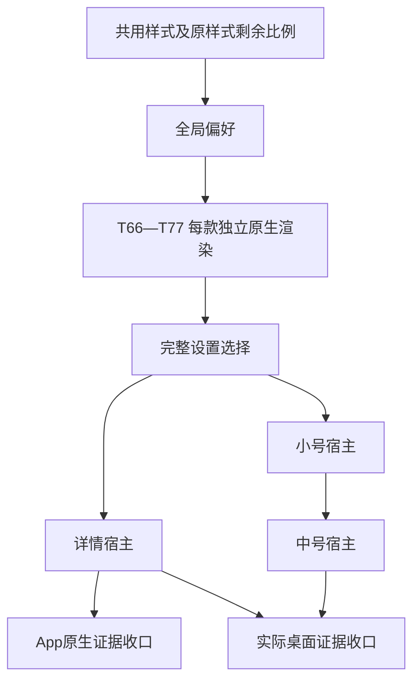

# 全局卡片样式规划

确认：2026-10-13，需求0.24／D-72。第一阶段T64／T65已实现并经手机App／实际桌面及偏好持久检查，最终安装与清理见两项验收；第二阶段T66—T77的12款共用原生渲染已实施；正式选择／详情／桌面宿主及收口待T78—T83，统一状态见项目进度。全部网页水印与专用小号视觉认可沿用，不重新设计／重复网页验收；Figma只读。开发必须由用户明确指定任务。

2026-10-15补充：本人要求紧凑易读改版（D-74）、新增霓虹派对（D-75），对比页全部认可；D-76定为默认彩色斜粒、删除原样式。2026-10-15新会话按本人授权建立T84—T88并开始实施（D-76）；T82／T83保持未开始，待新版本完成后重新评估。

[统一进度](../../项目进度.md) · [任务总览](../README.md) · [需求正文](../../requirements.md) · [执行约定](../执行约定.md)

## 四个会话、四个大阶段

2026-10-13用户确认按四个会话推进，每个会话完成一个大阶段。未来明确“开始卡片样式第一阶段”等指令，授权连续执行该阶段全部小任务；本次只沟通并记录，不启动第一阶段、不自动创建会话。各任务仍单独自检、记录和Git存档，阶段末给本人明确验收步骤并停止；不擅自进入下一阶段。

| 大阶段／会话 | 小任务 | 阶段结束本人验收的重点 | 交付时必须落实 |
|---|---|---|---|
| 第一阶段：基础 | T64—T65 | 原样式App／详情／实际小中号比例已改为强调剩余；组件无邮箱时间、原账户归属保持；偏好保存的固定输入结果 | 写清打开Token 仪表盘→额度→点击账户卡→查看详情→回主屏幕查看现有小／中号→点击对应详情。真实额度不强求特定数字；端点小数由开发者准备。样式选择入口尚未制作，偏好记住由开发者结果表交付，不能叫本人进入不存在的“卡片样式”设置 |
| 第二阶段：12款原生展示 | T66—T77 | 各款原生整体设计、明暗、大字号与减少动态可读，图形表达剩余 | 正式设置选择入口尚未接入；执行者先准备可查看的隔离原生版本／各款画面和明确切换或查看条件，再按实际准备写清本人点什么、看哪款、预期。原生渲染结果与实际桌面分开，不要求重复网页认可、不加正式调额／故障设置 |
| 第三阶段：实际接入 | T78—T81 | 设置13款选择及切回／记住、账户／详情／小中号跟随，组件选户保持 | 写清设置→卡片样式→点具体名称→回额度→点卡片→回主屏幕等待实际换图→分别点组件→重开检查。按真实系统结果给观察窗口；保护原组件，未显示如实待验 |
| 第四阶段：验收收口 | T82—T83 | 只补本轮原生证据缺项，完整链路可用、没有未说明停点 | 先引用已通过结果，具体列出本人确实还需操作的步骤；若本人操作已齐，明确无需重复，提供开发者补缺结果与完整证据索引。不能再安排旧登录、续期、通知、教程等全套验收 |

上述是阶段规划，不是已安装版本或现在可执行的验收指令。阶段实际交付时，必须依据已完成版本列出“起始位置／实际点击路径／预期可见结果／通过标准”，讲清本人操作和开发者已验部分；不让本人反查任务文件理解步骤。每次请本人验收都遵守长期规则，不必再次提醒。

## 用户将看到什么

设置“卡片样式”用名称＋缩略图选择原样式及12款，点选自动保存，所有账户、详情额度卡和全部小／中号组件实例一起采用同款；重开保持。明暗沿既有深色模式，组件账户仍各自按系统编辑配置。原App样式保留排布，所有样式比例统一为强调剩余／灰色已用；组件全部无邮箱、前缀或任何时间。新卡按已认可网页整体设计，真实内容替换模拟，详细身份进入既有详情。

## 现有实现核对与复用

本轮只读核对源码和旧通过记录，不运行App或重新测旧功能。

| 能力 | 当前事实与定位 | 本轮处理 |
|---|---|---|
| 设置与明暗保存 | Sources/Features/SettingsView.swift有深色模式，RootView.swift以AppStorage保存appearance，并经WidgetAppearance.publish请求reloadTimelines | 复用设置导航／明暗；另加样式偏好和选择入口，不能把样式写入appearance |
| 额度语义 | Domain/QuotaSnapshot.swift的QuotaPercent保存used并派生remaining；Shared/WidgetSnapshot.swift保存usedPercent且已有remainingPercent | 复用内部可信数据；只改派生绘制比例，不迁移、反转平台已用数据 |
| 原生图形 | QuotaWindowView宽度用percentage.used；QuotaWidgetContent.usedFraction用于小中号同一条；原生没有12款渲染器 | T64改原样式比例，各款分别新增几何／材质／布局及动效，不保留两种含义 |
| 首页排布 | QuotaAccountCard有实际套餐、完整身份、窗口、预计重置、菜单、手动小转圈；整卡transaction关闭布局动画 | 原App排布复用；新整卡按网页无邮箱，保留现有菜单／刷新触点。各款动效需处理事务限制，不能因原容器禁动画而静默丢失动效 |
| 详情 | CodexDetailPanel复用QuotaWindowView(detail:true)，先5小时后每周；详情列表有完整身份、可信补充行、成功时间 | 复用面板与操作，只切换额度卡呈现。D-68旧统一倍率／时间上方不约束新风格；不重新开发字段解析 |
| 组件选择 | QuotaWidgetConfiguration.account唯一参数，稳定ID／first-account；selecting解析有效ID，缺目标回首项 | D-64完整复用，不加入style参数、不重设原组件。编辑选择列表保留完整邮箱，画面移除前缀 |
| 组件更新／路由 | Provider Entry已有appearance；timeline复用AutomaticWidgetRefresh；App调用WidgetCenter；destinationURL来自真实所选entry、含身份摘要 | 增加Entry的全局样式读取及两尺寸宿主；保持选户、时间线和点击详情。记录请求与实际换图，风格保存不变额度成功时间；系统原时间线查询仍走原规则 |
| 异常／适用窗口 | shouldDisplay／showsFiveHourLimit区分无5小时与unknown，旧值和原成功时间已有保护，未知不限量不画条 | 所有渲染共用已核实状态，不猜Pro名称，不把灰条当未知0或100 |
| 动态与字号 | 既有辅助字号、ViewThatFits、读屏标签及教程reduceMotion处理已有成果；12款额度动画没有实现 | 复用原则及原生环境值，新增各款必要适配；组件永远静态，无新动效开关 |

旧T23／T37／T58／T60／T62及真实额度／组件对照通过沿用。仅展示含义和新增风格等改动触及部分重新核验，旧验收不改写为新规则通过。T53／T54／T61的开发者自然记录和原T56收尾保持原停点，不增加本轮重复验收。

## 设计来源与样式目录

唯一视觉目标为[已认可网页](../../../design-references/2026-10-12/dist/index.html)。1—11使用selected-reference-N内下排水印整卡（排除[data-small-widget]），12使用自身水印整卡；小号均取各款[data-small-widget]暗／亮。中号无独立网页成品，原生按同款适配，不另画网页或改Figma。

已读生成器build_gallery.py、prototype.css／prototype.js、horizontal-liquid.css／js、watermark.css／js、first／more-watermark-comparison.css、first／more-small-comparison.css、watermark-logo.svg、参考包README与网页版交互样机验收及相应JSON。本轮读取dist实际HTML核对12款、24小号、无邮箱与全部控制／样式源码内嵌；没有生成或改写网页。旧adaptation-details.json及弹窗是历史建议，不能覆盖已认可下排。

下列中文名称是清楚区分风格的实施目录文案，不是重新设计；稳定标识是实施候选，不改网页唯一编号。原样式名称“原样式”，默认／可切回，无强制新增装饰水印。

| 网页编号 | 设置名称 | 标识候选 | 整体辨识度 | 专用小号依据 | 任务 |
|---|---|---|---|---|---|
| 1 | 彩色斜粒 | `skala` | 彩色斜粒、三排纹理及淡蓝／紫／粉水印 | 上下两窗口，短轨道减密；斜粒保持连续裁切 | T66 |
| 2 | 薄荷胶囊 | `capsule` | 薄荷渐变、柔光胶囊、灰绿水印 | 上下两条柔光胶囊，0%不残留柔光 | T67 |
| 3 | 精密刻度 | `ticks` | 密集精密刻度、克制灰白／灰蓝水印 | 上下两条刻度，亮版白色刻度与灰色已用区可辨 | T68 |
| 4 | 金色仪表 | `dials` | 金色弧形刻度、指针、中央读数、暖金水印 | 两行左小仪表／右数字，0%小号指针转灰 | T69 |
| 5 | 黑岛绿线 | `island` | 黑色胶囊外壳、绿色细能量线、固定读数、灰绿水印 | 两组黑岛，能量线和读数留在各自外壳内 | T70 |
| 6 | 紫色模块 | `blocks` | 紫色内层模块、五段粗块、淡紫水印 | 两块浅／深紫内面板，末段可部分填充 | T71 |
| 7 | 横向液体 | `liquid` | 横向绿色液体、深蓝容器、波面气泡、青绿水印 | 两行左读数／右横向容器；不是旧纵向液位版 | T72 |
| 8 | 黑白票签 | `ticket` | 黑白边框票签、斜块与虚线、灰白水印 | 两条票签内面板；亮版黑斜块表示剩余 | T73 |
| 9 | 暖黄手账 | `journal` | 暖黄纸面、虚线分隔、手绘笔触、暖黄水印 | 上下笔触额度轨道及纸面纹理 | T74 |
| 10 | 冰蓝玻璃 | `glass` | 冰蓝内面板、高光管状额度、冰蓝水印 | 两条玻璃内面板，圆头按实际比例适配 | T75 |
| 11 | 橙色双面板 | `panels` | 橙色周主面板、灰色5小时次面板、暖橙水印 | 两组浅内面板及各自刻度配色 | T76 |
| 12 | 蓝条水印 | `watermark` | 左右双栏、大百分比、蓝条、条下重置时间、单色裁切水印 | 精简文字头部、上下两窗口及蓝条，无额外头部图标 | T77 |

网页73／50、Plus及日期是模拟。原生用实际套餐、可信数值和预计时间，比例保持内部精度，不把网页0.1步长／一位文本限制带入真实数据。App合适动效来自可信变化，第7装饰动态不改值且离屏／后台暂停；水印／组件静态。12号时间在图形下，其他款按自己网页信息层级；更多详细信息留在详情。

## 小任务、依赖与可启动顺序

本轮新增20项、沿现有编号T64—T83，单项范围／可见结果／检查／最少亲验详见对应文件。

| 任务 | 直接前置 | 规划状态 |
|---|---|---|

| [T64 建立共用样式能力并统一剩余比例](T64-建立共用样式能力并统一剩余比例.md) | T23、T37、T62（均已有成果与通过记录） | 已完成，见T64验收 |
| [T65 保存并共享全局样式偏好](T65-保存并共享全局样式偏好.md) | T64 | 已完成，见T65验收 |
| [T66 原生彩色斜粒样式](T66-原生彩色斜粒样式.md) | T64、T65 | 已完成，见本款及阶段验收 |
| [T67 原生薄荷胶囊样式](T67-原生薄荷胶囊样式.md) | T64、T65 | 已完成，见本款及阶段验收 |
| [T68 原生精密刻度样式](T68-原生精密刻度样式.md) | T64、T65 | 已完成，见本款及阶段验收 |
| [T69 原生金色仪表样式](T69-原生金色仪表样式.md) | T64、T65 | 已完成，见本款及阶段验收 |
| [T70 原生黑岛绿线样式](T70-原生黑岛绿线样式.md) | T64、T65 | 已完成，见本款及阶段验收 |
| [T71 原生紫色模块样式](T71-原生紫色模块样式.md) | T64、T65 | 已完成，见本款及阶段验收 |
| [T72 原生横向液体样式](T72-原生横向液体样式.md) | T64、T65 | 已完成，见本款及阶段验收 |
| [T73 原生黑白票签样式](T73-原生黑白票签样式.md) | T64、T65 | 已完成，见本款及阶段验收 |
| [T74 原生暖黄手账样式](T74-原生暖黄手账样式.md) | T64、T65 | 已完成，见本款及阶段验收 |
| [T75 原生冰蓝玻璃样式](T75-原生冰蓝玻璃样式.md) | T64、T65 | 已完成，见本款及阶段验收 |
| [T76 原生橙色双面板样式](T76-原生橙色双面板样式.md) | T64、T65 | 已完成，见本款及阶段验收 |
| [T77 原生蓝条水印样式](T77-原生蓝条水印样式.md) | T64、T65 | 已完成，见本款及阶段验收 |
| [T78 设置中选择卡片样式](T78-设置中选择卡片样式.md) | T65、T66—T77、T46 | 已完成，见T78验收 |
| [T79 详情额度卡跟随所选样式](T79-详情额度卡跟随所选样式.md) | T78、T62 | 已完成，见T79验收 |
| [T80 小号组件接入全局样式](T80-小号组件接入全局样式.md) | T78、T33、T60 | 已完成（实际小号检查齐，本人待验） |
| [T81 中号组件接入全局样式](T81-中号组件接入全局样式.md) | T80、T34 | 已完成（实际中号及正式新链检查齐，本人待验） |
| [T82 收口App样式必要原生验收](T82-收口App样式必要原生验收.md) | T79 | 未开始 |
| [T83 收口实际桌面组件样式同步验收](T83-收口实际桌面组件样式同步验收.md) | T79、T80、T81 | 未开始 |
| [T84 样式集合与偏好迁移](T84-样式集合与偏好迁移.md) | T65、T78 | 已完成 |
| [T85 账户卡与详情额度卡按对比页实现](T85-账户卡与详情额度卡按对比页实现.md) | T84 | 已完成 |
| [T86 小号与中号组件按对比页实现](T86-小号与中号组件按对比页实现.md) | T85、T60 | 已完成 |
| [T87 选择页13张中号预览](T87-选择页13张中号预览.md) | T84、T86 | 已完成 |
| [T88 回归、安装与收口](T88-回归、安装与收口.md) | T84—T87 | 待验 |

推荐第一个启动T64：先统一剩余比例及共享展示输入，保证原样式与后续新风格不会含义相反。其直接前置T23（312342f）、T37（e447eab）、T62（b1207b5／916b349）已有实现／必要验收和本地历史；启动当天仍核对记录及Git。然后T65；T66—T77互不依赖，用户可指定任一款，明确启动第二阶段即授权该阶段12款连续完成；仅指定单项时不连做；T78等全部12款完成再提供完整选择，避免正式设置暴露空白款。开发各款用隔离原生输入／启动参数，不新增产品预览页、未完成选择项或故障设置。

每款任务一次完成该款共用渲染：整卡／单窗口／专用小号／中号静态适配。T79／80／81仅接入已准备渲染与必要真实宿主核验，不负责一口气重新制作12款。T82／83只补本轮证据缺项；新功能收口需两项均完成。原MVP的T56不因此改标完成、不作为新增任务开发前置，也不自动合并为新增样式收尾。

## 本轮必要原生验收与最少用户操作

开发者逐项维护矩阵，已有本轮同一证据直接引用，不按任务号重做。真实手机App、实际桌面组件与隔离原生渲染分别标明；网页认可及离线JS检查都不能当原生通过。

| 必查内容 | 开发者准备／证据 | 主归属 |
|---|---|---|
| 13款全部明暗、整卡／详情、正常与辅助最大字号、长真实套餐与时间 | 真App原生截图与目视；逐款基本适配，详情补宿主差异 | T64／T66—77，T79／T82补缺 |
| 13款×明暗×小中号、专用小号辨识度／中号空间 | 实际桌面截图和系统环境；View预览仅辅助，不能顶替 | T80／81，T83补缺 |
| 默认原样式、点选自动保存、切回、所有账户与全部实例、重开保持 | 真App和桌面短链路，至少默认与不同指定账户实例；记录请求／实际出现时间 | T65／78／80／81 |
| 适用双窗口／仅周／无适用额度、未知／不限量 | 共用输入固定值＋隔离原生／桌面，实际账户只观察可用真实窗口 | 各款自检，T82／83补缺 |
| 剩余0／100／0.1／99.9／33.33／70.125、两窗口不同数 | 长度／弧长／平均面积准确，纹理连续裁切；固定输入不写正式快照 | T64、各款，宿主检查 |
| 失败可信旧值和原成功时间、首次未知、预计时间到点不补满 | 开发者隔离异常／时钟，原成功时间在详情对照，组件无时间 | 各款／T79／80／81 |
| 动效、减少动态、水印静止 | 实际系统减少动态分支、切换／数值变化，组件静态，动态不误导数值 | 各款／T82；组件T83 |
| 账户归属／原操作、正式数据保护 | 复用既有路由和数据保护；仅回归新触点，排序删除用演示或隔离条件 | T78／79／80／81 |

用户最少步骤随每项给出；最终只需一次“选款→看账户／详情→回桌面等实际换图并点击→重开→切明暗”的短体验，已在前项亲验部分不重复。用户无需重新登录、制造失败、调系统时间、重装App／删除原组件或盯自然后台。数据端点和异常由开发者准备隔离场景；系统延迟如实待验，不用重装组件掩盖同步问题。

## 文档取代与保存边界

需求0.24／D-72取代D-17卡片仅黑白灰限制、D-23旧实色已用、组件邮箱前缀、新App强制旧信息排布及D-68统一时间位置；D-64独立账户选择、D-59取消入口、D-71适用窗口保留。旧网页／Figma／验收不改造、不删除；历史记录不伪写新测试。当前仍是批准的需求和未开始任务。

开发前读规则／进度／任务与直接前置。每次开发或反馈后更新任务、进度、验收并本地Git存档，不自动开始下项、不推送。先归档必要去敏证据，确认无进程使用后清理当轮可重建产物，记录范围／前后大小／实际停点。当前规划无App构建物，临时文档校验文件结束清理；历史build缓存不在本轮清理范围。正式账户、授权、组件配置与其他未提交工作保护。

2026-10-13第一阶段已按授权完成并结束，明确操作路径见[T65阶段验收](../记录/T65-验收.md)。后续18项未启动；本文件中的规划与初始源码核对保留为历史依据，不能读成全部样式已实现。

2026-10-14本人针对第一阶段最终交付明确“全部验收通过”，T64／T65整体亲验收口，偏好固定输入检查沿用。后续阶段未启动；详情见两项验收最新追加，不要求重复步骤。

2026-10-14第二阶段实施及必要检查已齐，最后归档／清理见[阶段验收](../记录/第二阶段-T66-T77-验收.md)。T66—T77逐款存档；手机准备的是Debug隔离原生画面，无正式产品预览入口。实际桌面新样式仍留第三阶段，本会话结束停止，不启动后续。

2026-10-14本人明确第二阶段全部验收通过，T66—T77共12款原生交付亲验收口；已同步进度及逐款任务／记录并本地存档。仅反馈文档维护，新增构建产物0→0，既有自检及清理沿用；无新增测试或安装。正式样式选择、详情宿主和实际桌面新款未接入，T78—T81及第四阶段保持未开始，结束停止；不重复验收。见[阶段最新反馈](../记录/第二阶段-T66-T77-验收.md)。

2026-10-14第三阶段已明确启动，T78正式选择／账户整卡和必要手机检查已齐。已认可12款直接复用，前两阶段不重验；T79—81依本会话连续授权接续，T82／83未启动。本人验收与最终安装／清理阶段末合并，实时见项目进度。

## 2026-10-15 第三阶段交付

T78—T81开发者必要检查与逐项存档完成，Token 仪表盘0.1.0（3）Release已同Bundle装入本人iPhone 11，正式入口与原四组件配置保留；正式设置／账户／详情／实际小中组件均已接入，13款实际宿主核对完成。本人新增正式链待[合并验收](../记录/第三阶段-T78-T81-验收.md)，不重复第二阶段12款视觉亲验。全部当轮共用缓存已实际清理，停止于T81；T82／T83维持未开始。

## 2026-10-19 新增第14款（T119，D-84）

本人确认 Figma「订阅额度 · 新拟态 UI」的效果并选择“新增一款样式”，据此新增[T119 薄荷新拟态样式](T119-薄荷新拟态样式.md)。默认样式、原有 13 款与设置页均不变，选择页按 `allCases` 自动多出第14张预览。本轮仅写入代码与文档，未编译、未测试、未装机，见 [T119 验收记录](../记录/T119-验收.md)。
