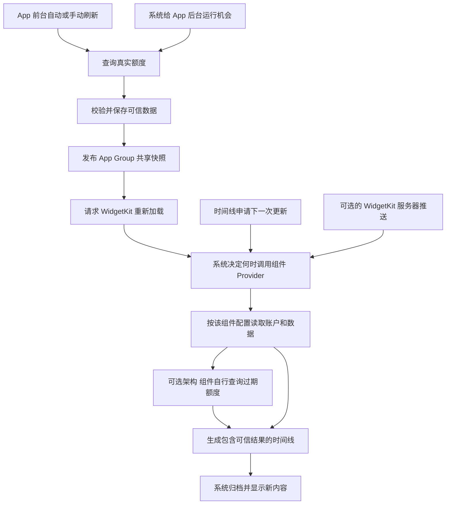

# iPhone 小组件自动更新技术调研

调研日期：2026-10-11。项目核对版本：`5b93a4e`。适用于本项目的 Codex 订阅额度、小号和中号桌面组件。

**可以实现自动更新，但普通 iPhone 桌面组件不能保证在 App 后台时每 5 或 10 分钟刷新。** 频率可以作为请求目标，最终运行时间由系统决定。项目当前也并非完全没有更新能力：前台同步已有通过证据，未解决的是后台保存新数据后，系统没有再次调用组件生成新画面。

建议分两步推进：先针对现有系统调度停点做最小验证，再评估“组件被系统唤醒时自行获取新额度”的架构。后者能减少对主 App 后台运行的依赖，但不能让尚未被调用的组件代码自行运行，更不能保证五分钟时效。

本次是技术研究，不代表架构变更、刷新按钮、频率设置或新后台服务已获批准。T35 保持待验；打开／回 App 自动刷新、后台 30 分钟目标、必要网络检查、D-64 的系统账户选择继续有效。原[本地同步按钮方案](T35-小组件手动同步调研方案.md)仍只是独立候选，不能代替自动更新。

## 更新需要经过哪些环节

App 和组件扩展是两个进程。桌面显示的是系统根据时间线生成并归档的视图，不是 App 页面缩小后继续运行。共享数据文件变了，也不等于桌面已经变了。[Apple WWDC26 WidgetKit foundations](https://developer.apple.com/videos/play/wwdc2026/277/)



其中“取到数据”“存好共享快照”“Provider 返回新时间线”“桌面实际显示”应分别确认。`reloadTimelines(ofKind:)` 是请求重新加载，不能把方法调用完成当成屏幕更新成功的回执。普通 SwiftUI 状态绑定也不能跨两个进程把桌面变成持续运行的 App 页面。

主 App 不在前台，不代表组件绝对不能更新。组件可以由系统独立调用，在生成时间线时访问网络；因此技术上存在不先唤醒主 App 的取数路径。[Apple 组件联网文档](https://developer.apple.com/documentation/widgetkit/making-network-requests-in-a-widget-extension)

## 五分钟和十分钟到底能做到什么

| 用户期待 | 技术上可以做什么 | 能否保证 |
|---|---|---|
| App 刚更新，回桌面看到一致数据 | 成功保存共享快照后请求重载；必要时在离开 App 时合并补发一次 | 这是应实现和验证的正常路径，但没有固定秒数的显示保证 |
| App 长期在后台，至少每 5 分钟更新 | 申请 5 分钟后的时间线重载，或后台任务机会 | 不能保证最长陈旧时间不超过 5 分钟 |
| 至少每 10 分钟更新 | 同上，可设为内部实验目标 | 不能保证；并不因间隔变长就成为系统承诺 |
| 大约每 30 分钟更新 | Widget 时间线及 BGAppRefresh 的合理候选目标 | 可尽力执行，也可能更晚或没有执行机会 |
| 点击组件立即尝试更新 | iOS 17 起用真实按钮交互执行 AppIntent | 官方保证交互后重载时间线；联网成功和固定秒数内显示仍不是保证 |
| 不联网而让倒计时持续变化 | 使用系统支持的动态时间文本 | 可以，但这不是获取新的额度数据 |

Apple 给经常被查看的组件描述了典型的每日 40～70 次后台刷新预算，常见间隔约 15～60 分钟，并强调实际间隔变化。这不是每个组件都能拿到的配额保障，也不是所有触发加起来的硬上限。预算随使用情况分配，不能当成每天零点固定清零的计数器。[Keeping a widget up to date](https://developer.apple.com/documentation/widgetkit/keeping-a-widget-up-to-date)

作为数量对比，全天每 5 分钟需 288 次，每 10 分钟需 144 次，每 30 分钟需 48 次。这说明全天高频轮询和普通组件的典型预算并不匹配；48 次落入典型区间也不能反推“每半小时保证一次”。这里的次数是算术对比，不是 Apple 对本项目的分配结果。

文档提到时间线条目建议至少相隔约 5 分钟，指的是预先准备的显示条目间隔，不能理解成每 5 分钟可以重新联网。时间线可提前安排照片、日程等已知内容；无法提前知道的 Codex 剩余额度不能预填，到了预计重置时间也不能自行改为满额。[Apple 时间线说明](https://developer.apple.com/documentation/widgetkit/keeping-a-widget-up-to-date)

动态时间文字可以在扩展没有运行时由系统更新。其他 App 的倒计时不断变化，不证明其业务接口在每秒查询；本项目按 D-64 不显示时间，这里仅解释技术区别。[Displaying dynamic dates in widgets](https://developer.apple.com/documentation/widgetkit/displaying-dynamic-dates)

频率选择器只能改变申请时间，不能改变 iOS 权限。对本项目不建议先增加“5／10／30 分钟”设置：先证明自动更新链路有效，再判断是否有设置价值。本次讨论没有将现有 30 分钟规则改成新需求。

## 各种更新机制的适用范围

### App 发布数据后请求组件重载

实现顺序应是：查询和校验成功 → 持久保存 → 发布完整共享快照 → `WidgetCenter.shared.reloadTimelines(ofKind:)`。失败保留原可信数据及原成功时间；请求范围可以是对应 kind，本项目两种尺寸共用同一 kind。

App Groups 用来给 App 和扩展提供共享容器，少量数据可以用共享偏好，也可以用文件或数据库。它解决访问问题，不负责触发刷新；多进程写入仍需要保持记录完整和版本一致。[Configuring app groups](https://developer.apple.com/documentation/xcode/configuring-app-groups)

后台调用重载通常受刷新预算限制。前台不计普通后台预算，也不等于可以无限频繁调用：WWDC26 明确指出频繁前台 reload 仍可能被限流，并建议数据可能改变时，在 App 进入后台再做一次最终 reload。[WWDC26 10:54 起](https://developer.apple.com/videos/play/wwdc2026/277/?time=654)

针对本项目的工程建议是合并离开前台前尚未覆盖的内容版本，仅在必要时补发一次，不对每个界面状态或定时器反复 reload。该建议尚未实测，不能写成修复结论。

### 时间线安排下一次机会

WidgetKit 的三种策略是：`.atEnd` 在现有时间线结束后申请新的时间线，`.after(date)` 在指定时间之后具备重载资格，`.never` 不主动安排下一次时间驱动重载。它们决定的是重载机会；`.after` 不是精准闹钟，`.never` 也不会禁止 App 或交互触发重载。[WWDC21 Principles of great widgets](https://developer.apple.com/videos/play/wwdc2021/10048/)

对于在其他设备上也会消耗的订阅额度，服务端数据可能在用户没有打开 iPhone App 时变化。从数据特征判断，能够取新数据的 Provider 配合 `.after` 比单纯依赖 App 的主动发布更值得验证。这是架构判断，不代表改一行策略即可解决当前故障。

### 组件被唤醒时自己联网

在 `AppIntentTimelineProvider.timeline(for:in:)` 中按该实例的配置找到账户，读取可信缓存；需要新数据时调用共享取数能力，得到结果后生成时间线。系统可以直接运行组件扩展，主 App 不必先处于运行状态。Apple 允许此方式，但扩展的时间和资源有限。[Making network requests in a widget extension](https://developer.apple.com/documentation/widgetkit/making-network-requests-in-a-widget-extension)

它解决的是“组件已经获得执行机会，但 App 缓存很旧”的问题。如果系统没有调用 Provider，这条路径也不会开始。它不能单独解决本项目已经观察到的 Provider 未被调用停点。

### 主 App 的后台刷新

`BGAppRefreshTask` 适合短时取数。请求中设置 `earliestBeginDate = 当前时间 + 30分钟`，只表示不早于该时间，系统不保证到点执行；完成后还需要安排下一次请求。[earliestBeginDate](https://developer.apple.com/documentation/backgroundtasks/bgtaskrequest/earliestbegindate)

App 回到后台后通常会被挂起，此时 Timer、循环及 `Task.sleep` 都不能作为常驻定时器。Apple DTS 明确否定“普通后台代码保证每 15 分钟运行”的假设，某些常见情况下根本不给后台刷新时间。从多任务界面划掉 App 通常还会阻止主 App 的后台唤起，直到再次手动打开；这不应扩大解释成所有独立 Widget 路径必定停止。[iOS Background Execution Limits](https://developer.apple.com/forums/thread/685525)

电量、温度、网络及使用习惯等影响后台执行机会。`BGProcessingTask` 是维护任务，iOS 26 的 `BGContinuedProcessingTask` 是继续完成用户启动的有限工作，都不是每五分钟轮询的替代定时器。[WWDC25 Finish tasks in the background](https://developer.apple.com/videos/play/wwdc2025/227/)

### 后台网络传输

Widget 可以建立后台 `URLSession`，通过 `onBackgroundURLSessionEvents` 接收传输事件，保存结果后再请求重载。它用来完成已经发起的传输，不会让组件永久运行；持续串联下载还会触发系统限速。[组件后台网络说明](https://developer.apple.com/documentation/widgetkit/making-network-requests-in-a-widget-extension)、[Downloading files in the background](https://developer.apple.com/documentation/foundation/downloading-files-in-the-background)

本项目额度响应很小，建议先评估 Provider 内有界的请求链，包括网络检查和必要续期；只有测试证明需要延续传输时再引入后台 session。它不会自动使整套业务事务、续期和存储在后台持续执行。

### 两种服务器推送

| 方式 | 调用链 | 本项目取舍 |
|---|---|---|
| 普通静默推送 | 服务端 → APNs → 主 App 后台处理 → 取数和共享保存 → 请求组件重载 | 增加主 App 唤醒机会，但仍要经过后续组件调度 |
| WidgetKit 专用推送 | 服务端 → APNs → WidgetKit 触发时间线重载 → 组件取数或读取有效缓存 | 减少对主 App 唤醒的依赖，iOS 26 起提供 |

普通静默推送是低优先级，不保证交付；Apple 建议别超过每小时 2～3 次，处理窗口约 30 秒。它可被延迟、合并，不能拿来实现 5／10 分钟准点任务。[Pushing background updates to your app](https://developer.apple.com/documentation/usernotifications/pushing-background-updates-to-your-app)

WidgetKit 专用推送需要启用推送能力，配置 `WidgetPushHandler`，把 token 交给服务器。服务器通过 APNs 的 `widgets` 类型发送内容变更信号。核心形式为 `apns-topic: <主App bundle ID>.push-type.widgets` 和 `{"aps":{"content-changed":true}}`。相关 API 的最低版本为 iOS 26；本工程最低 iOS 17，若采用需做可用性分支。[WidgetPushHandler](https://developer.apple.com/documentation/widgetkit/widgetpushhandler)、[WWDC25 21:13 起](https://developer.apple.com/videos/play/wwdc2025/278/?time=1273)

Apple 明确将专用推送定位为时间线的补充，仍受预算和机会式调度限制，没有公开的五分钟必达保证。推送信号也不会自动把 App Group 的旧额度变成新值；若 Provider 仍只读旧缓存，结果仍旧，这是由调用链得出的工程判断。[Updating widgets with WidgetKit push notifications](https://developer.apple.com/documentation/widgetkit/updating-widgets-with-widgetkit-push-notifications)

本项目尚没有服务器及已接通的额度变化事件来源。若采用按变化推送，服务器需先获得变化信息；若靠轮询查询，则还要处理查询授权、数据保存和持续运维。也可以定时发送“该刷新了”的信号，但组件仍须在系统允许执行后取数，这不会消除显示调度或保证5／10分钟更新。因此不建议把服务器作为当前本机换图故障的第一步修复。

### 用户交互和实时活动

iOS 17 起，组件中的 `Button(intent:)` 可以运行 AppIntent。官方保证按钮或开关交互结束后重载时间线，必要的保存工作应在 `perform()` 返回前完成。普通按钮闭包或后台自行调用一个同名方法不等于真实组件交互。[Adding interactivity to widgets and Live Activities](https://developer.apple.com/documentation/widgetkit/adding-interactivity-to-widgets-and-live-activities)

“同步已有缓存”和“重新联网查额度”是两种不同动作。前者能尝试把本机已经保存的55%显示出来，不能获得服务器上的最新值；后者还要完成网络检查、凭据访问、续期与写入保护。按钮只能作为人工补充；D-64 当前没有刷新按钮，本次不恢复或新增。

Live Activity 适合有明确开始结束的事件，其本身不能联网，更新来自 App 或 ActivityKit 推送；普通活动最长活跃 8 小时，结束后锁屏最多再留 4 小时。因此从用途及生命周期判断，它不适合作为本项目全天常驻桌面额度卡片的替代。[Displaying live data with Live Activities](https://developer.apple.com/documentation/activitykit/displaying-live-data-with-live-activities)、[Live Activities 设计指南](https://developer.apple.com/design/human-interface-guidelines/live-activities)

## 当前项目的实际停点

以下是代码与已保存验收材料的核对结果，不是本轮新做的手机测试。

| 环节 | 现有实现和证据 | 判断 |
|---|---|---|
| 前台取数 | 冷启动和回 active 都独立刷新；`CodexConnectionFlow.swift` 的前台入口 | 已有路径，不受后台30分钟目标限制 |
| App 后台 | `BackgroundQuotaRefresh.swift` 提交最早30分钟后的 BGAppRefresh 请求 | 已实现请求及调试执行；自然调度仍待验 |
| 共享保存 | `AccountStore` 提交后投影，`WidgetSnapshotStore` 原子写 App Group JSON | 已有完整发布链；文件虽叫 `first-account.json`，内含全部可选账户 |
| 更新请求 | `AccountStore.publishWidget` 保存后按可见变化调用 `reloadTimelines(ofKind:)` | 仅时间元数据变化不请求；普通内容变化仍请求 |
| Provider | `SubscriptionUsageWidget.swift` 读取共享数据，按系统配置选账户，返回单个 entry 和 `.never` | 不自行联网，不主动定时重载 |
| 当前后台异常 | 后台两户已保存55%，请求送到系统，桌面仍90%，没有新的 Provider 调用 | 停在系统收到请求后、Provider 运行前 |

核心代码见 [Provider](../../../Sources/Widget/SubscriptionUsageWidget.swift)、[后台任务](../../../Sources/Services/BackgroundQuotaRefresh.swift)、[共享发布](../../../Sources/Storage/AccountStore.swift)、[快照存储](../../../Sources/Shared/WidgetSnapshotStore.swift)。

已有对照的证据强度如下：

- 普通同步的两尺寸10场景、固定账户5阶段已有通过材料。较早的一轮中，后台保存55%后，仅在前台对同一份数据发 reload，两尺寸实际变55%。这说明读取到显示的后半段能够工作。
- 小号出现负预算及系统策略判定；临时开启 WidgetKit 开发者模式后小号显示55%。预算限制有对照支持。
- 中号存在正预算记录，实体查询 `missing=0`，开发者模式及重启仍未恢复该轮后台更新。不能把中号也归为已经证实的预算耗尽，更不能把特定系统 bug 写成定论。
- 旧 `.after(30分钟)` 下曾观察约35分钟仍没有新的 Provider 调用。后来保留 `.never` 是减少只读旧缓存的重复开销，不是后台修复成功。恢复 `.after` 可以作为对照，但需要新证据和具体目的。
- 最近重启后观察约180秒仍90%；180秒只是当次观察窗口。上述专项是 iPhone 11／iOS 26.5、隔离合成数据、系统调试触发，不能代替自然后台或真实订阅额度验收。

来源：[T35 验收](T35-验收.md)、[前台同数据对照](证据/T35/后台链路诊断/前台对照-分段日志.txt)、[重启后分段记录](证据/T35/后台修复验证/重启后-分段日志.txt)、[系统预算摘录](证据/T35/后台修复验证/预算对照-系统摘录.txt)。系统材料包含 Console 人工摘录，不是完整 logarchive，不能从内部字段推断 Apple 未公开的全部调度规则。

另外有一个独立数据保护缺口：业务查询失败时能够保留旧额度；但共享文件本身读失败时，`QuotaWidgetContent.unavailable` 没有旧数字可用。它需要单独处理，不能当成本轮“Provider 根本没运行”的原因。见[内容读取实现](../../../Sources/Shared/QuotaWidgetContent.swift)。

## 推荐的技术方案与先后顺序

### 先验证现有发布到显示的链路

这是当前优先级最高的工作，目标是让 App 已保存的新值在正常模式下实际出现在桌面，而不先扩大登录、账户或服务器范围。

1. 继续使用真实 kind、现有账户配置和两种尺寸；追踪同一快照版本的保存、reload 请求、Provider 开始／返回和桌面结果。先对小号、中号分别留证，不能互相代替。
2. 检查前台结束时能否合并一次尚有内容变化的最终 reload。该项来自 Apple 最新建议，先做单变量验证，不直接归因为当前故障。
3. 如果评估 `.after` 作为补充读取机会，明确它要验证的只是已有新快照能否被重新读取；不得用重复旧数据的高频轮询制造通过。此前30分钟目标下未观察到重载的对照保留，不能由此断定 `.after` 机制失效。
4. 中号在正常模式仍不进入 Provider 时，缩减为保留必要配置的最小复现，区分扩展被终止、配置解析、系统调度等可能性；继续保留未知。必要时准备 Apple Feedback 材料，提交外部反馈属于另一步操作。

开发者模式能临时解除限制，适合对照，不是用户日常设置或最终验收条件。更频繁调用 reload、重复删加组件或再次重启都不能作为未经验证的修复承诺。

### 再验证组件自主取数

对于“长时间不打开 App，也希望看到近期额度”，值得验证的目标架构是：**主 App 前台刷新、组件按系统时间线机会自主刷新、BGAppRefresh 补充；共同使用一致的数据和业务规则。** 不要求三个入口同时运行，也不把三者的机会相加成频率保证。

候选 Provider 流程：

```text
收到时间线请求
  → 从系统配置解析有效账户
  → 读取该账户的可信快照与连接版本
  → 判断缓存是否需要更新并合并同账户在途工作
  → 在有限执行窗口内完成网络评分、必要续期和额度查询
  → 校验账户仍有效且未被删除或更新连接
  → 成功则原子提交；失败则保留仍可信的旧值
  → 返回当前可信数据及下一次 .after 申请时间
```

候选实现需要处理以下真实差异，不能只把现有 App 类复制进 Widget：

- **可复用查询层。** 将网络检查、Codex请求、解析、续期和有效绑定校验抽为可由扩展调用的能力。App 页面状态和主进程内存对象不能成为扩展启动的前置。
- **凭据访问。** Widget 必须被授权访问相应 Keychain access group；当前 App 私有凭据不会因共享普通 JSON 就自然可用。token 不写到组件展示文件。沿用现有 `AfterFirstUnlockThisDeviceOnly` 保护级别，新增需要评估的是共享访问组、既有条目迁移和扩展授权；仍保留重启未首次解锁的不可读处理。[Keychain sharing](https://developer.apple.com/documentation/xcode/configuring-keychain-sharing)、[AfterFirstUnlockThisDeviceOnly](https://developer.apple.com/documentation/security/ksecattraccessibleafterfirstunlockthisdeviceonly)
- **跨进程并发。** App 和扩展可能同时续期、刷新、删除或更新连接，需要跨进程协调、提交版本校验和原子存储。单个 Swift actor 只管本进程，不能保护两个进程的令牌轮换。锁或事务的具体方式留最小设计确定。
- **共同读取新结果。** Widget 自己查询成功后，App 下次打开也应读到较新结果，不能用主 App 内存里的旧记录覆盖它。展示快照不能成为无身份校验的凭据或账户事实来源。
- **多个实例。** 每个组件仍按 D-64 的系统配置选账户：默认首项，固定选择不随排序或额度更新改变，所选账户删除后回当前首项，无账户显示添加入口。相同账户尽量共享本次新鲜结果，避免小号、中号及多个实例各自重复请求。无需将所有账户每次全部刷新。
- **失败结束。** 被取消、时间不够、网络评分不达标及真实查询失败都正常结束并保留可信旧值和原成功时间。没有可信值时如实展示既定状态；不恢复重新登录建议，不在重置时伪造满额。

以上是候选设计。网络检查和续期增加请求链长度，能否在扩展执行窗口内稳定完成须用本项目真实路径验证。若做不到，应记录限制作进一步取舍，不能通过跳过网络检查来换取表面成功。

内部第一次对照可保持现有30分钟目标，以减少变量；5／10分钟仅作为之后评估延迟和资源消耗的实验参数。不能把该建议误记为批准独立查询周期。T32／T35原范围为组件读共享数据，自主取数属于待确认的架构变更。

### 最后再决定推送或交互补充

若未来有可靠的服务端变化来源，再比较 WidgetKit 专用推送的收益与服务器成本。若希望用户主动纠正旧画面，可独立验证 AppIntent 按钮；必须明确它是本地同步还是重新查询。无论哪条补充路线通过，都不能代替正常后台无点击的验证。

如果产品要求升级成“任何时候桌面数据最多陈旧5分钟”，现有公开的普通 WidgetKit 机制无法提供这个硬保证；需要重新选择体验和时效承诺，而不是继续提高请求频率。

## 怎样验证用户真的看到了新数据

验证分成“本地新值能否呈现”和“能否自然取得新值”两组。第一组用隔离数据控制新旧值，第二组用正常设备使用和真实取数验证；不把它们混成一个通过结论。

建议开发者记录以下时刻：查询完成、共享快照提交、reload请求、Provider运行、时间线返回、桌面观察到新值。共享快照带非敏感版本标记；账户用去敏标识。最后一项以屏幕证据为准，内部调用成功不等于屏幕成功。

| 需要验证的情形 | 要回答的问题 |
|---|---|
| 前台查到新值后回桌面 | App退出前台的发布与最终请求是否有效；两尺寸各自正确 |
| App后台已保存新值，用户保持桌面 | 何时进入Provider，是否实际呈现同一快照版本 |
| 长时间不打开App，组件有时间线机会 | 若采用自主取数，是否真正发出查询、保存并显示新值 |
| 默认／固定账户及多个实例 | 取数和显示是否属于对应配置；是否重复请求或串户 |
| 网络失败与恢复 | 旧额度与原成功时间是否保留；恢复后是否自然采用新值 |
| 锁屏、低电量、后台刷新关闭、重启未首次解锁 | 分别记录系统机会和数据可访问性，不能期待这些状态下同样频率 |
| 主App被系统结束与用户划掉 | 分开验证主App路径和Widget路径，不把强退当成系统回收 |

Apple DTS 指出，调试器会改变挂起行为。最终应从手机主屏幕普通启动，关闭 WidgetKit 开发者豁免，使用正常签名构建；调试触发只用于定位，不计为自然运行。无需为本项目引入 TestFlight 或发布阶段。[Testing and Debugging Code Running in the Background](https://developer.apple.com/forums/thread/796528)

研究建议是后续进行跨白天、夜间的多日自然观察，记录实际刷新分布、最长陈旧时间、失败和无执行机会；可以计算5／10／30分钟内采用新值的比例，但不能把一次碰巧较快的更新推广成保证。真实服务端变化时间不可知时，只报告从查询成功到桌面观察的延迟，不伪造端到端实时性指标。

本轮没有启动这些实验、修改实现、安装手机或进行真实额度查询。研究完成不改变 T35 和自然后台验收的待验事实。
