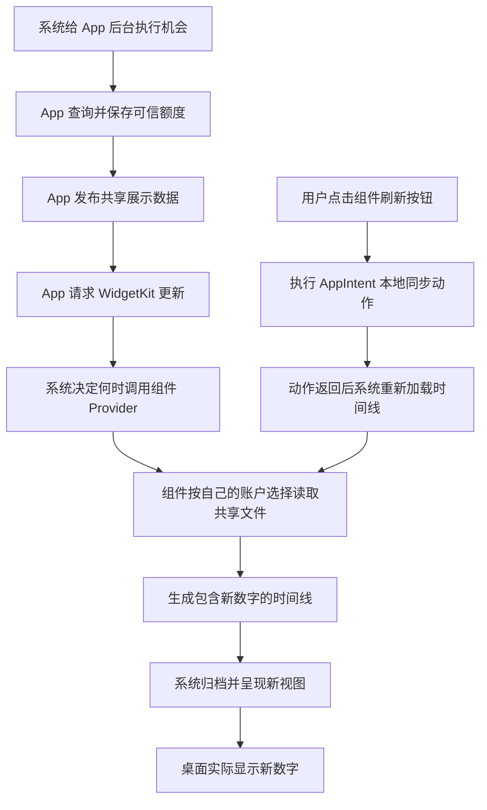

# T35 小组件手动同步调研方案 待审核

2026-10-11；核对版本 `f8eb419`。本稿只提出方案，尚未批准、实现或通过手机验收。T35 的正常后台更新问题仍未解决；D-64 的系统账户选择继续有效。

**结论：部分可行。** 苹果公开支持在小号、中号组件内点击按钮，不打开 App 即执行操作，并在操作结束后重新加载时间线；交互触发的重载不扣普通后台刷新额度。因此，“App 已经保存55%，桌面仍是90%，点击后让桌面显示55%”有明确技术依据。尚不能承诺本项目这台手机上的两个尺寸一定立即显示55%，需要独立验证。按钮可成为补充入口，不能替代正常后台更新或将 T35 标成完成。

推荐先审核“只同步本机已保存额度”的方案。批准后先做最小交互验证，确认小号、中号的桌面数字均实际变化，再完善失败保护和正式按钮。若中号仍不更新，保留失败，不扩展成组件自行联网。

## 已有证据与代码事实

| 已有结果 | 能说明什么 | 不能说明什么 |
|---|---|---|
| 正常模式中，后台保存两户55%，系统收到请求，桌面仍90%，请求后没有新的 Provider 调用 | 停在系统接收更新请求之后、组件读取之前 | 不能认定是读出了55%却显示成90% |
| 前台对同一份后台55%只发重载请求，两尺寸实际55% | 共享读取、时间线生成、两尺寸显示这条后半链路能够工作 | 不能证明后台已修好，也未验证按钮 |
| 开启 WidgetKit 开发者模式后两小号55%，中号仍90% | 小号有刷新额度约束的对照证据 | 不能将全部实例归为额度耗尽；不能作为正常使用结果 |
| 恢复正常模式并完整重启后，两尺寸仍90% | 重启没有解决本次后台桌面更新 | 不再把重启、切开关列成未经执行的修复建议 |
| 36项专项检查及 Release 构建通过 | 减少无效请求、当前隔离数据源等修正已有代码证据 | 不代表桌面数字在后台已更新 |

上述手机记录均为 **iPhone 11 / iOS 26.5、隔离合成账户、系统调试触发**，不是自然后台运行，也不是真实订阅额度。普通同步10场景、固定账户5阶段、尺寸菜单亲验沿用原证据，本轮没有重跑。

本轮重读了[重启后分段记录](证据/T35/后台修复验证/重启后-分段日志.txt)和[前台同数据对照](证据/T35/后台链路诊断/前台对照-分段日志.txt)，目视核对[后台仍90%](证据/T35/后台修复验证/重启后-后台仍90.png)及[前台后55%](证据/T35/后台链路诊断/同一后台55-前台仅重载对照.png)。更完整历史见[T35验收](T35-验收.md)。前台对照是较早隔离场景，不冒充重启后的同一轮或中号固定账户专项。

当前代码对应关系：

| 环节 | 现有实现与本轮判断 |
|---|---|
| App 后台 | `BackgroundQuotaRefresh` 提交最早30分钟后的后台机会；系统实际启动后复用 `CodexConnectionFlow.refreshQuotaInBackground()`。打开／回前台刷新独立保留 |
| 查询和提交 | `CodexQuotaService` 保留网络检查、有效绑定校验；`AccountStore.commit` 先保存账户，再发布组件数据 |
| 共享数据 | `WidgetSnapshotProjection` 只投影展示字段；`WidgetSnapshotStore` 原子写入 App Group 文件。文件名虽为 `first-account.json`，当前内容包含全部可选账户 |
| 更新请求 | `AccountStore.publishWidget` 保存完成后调用 `reloadTimelines(ofKind:)`；仅时间变化不请求，所有可选账户可见内容变化仍请求 |
| 账户选择 | `QuotaWidgetConfiguration` 保存系统配置；Provider 每次按配置 ID 从当前共享数据选择。固定选择保持，默认跟随首项，已删除选择回有效首项 |
| 时间线 | 两尺寸使用同一 `QuotaWidgetProvider`；读共享数据，生成一个当前条目，策略为 `.never`；不自行联网 |
| 失败缺口 | 查询失败且共享文件可读时已有旧值保护；共享文件读取异常则 `QuotaWidgetContent.unavailable` 只有“刷新失败”，没有旧数字。不能声称“只加按钮”就满足所有失败保留旧值 |

工程最低系统为 iOS 17，满足交互式组件的基础版本要求。没有必要为了该按钮提高最低版本、恢复旧编号或改变账户选择规则。

## 从取得数据到桌面数字更新

App 能控制查询、校验、保存、发布顺序以及是否发请求；组件能控制被调用时读什么、选哪户、交给系统什么内容。App 无法自行决定后台任务何时启动，也不能直接替换桌面画面。[后台最早执行时间说明](https://developer.apple.com/documentation/backgroundtasks/bgtaskrequest/earliestbegindate)明确它只限制“不要早于”，不是30分钟必定执行。

三件事必须分开记录：

- **请求更新**：告诉系统内容可能变了。`reloadTimelines` 返回，不代表组件已执行，更不是桌面显示成功的回执。
- **生成新时间线**：系统已经调用 Provider，组件读到了数据并返回含55%的条目；还要经过系统归档和显示。
- **桌面显示新内容**：手机桌面上对应账户、两个窗口的数字实际变化。只有这一项能回答用户是否看到了55%。

苹果说明，组件视图会被系统归档，显示时由系统进程呈现；看到组件不代表其代码一直运行。因此有两份不同的“缓存”：App 保存的展示数据，以及系统保存的组件视图。前者变成55%不会自动改写后者。普通 SwiftUI 状态绑定或文件变化通知不能代替新时间线。[WWDC23 Bring widgets to life，7:45起](https://developer.apple.com/videos/play/wwdc2023/10028/?time=465)

时间线的未来条目适合已知事件，不适合提前编造未知额度。`.after` 是提出后续重载时机，不能保证准点；`.never` 是不主动安排下一次定时重载，并不禁止 App 请求或用户交互触发更新。当前采用 `.never` 与“App发布数据、组件只读”的职责相符，但它本身没有修好后台问题。[WWDC21 Principles of great widgets](https://developer.apple.com/videos/play/wwdc2021/10048/)

## 按钮的官方支持和边界

**苹果明确说明：** iOS 17 起可使用接受 AppIntent 的 `Button`／`Toggle`；小号和中号均支持。动作默认在组件扩展进程执行，`perform()` 返回后，系统使用 Provider 重新加载时间线。官方原文为“Interactions with a toggle or button always guarantee a timeline reload.” 普通按钮闭包、点击手势或仅更改视图内存状态不具备这一机制。[添加交互官方文档及内嵌示例](https://developer.apple.com/documentation/widgetkit/adding-interactivity-to-widgets-and-live-activities)

**刷新额度关系：** 苹果将组件执行 AppIntent 列为不计入日常刷新额度的情形；普通后台 `WidgetCenter` 请求通常受该限制。额度按组件实例管理、动态分配，并非所有实例共享一个固定计数，也不能假定午夜统一恢复。故按钮是不同的受支持触发路径，有理由尝试，而不只是再发一次相同后台请求。[Keeping a widget up to date](https://developer.apple.com/documentation/widgetkit/keeping-a-widget-up-to-date)

这里的方案依赖用户真实点击组件按钮。不能把 App 在后台直接调用同一个动作方法，等同于系统处理了一次用户交互；也不能推断它能给其他普通后台请求解除限制。

**运行环境：** 使用普通、无需前台的 AppIntent，不采用打开 App 的执行模式，也不借用音频、导航或 Live Activity 协议。数据通过 App Group 共享文件读取，不依赖主 App 正在运行的对象或内存。苹果更新的说明还指出，共享意图在多个目标之间存在进程选择规则；实现必须在独立进程冷启动时也正确，不能把“App 未显示”误记为“App 进程一定未运行”。[App Groups](https://developer.apple.com/documentation/xcode/configuring-app-groups)、[WWDC26 App Intents，15:27起](https://developer.apple.com/videos/play/wwdc2026/345/?time=927)

**执行限制：** AppIntent 不是长期后台服务。苹果 WWDC26 对普通意图说明了30秒执行限制及专用长任务机制；本方案只做很短的本地读取，不依赖新长任务 API，不把30秒当作桌面显示时限，也不依赖异常退出后内存仍存在。必须等待必要工作完成再返回，不能启动一个未等待的任务便报告结束。[WWDC26 App Intents，13:26起](https://developer.apple.com/videos/play/wwdc2026/345/?time=806)

**证据的适用范围：** 官方保证的是交互后的时间线重载，不是本项目在所有设备状态下、固定几秒内一定显示指定数字。数据读取失败、进程异常、特定系统版本问题仍需处理；锁定设备上的交互需先解锁。苹果的[Emoji Rangers官方示例](https://developer.apple.com/documentation/widgetkit/emoji-rangers-supporting-live-activities-interactivity-and-animations)展示按钮改变模型的方式；“只重读本地额度”的动作设计是本项目据此作出的推断，不冒称苹果已替本项目测试。

`WidgetCenter.reloadTimelines(ofKind:)` 面向同一种类的全部组件，并不是“只更新被点的某个实例”的接口。本项目两尺寸为同一 kind。优先使用点击动作结束后的自动重载，不在动作里额外循环或默认调用 `reloadAllTimelines()`；不承诺点击小号会使另一个中号同时更新。若系统顺带更新其他实例，各自仍须使用自己的选择。[reloadTimelines官方定义](https://developer.apple.com/documentation/widgetkit/widgetcenter/reloadtimelines(ofkind:))

## 推荐的用户行为

按钮含义为“同步已保存额度”。它只把 App 已成功发布的数据重新显示到当前组件；**不会让 App 再查一次，也不会让组件自行登录或联网。**

| 点击时情况 | 推荐显示和处理 |
|---|---|
| 当前账户共享数据是55%，桌面是90% | 动作结束后重新读共享数据，交给系统显示55%；成功不弹提示 |
| 当前账户共享数据仍是90% | 桌面保持90%；不修改原查询成功时间，不声称查询到了最新额度 |
| App 查询失败，但保存着本户旧额度 | 保留旧额度和原成功时间，也保留 App 发布的简短失败提示；本地读取成功不能清除网络查询失败 |
| 共享数据读取失败 | 使用仍可信、仍属于同一账户及连接版本的旧展示，提示“刷新失败”，同一按钮重试；不清零、不显示满额 |
| 确认尚未获取额度／Free无适用额度 | 保持相应真实状态，不凭点击造出数字 |
| 成功读取后确认所选账户已删除 | 沿用已有回退首项规则；无账户显示“添加账户”，不复活旧账户 |

点击反馈采用按钮本身的系统按压反馈。数字在新条目到达后才改变；不预先写55%、不显示成功对勾，不加“刚刚更新”时间，不承诺持续转圈直到桌面完成。若需要等待提示，可评估官方 `invalidatableContent`，但首版优先保持旧数字可读，只让按钮反馈，不将整张卡片遮住。[交互反馈说明](https://developer.apple.com/documentation/widgetkit/adding-interactivity-to-widgets-and-live-activities)

**位置建议：** 小号和中号均在卡片右上角、账户信息区右侧放一个小圆形回转箭头；给它独立且容易点中的区域，不覆盖套餐、邮箱或额度数字。两尺寸位置一致，随现有浅深配色；无账户空态不显示。读屏名称“同步已保存额度”，提示“显示此账户在 App 中已保存的数据”。它不承担切换账户功能，不恢复编号、不新增选择器。尺寸、间距、动画时长留到批准后实际布局验证。

## 数据保护与必要实施差异

正常路径可复用现有 App Group 与 Provider。按钮动作读取并校验当前共享数据后结束，随后 **Provider 独立重新读取**；不能假定动作的返回值会自动成为新时间线。最终账户由 Provider 收到的系统配置决定，按钮无需携带整份旧额度或重新写入所选账户。遇到并发写入，可以读到完整旧版或完整新版，不能混合两个账户或两个版本；采用读到的最新可信完整版本，不无限重试。

还要明确区分“App 私有账户文件里有55%”与“已向组件共享成功的文件里有55%”。本方案只保证尝试后者；如果 App 未成功发布，组件没有权限靠按钮读取 App 私有文件补齐。这种情况仍需 App 的发布恢复机制。

为兑现读取失败时保留可信旧值，需要补齐按账户及连接版本隔离的最近可信展示缓存，并由 App 在删除、连接作用域变化、清空时使旧副本失效。现有共享数据没有连接 generation，不能仅用邮箱或账户 ID 判定旧值仍适用；可采用仅用于展示有效性的非敏感版本标记，不能把凭据或授权放入共享文件。具体存储布局在批准后的最小实现设计中收敛。

成功读到明确空态、删除或新连接时，以新事实为准，不能用回退缓存恢复旧额度。只在无法取得新展示且旧值仍可验证有效时使用旧值。即使组件进程被结束，仍须能读取已持久保存的可信展示，不能只靠内存保存。

**不可作绝对保证的边界：** 若共享容器及可信旧副本都不可读，或者无法验证旧账户仍有效，公开 API 不能保证把系统已归档的旧数字取回并附加失败文案。系统可能继续显示旧画面；若需生成新画面而无可信数据，只能显示“刷新失败”，不能编造旧值或恢复已删除身份。需要把这一结果单独验证和如实说明，不能将“所有读取失败必保留数字”写成已实现承诺。系统若未执行交互或未呈现新条目，失败提示本身也不能保证出现。

以上缓存保护是候选实施范围，不是当前后台90%问题的已证实原因。按钮读盘也不会绕过既有网络检查：本方案没有新网络操作；未来若增加联网查询，仍必须执行原网络门控。

## 对后台问题的影响与其他方案

| 方案 | 依据与收益 | 取舍和建议 |
|---|---|---|
| 本地同步按钮 | 用户交互自动重载且不扣普通后台额度；可直接针对已有55%但桌面90%的情况 | 推荐先验证；通过也只代表手动入口有效 |
| 继续处理原自动更新 | 保留 App 30分钟目标、前台自动刷新、先发布后请求；系统调用后组件读当前选择 | 必须保留。只做针对停止点的正常模式观察；不能靠按钮代替无点击对照 |
| 低频定时读取作补充 | `.after` 可提供另一种系统允许的读取机会 | 仍受调度限制，可能重复读同一份数据；原 `.after(30分钟)` 下也曾35分钟仍90%。目前无依据恢复定时读取来宣称修复；仅有新证据时做单变量评估 |
| 打开 App 后同步 | 前台请求不扣普通后台额度；本项目已有同数据前台对照 | 符合公开机制的后备方式，但需要打开 App，不能称无打开刷新。若后续采用专门入口，另行批准；本轮不启动T36 |
| WidgetKit 推送更新 | WWDC25引入的服务器事件触发路径 | 需要服务器、推送令牌等；苹果明确它仍受刷新额度约束且择机执行。当前数据已在本机，增加服务器没有针对性，不推荐 |
| 按钮重新联网查询 | 扩展可用公开网络 API 查询 | 独立备选，需处理凭据访问、网络评分、续期、并发写入及执行中断，明显扩大范围；不作为本轮推荐 |

苹果对推送限制见[WWDC25 What’s new in widgets，更新章节](https://developer.apple.com/videos/play/wwdc2025/278/?time=765)。扩展联网虽然允许，但资源和执行时间受限；后台网络会话也需要额外处理，不能当作点击后必定取得最新额度的保证。[Making network requests in a widget extension](https://developer.apple.com/documentation/widgetkit/making-network-requests-in-a-widget-extension)

若继续出现正常模式中号未进入 Provider，应保留该实例配置的去敏诊断，并制作最小复现供 Apple Feedback Assistant 排查；提交反馈另行授权。当前没有公开的“强制桌面立即显示”“清空系统缓存”或“重置刷新额度”接口可作为修复承诺。不开启开发者豁免作为日常方案，不伪装音频／定位，不重复请求轰炸系统。

## 批准后的实施与真机验收

实施顺序建议：先在隔离构建中接入一个普通 AppIntent 和两尺寸按钮，保持现有 kind、系统账户配置和数据源；确认真正点击能让两尺寸显示新数字。再补齐失败回退及失效保护、按钮布局、必要回归。原自动更新继续单独记录，不因手动通过关闭 T35。

只补交互新增行为和涉及的数据保护检查，不重跑整套登录、普通同步与尺寸菜单。所有手机测试由开发者准备；真实账户、授权和现有组件选择保留。批准后若需要安装测试包，应覆盖安装并清理隔离数据，不卸载、不删重加组件、不修改设备设置。真实额度核对继续延期。

| 专项 | 做法 | 通过依据 |
|---|---|---|
| 小号本地同步 | 小号先实际90%，隔离 App 后台保存55%；持续停留桌面，然后只点小号刷新 | 该小号账户及周／5小时实际55%，App界面没有打开；截图或录屏留证 |
| 中号本地同步 | 单独准备中号90%与已保存55%，直接点中号，不能靠小号带动 | 中号自身数字实际55%；单独记录，不以小号通过代替 |
| 账户保持 | 沿用已有系统选择，隔离数据用不同账户、不同数值；核对默认和固定选择 | 固定选择及排序保持；桌面显示各自数据。需补默认配置时在模拟器验证，不擅改手机选择 |
| 不联网、没有新值 | 已保存值保持不变，点击同步，观察调用记录 | 没有新增额度网络请求／授权操作，原值与原成功时间保持；不出现假成功 |
| 失败和恢复 | 隔离制造读失败、有可信旧副本、无可信旧副本；再恢复共享数据 | 可验证旧值保留且提示简短；无可信值不编造；恢复后桌面实际新值 |
| 失效和并发 | 测试数据中删除／更新连接后点击旧画面，及 App 同时发布新版 | 无旧身份复活、无旧作用域额度带入、无跨账户混合；真实账户不动 |
| 冷启动与独立实例 | App界面未打开、扩展重新启动后直接点击；同账户多个组件分别观察 | 不依赖进程内存；明确被点击实例结果及其他实例是否连带更新，不承诺全部同步 |
| 原后台更新 | 与手动阶段分开保存记录；正常模式无点击、无回App的观察 | 两尺寸桌面自行从旧数字变为新数字，才能记后台这一轮通过；自然执行仍独立留T53 |

每次记录保存新数据、点击、动作开始／结束、Provider读取值、时间线返回值和桌面实际变化的时间。可采用有限观察窗口并报告实测等待；窗口结束未变就记“本次桌面数字未更新”，不能把调用成功写成通过，也不能将窗口长度写成苹果保证。

重点隔离：如果准备55%后桌面已经自行更新，这一轮可记录后台结果，但不能声称测试了“90%停滞后点击恢复”。若点击小号使中号连带更新，仍应在另一轮单独验证中号直接点击；不为了造条件高频重载或开关系统豁免。系统调试触发、自然后台与人工点击三种结果分开。

## 审核要点与当前停点

待审核内容是：新增一个仅同步 App 已保存数据的圆形刷新按钮；两尺寸右上角同位；保持各自账户选择；正常不显示成功提示；失败保留可验证的旧值并允许重试；不新增组件联网能力。

官方已支持交互及其重载机制；本项目能否在当前正常模式、原有中号实例上稳定显示55%，仍需批准后真机验证。正常后台停止点、极端共享存储不可读时的显示边界仍未解决。D-64目前仍生效，本稿不提前改成新决定。未修改代码、构建、安装、操作手机设置、变更真实账户或启动T36。
