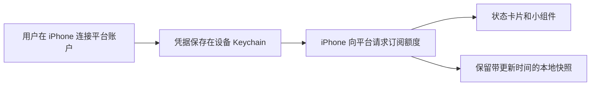
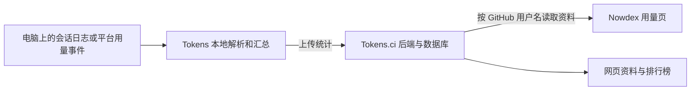

# Nowdex 与开源参考项目详细研究

研究日期：2026 年 10 月 8 日。目标：只开发 iPhone App，第一版支持 Claude、Codex、Cursor，优先不自建业务后端。

范围更新（按需求 0.4）：用户已确认第一版做订阅剩余额度、同平台多账户、桌面小组件、重置通知与小组件教学，已取消产品内演示模式，不做电脑 token 历史，不接入 Tokens.ci。新增账户和实际额度查询前统一检查指定网络评分的要求见需求第 4.8 节，尚未做技术接入验证。本报告保留完整的竞品和历史统计研究，用于解释参考产品；涉及 Tokens、历史费用、同步或内购的内容，不是我们的开发任务。

当前开发范围见 [需求文档](requirements.md)，产品决定见 [决策记录](decisions.md)。本报告区分截图事实、用户观察、官方声明、源码证据和待验证事项。

## 核心结论

Nowdex 把两类数据放进同一个 App：订阅还剩多少额度，以及过去消耗了多少 token。两者的数据来源不同。

- **状态页和额度小组件**：Nowdex 官方说明由用户设备直接请求各平台，凭据保存在 Keychain；不需要先运行 Mac 配套 App。[官方手机使用说明](https://nowdex.app/blog/iphone-ai-usage/)
- **用量页和历史统计**：电脑运行 Tokens 采集器，向 Tokens.ci 上传汇总，手机读取其公开资料 API。Tokens 官方明确把 Nowdex 列为认可的第三方客户端。[Tokens 官方接入说明](https://tokens.ci/docs)
- **因此可以不自建服务器，但完整体验仍依赖云服务**：平台本身的服务、Tokens.ci，以及按需使用的 iCloud、Apple 内购和 RevenueCat。
- **能复用开源实现，不能把依赖名单理解为整款 Nowdex 已开源**。本次找到的是相关开源项目，没有找到可核实的 Nowdex 完整 iPhone 源码。
- **剩余额度的产品方向有现实依据，三家平台的手机授权流程仍需验证**。已上架产品和公开源码能够证明路线值得做，不能代替我们自己的登录、续期和真机测试。

本次工作为截图分析、公开资料核对和源码静态研究。下载了 Tokens、Tokscale、ccusage，保留已有 CodexBar。未安装工具、未运行采集器、未启动后台服务、未登录平台、未读取或上传本机个人会话记录。源码中的文件路径只是研究对象，不代表本次读取了那些文件。

## 证据强度

| 结论 | 证据 | 能确认到什么程度 |
|---|---|---|
| 截图产品是 Nowdex | 设置页、空状态页、Pro 名称 | 截图直接确认 |
| 历史用量依赖 Tokens.ci | 截图安装命令、Tokens 官方对 Nowdex 的接入说明、上传与查询源码 | 已有完整证据链 |
| Tokens 有后端和数据库 | 数据库 schema、上传接口、查询接口、部署配置、隐私政策 | 可确认存在，不依赖推测 |
| Nowdex 额度查询在设备进行 | Nowdex 官网和隐私政策 | 官方声明；未抓包独立审计 |
| Nowdex 不存储用户密码和用量到自有后端 | Nowdex 隐私政策 | 官方声明，不能扩大为它没有任何服务器或外部服务 |
| Nowdex 每家平台的具体登录步骤 | 截图未覆盖三家流程；用户补充观察到连接 OpenAI 会打开 GPT 网站登录 | 已知部分交互；授权回调、凭据取得、续期及其他平台仍未确认 |
| SwiftProtobuf 具体用于哪项服务 | 只有许可证页，缺少调用源码 | 未确认，不能指定给 Cursor 或其他平台 |
| 我们自己的 App 已能查到三家真实余量 | 尚无功能实现与真机验证 | 未验证 |

## 截图中各页透露的信息

| 截图 | 直接可见的信息 | 实现含义与边界 |
|---|---|---|
| IMG_1485.PNG | 连接账号的服务选择列表 | 各平台需要独立接入；此页未展示 OAuth、Cookie 或手工凭据流程 |
| IMG_1486.PNG | 状态页空状态、连接按钮、体验演示 | 额度看板和演示数据是独立入口；示意图中的 42% 不能作为真实数据样例 |
| IMG_1487.PNG | iCloud 同步账号配置 | 同步配置与历史数据采集应分开理解；截图本身无法确定底层用 CloudKit 还是其他 iCloud API |
| IMG_1488.PNG、IMG_1489.PNG、IMG_1491.PNG | 用量页，安装 Tokens、GitHub 登录、后台运行、填写 GitHub 用户名 | 这是历史统计接入，不是 Claude/Codex/Cursor 订阅账户授权 |
| IMG_1490.PNG | Pro 终身买断、iCloud、用量显示、主题、额度重置通知 | Pro 属于 App 自己的付费权益；重置文案是刷新时检测，未承诺每次重置实时推送 |
| IMG_1492.PNG | 六组开源许可条目 | 依赖清单，不是完整应用源代码清单 |
| IMG_1493.PNG、IMG_1494.PNG | Lobe Icons | AI 服务品牌图标来源 |
| IMG_1495.PNG | RevenueCat 5.85.0 | 购买 SDK 的截图版本；不能据此断定当前线上版本或全部启用的功能 |
| IMG_1496.PNG | SwiftProtobuf 1.38.1 | Protobuf 编解码依赖；用途尚不能定位 |
| IMG_1497.PNG、IMG_1498.jpg、IMG_1499.PNG | ccusage、Tokscale、CodexBar；特定提交的 attribution | 明确指向用量核算、Codex 解析、Cursor 事件分页等复用方向 |
| IMG_1500.PNG | uiGradients | 渐变配色素材 |
| IMG_1501.PNG | 两个 CC0 小票音效、剪辑处理说明 | 撕纸和打印效果的音频素材；不参与账户或额度查询 |
| IMG_1502.PNG | 演示模式标识、退出入口、各平台额度卡片、重置时间、小组件教程入口 | 样例证明界面展示方式，不证明真实账户接口返回字段；我们只支持三家，不照搬额外平台 |
| IMG_1503.PNG、IMG_1505.PNG | 主屏幕添加小组件教程的不同画面 | 可以确认教学内容和小组件示意，无法仅凭静态截图还原完整动画时序 |
| IMG_1504.PNG | 长按小组件选择要显示的账户 | 可配置账户是明确交互参考；单张截图不能证明所有尺寸、锁屏组件或刷新机制 |

全部 21 张原始截图已归档在 [reference/nowdex-screenshots](../../reference/nowdex-screenshots/)，保留原始文件名。用户明确提到锁屏可收到通知，但这些新增截图没有展示实际锁屏通知或锁屏小组件；两种能力不能混为一谈。

截图中的 ¥42.00 是拍摄时显示的价格，仅记录为截图证据，不作为当前价格或我们的定价建议。

## 这些项目分别做什么

| 项目 | 主要用途 | 在参考产品中的证据 | 我们是否需要 |
|---|---|---|---|
| [CodexBar](https://github.com/steipete/CodexBar) | 平台额度查询、授权源适配、重置时间、部分费用统计 | 截图 attribution；Nowdex 官网注明受其启发 | 额度模块最重要的参考；选择性抽取网络、模型和解析逻辑 |
| [ccusage](https://github.com/ccusage/ccusage) | 分析本地编程工具记录，统计 token、日期、模型、估算费用 | 截图注明核算逻辑参考提交 `0d9ef3f` | 本版不集成；保留历史核算算法研究 |
| [Tokscale](https://github.com/junhoyeo/tokscale) | 多工具用量扫描与统计、Rust 核心、终端报表和可选发布能力 | 截图注明 `4664d38` 与 Cursor 分页参考 `a52693c` | 本版不集成；历史去重和事件核算有参考价值，但不是现成 iPhone App |
| [Tokens](https://github.com/missuo/tokens) / [Tokens.ci](https://tokens.ci/docs) | 从 Tokscale 分叉，提供电脑采集上传、云端资料与历史统计、查询 API | 截图命令与官方认可客户端说明完全对应 | 本版明确排除；订阅额度不依赖这条历史统计链路 |
| [RevenueCat](https://github.com/RevenueCat/purchases-ios-spm) | 管理本 App 的内购和购买权益 | 截图 SDK 与 Nowdex Pro 相对应；具体内部配置未知 | 可选。只做 Apple 平台可评估直接使用 StoreKit；不是查询 AI 平台余量的组件 |
| [SwiftProtobuf](https://github.com/apple/swift-protobuf) | 生成和编码、解码 Protocol Buffers 数据 | 截图只确认存在此依赖 | 接口真正需要 Protobuf 时再引入；不能因参考产品有它就照搬 |
| [Lobe Icons](https://github.com/lobehub/lobe-icons) | AI 品牌图标资源 | 许可证页 | 可选，取适合 iPhone 的资源形式，不必引入 React 组件 |
| [uiGradients](https://github.com/ghosh/uiGradients) | 渐变色组合 | 许可证页 | 可选，属于视觉细节 |
| [撕纸音效](https://bigsoundbank.com/torn-paper-2-s3239.html)与[打印裁纸音效](https://freesound.org/people/twisterad3/sounds/413838/) | 小票效果音 | 许可证页注明 CC0，与来源页一致 | 本版不需要；来源许可不等于 Nowdex 加工后的成品也公开 |

这里有三种不同的复用方式：直接依赖一个库、借鉴并移植一段算法、调用别人托管的服务。Nowdex 的列表同时出现了这三种线索，不能把它们视为下载安装后自动拼装成 App 的零件。

截图里的提交号说明曾参考的历史版本。本次审阅的是下文固定的当前源码快照，未把这些旧提交与 Nowdex 私有实现逐行对比。

### 版本和许可证档案

| 项目 | 版本依据 | 许可证依据 | 采用时的处理 |
|---|---|---|---|
| CodexBar | 本地 `version.env` 为 0.73.1；精确提交见源码索引 | 本地 LICENSE：MIT，2026 Peter Steinberger | 选择性移植并保留版权和许可声明；不原样搬运桌面依赖 |
| ccusage | 本地 `apps/ccusage/package.json` 为 20.0.26 | 本地 `apps/ccusage/LICENSE`：MIT，2025 ryoppippi | 当前只研究；未来复用时记录实际采用版本 |
| Tokscale | 本地 `Cargo.toml` 的 CLI 版本为 4.18.0 | 本地 LICENSE：MIT，2025 Junho Yeo | 当前只研究 |
| Tokens | 本地 `cli/Cargo.toml` 的 CLI 版本为 27.1.1 | 本地 LICENSE：MIT，2025 Junho Yeo、2026 Vincent Yang | 当前只研究；代码许可与托管服务条件分开判断 |
| Lobe Icons | 截图未显示版本 | IMG_1493、1494 显示 MIT | 如采用，固定实际资源版本，保留许可并核对品牌使用条件 |
| RevenueCat | 截图为 5.85.0，不代表当前线上版本 | IMG_1495 显示 SDK 为 MIT | 收费方案需要时再选型；SDK 开源不代表托管服务永久免费 |
| SwiftProtobuf | 截图为 1.38.1 | IMG_1496 标注 Apache 2.0 with Runtime Library Exception、BSD-3-Clause | 实际引入时核对该版本 LICENSE、NOTICE 及包含的第三方组件 |
| uiGradients | 截图未显示版本 | IMG_1500 显示 MIT | 原生渐变已能满足基本设计，不作为必需依赖 |
| 小票原始音效 | 来源编号 3239、413838 | IMG_1501 与原始来源标注 CC0 1.0 | 本版不使用；如以后采用应从获许可的原始来源取得 |

目前没有将上述任何代码库或素材引入我们的 App 工程。前四项完成了本地源码静态核对；其他条目依据截图与先前公开来源研究记录，尚未建立本产品的依赖锁定文件。

### 苹果自带能力与第三方依赖的区别

桌面小组件可由 WidgetKit 实现，简单教学动画可由原生界面能力实现，本地提醒可由系统通知能力实现。它们不需要 Tokens.ci、RevenueCat、ccusage 或 Tokscale。

已知重置时间可以安排本地通知，系统在 App 未运行时仍能处理已安排的提醒；实际显示受权限、专注模式等设置影响。提醒必须区分“预计到达重置时间”和“已经联网确认额度恢复”。锁屏通知与锁屏小组件是两个功能，当前只确认前者。[Apple 本地通知](https://developer.apple.com/documentation/usernotifications/scheduling-a-notification-locally-from-your-app)、[WidgetKit](https://developer.apple.com/documentation/widgetkit/widgets-and-complications-collection)

## 电脑上的三条命令到底做什么

本节解释参考产品的历史统计功能，第一版不要求我们的用户执行这些操作。

截图依次展示：

1. `brew install owo-network/brew/tokens`：通过 Homebrew 安装 Tokens 命令行程序。它不是 CodexBar，也不是 Nowdex 的 Mac 界面。
2. `tokens login`：将这台电脑的 Tokens 上传身份绑定到 GitHub 用户。源码先申请设备验证码，打开网页授权，再取得 Tokens 服务的上传凭据。这不是帮用户登录 Claude、Codex 或 Cursor。
3. `brew services start tokens`：让后台进程持续运行 `tokens serve`，周期性扫描和提交统计。公式和当前源码默认周期为 30 分钟，可配置。不是只运行一次的初始化命令，也不是为手机开放一个本地网页服务器。[安装公式](https://raw.githubusercontent.com/OwO-Network/homebrew-brew/main/Formula/tokens.rb)

Claude Code 和 Codex 的会话记录主要在电脑上，因此需要电脑程序就地读取。手机本身没有这些会话文件。电脑关闭、睡眠或离线期间不会持续提交新统计；手机仍可显示云端已有的历史。重新运行后的补齐范围取决于本地记录是否仍存在。

Cursor 有不同之处：当前 Tokens 实现会利用 Cursor 会话请求网页用量事件接口，保存本地缓存，再纳入汇总，不是单纯读取 `~/.cursor` 就能得到全部费用。源码具有会话识别、分页、缓存和失效处理；某些情况需额外完成 Cursor 连接或同步。因此截图三条命令不保证每个平台立即都有完整数据。

## 数据是怎么流动的

### 订阅余量链路

此链路依据 Nowdex 官方的实现说明。我们自己的账户连接方法需要逐平台验证。读取额度不一定需要自有业务后端，但仍要访问 AI 平台的服务器。

### 历史用量链路

这个结构由截图、Tokens 官方对 Nowdex 的接入说明以及源码共同确认。手机里的“绑定”主要是选择要查询的资料，不代表已经完成 GitHub 身份验证，也不是把手机与电脑建立实时直连。

Tokens.ci 当时的公开说明为免费服务，并有基础设施赞助支持；公开资料没有说明 Nowdex 与其是否存在私下商业合作费用，不能据此推断特定合作成本或未来价格。[Tokens 说明](https://tokens.ci/docs) 本项目已排除此服务，因此它的接入费用不构成当前版本的开发依赖。

### 同步与购买是另外两条链路

- **iCloud**：Nowdex 官方说明，按需同步连接元数据，凭据可通过 iCloud Keychain 同步；其隐私政策说这种同步不包含用量快照和对话内容。iCloud 配置同步不能替代 Tokens 的历史统计上传。[Nowdex 隐私政策](https://nowdex.app/privacy/)
- **购买**：Apple 负责内购交易；RevenueCat SDK 可用于获取和管理本 App 的 Pro 权益。它支持匿名 App User ID，所以没有自建注册页也能管理购买。它是托管服务，不是纯本地额度解析库。[RevenueCat 配置说明](https://www.revenuecat.com/docs/getting-started/configuring-sdk)

## 是否有后端的准确答案

| 层次 | 是否存在服务端 | 我们是否必须自己维护 |
|---|---|---|
| Claude、Codex、Cursor 账户额度 | 有，属于对应平台 | 不维护，但依赖平台接口和授权 |
| Nowdex 自有的密码和用量存储后端 | 官方称不运行这类后端 | 额度核心可以以不自建为目标 |
| Tokens 历史统计 | 明确有上传 API、查询 API、账户、数据库 | 用其服务可不自建；自行部署就要维护 |
| iCloud 同步 | Apple 云服务 | 不自建，但需相应配置和用户授权 |
| RevenueCat 购买权益 | 第三方托管服务 | 可选，不是额度功能必需 |

Tokens 仓库中的 `compose.yaml` 包含 Next.js 服务和 PostgreSQL，`schema.ts` 包含用户、会话、上传记录、每日明细等表。`POST /api/submit` 验证上传身份后写入统计；`GET /api/users/[username]` 查询资料和汇总。

Tokens 的公开网页存在部署描述不一致：Docs 仍出现 Cloudflare Workers 与 Neon 的结构，隐私政策和当前部署文件又描述了迁移后的自托管结构。它们都能证明有后端和数据库；本报告不据此断言全部线上节点、数据库副本或所在地区。

## 公开资料模式与实际上传内容

Tokens 默认提供公开资料；隐私模式下，需要所有者会话或只读 token 才能查询。截图只展示用户名输入框，没有展示私密资料的只读 token 输入，因此不能保证那一版 Nowdex 支持 Tokens 私密账户。[Tokens 隐私说明](https://tokens.ci/privacy)

这意味着将来若扩展并采用公开模式，要向用户说清楚“选择公开用量资料”的含义；不能把用户名输入框写成能够验证身份的“安全账户登录”。如以后需要私密历史，应支持只读授权并验证 API 的兼容性。当前版本不实施这两种历史访问方式。

静态源码显示，普通提交的数据结构主要是日期、平台、模型、各类 token、估算成本、消息数、设备信息，以及可用时的活动时间指标。该数据结构中没有对话正文或源代码字段。

**还有一个不能漏掉的细节**：本次 Tokens 源码会调用 `discover_mcp_server_names`，将发现的 MCP 服务名称列表放进提交数据；服务端也会接收并保存。MCP 可以理解为 AI 工具连接的外部工具配置。这里读取的是配置名称，不是配置中的密码或令牌，但这说明“只上传几个 token 总数”并不完整。此结论针对本次固定的源码版本，未证明截图用户安装版本或线上全部版本行为相同。

相关证据位于 `main.rs` 的提交结构与组装函数、`mcp.rs` 的名称发现函数，以及服务端上传接口。后续若复用采集器，应以实际上传结构决定披露内容和采集范围，不能只复制宣传文案。

## 三个平台的额度查询如何复用

以下来自 CodexBar 当前源码，是候选技术路径，不是声称已经还原 Nowdex 的内部实现。网页内部接口可访问，不自动等于面向第三方长期开放的正式接口。

| 平台 | CodexBar 已有路径 | iPhone 需要解决的事 |
|---|---|---|
| Codex | 默认向 `chatgpt.com/backend-api/wham/usage` 发起请求，使用 Bearer 凭据及账户范围；响应包含限额窗口与使用比例等 | 手机如何获得可用授权、选择正确账户、授权过期怎样恢复；不能照搬读取电脑 `auth.json` 的方式 |
| Claude | OAuth 用量路径 `api.anthropic.com/api/oauth/usage`；另有 `claude.ai/api/organizations/{id}/usage` 网页会话路径 | 哪种授权能在手机稳定完成、组织范围、Cookie 或 token 失效与访问限制 |
| Cursor | `cursor.com/api/usage-summary` 与账户接口；网页会话常用 `WorkosCursorSessionToken` | 在手机建立和保存正确网页会话、套餐字段差异、会话续期；不能读取电脑 Cursor 数据库 |

可复用：响应模型、百分比与重置时间解析、错误分类、字段兼容逻辑及相关测试样例。

需要重做：iPhone 连接流程、Keychain 存储、界面、WidgetKit、小组件共享数据、生命周期管理和刷新调度。CodexBar 的 `Package.swift` 声明 macOS 平台，项目还有桌面浏览器 Cookie 与命令行依赖；不能只改一个平台开关，就当作现成 iPhone 工程。

Apple 的网页授权组件可以让 App 完成第三方服务的回调式授权，但平台需要支持对应流程。它不会把 Safari 的任意登录 Cookie 自动交给 App。[Apple 网页授权组件](https://developer.apple.com/documentation/authenticationservices/aswebauthenticationsession/)

不要把普通 API key 当成订阅凭据：API 花费、余额，与 Claude/Codex 订阅窗口不是同一个数据集。历史 token 总量也不能可靠地反推出剩余订阅百分比。

另一个需要保留的源码经验：CodexBar 避免擅自更新其他程序持有的共享刷新令牌。未来 iPhone 与小组件要有明确的授权刷新管理，避免并发续期覆盖凭据；若从电脑导入授权，也不能假定刷新令牌可无限共享。

## 历史费用为什么不能当成账单

历史解析器处理的通常是输入、输出、缓存和推理 token，再结合价格表计算费用。它们包含大量有价值的细节：累计记录如何取增量、流式记录如何去重、同一个会话如何避免重复扫描，以及推理 token 是否已经包含在输出 token 中。

Tokens 的服务条款明确区分估算成本和实际账单；套餐、折扣、赠送额度等会造成差异。[费用含义](https://tokens.ci/terms)

如果未来另立历史统计需求，界面需要区分以下信息；当前版本仅采用第一项：

- 平台报告的剩余额度和重置时间。
- 采集到的 token 用量及覆盖范围。
- 按公开价格估算的成本，或明确标注来自平台账单的费用。

不能因为电脑历史只采集了一部分，就把它显示成整个账户的全部消耗；也不能因为查询失败就显示剩余 100%。

## 建议的实现结构

建议使用原生 iPhone 工程，界面采用 SwiftUI；这是本项目的技术建议，不是对 Nowdex 全部 UI 实现方式的断言。

| 模块 | 职责 | 第一期建议 |
|---|---|---|
| 平台连接 | 三个平台各自的授权、账户识别、断开连接 | 必需，最先验证 |
| 额度适配层 | 查询并转换成统一窗口模型，同时保留平台差异 | 必需 |
| 本地状态 | Keychain 存凭据；保存带时间戳的成功快照 | 必需 |
| 状态界面 | 按账户独立卡片、固定剩余显示、左侧已用／右侧剩余进度条、重置倒计时、手动刷新、失效说明 | 必需；显示规则按需求 0.4，不再保留剩余／已用切换 |
| 小组件 | 读取共享快照或按系统允许时机刷新 | 核心额度验证后做 |
| 重置通知 | 已知时间的本地提醒、授权开关、更新取消及避免重复 | 第一版包含；未核实恢复时标注“预计” |
| 小组件教程 | 添加小组件说明、自制教学动画 | 第一版包含；产品演示模式已取消，样例数据仅用于 Figma 评审 |
| Tokens 接入 | 公开用户名或私密只读授权、历史图表、数据更新时间 | 第一版明确不做 |
| 购买权益 | StoreKit 或 RevenueCat，购买和恢复 | 当前未纳入；仅在确定需要收费时评估 |
| iCloud | 配置与凭据同步 | 本版不包含；未来有明确需求再评估 |
| 小票、音效、装饰 | 分享及视觉体验 | 本版不包含；未来有明确需求再评估 |

本地模型应至少区分：来源、账户标识、套餐、窗口时长、使用值、限额或百分比、重置时间、采集时间、数据是否过期。没有某个窗口就显示不适用或未知，不应强制每个平台都有“5 小时 + 每周”两根进度条。

不同平台的错误应互不影响：某一家授权过期不能清空另外两家；缓存数据必须显示更新时间。当前版本没有 Tokens 接入，不需要处理其服务状态。

小组件不是一直运行的进程。Apple 会调度刷新并分配预算；倒计时可以随时间更新，但额度数值需要新的网络数据。截图的通知说明是刷新时检测重置，据此不能承诺秒级通知。我们自己的方案包含打开 App 刷新、系统允许时刷新、清晰的更新时间，以及根据已知时间安排的预计重置提醒；不承诺实时低额度预警。[WidgetKit 刷新机制](https://developer.apple.com/documentation/widgetkit/keeping-a-widget-up-to-date?changes=_1)

## 已选路线与未采用路线

下面保留最初的路线比较。用户现已选择额度核心方向；B、C 不作为当前开发备选任务。

| 路线 | 功能 | 自建后端 | 用户电脑操作 | 判断 |
|---|---|---|---|---|
| A 额度核心 | 三平台剩余额度、重置、小组件、通知与教程 | 以不需要为目标，取决于授权验证 | 产品目标是在手机完成，不要求电脑采集器 | 已选；后续已取消产品演示模式；如验证遇到必须电脑辅助的障碍，应重新讨论，不直接增加步骤 |
| B 额度加 Tokens 历史 | A 加 token、估算费用、历史趋势 | 可以不自建，但依赖 Tokens.ci | 历史采集需要电脑工具 | 未采用；保留研究 |
| C 自有历史体系 | 自己控制采集、存储、查询与权限 | 通常需要，或另选托管同步方案 | 通常仍需本地采集器 | 未采用；超出当前范围 |

如果未来既排除 Tokens 和自建服务器，又要求手机随时查看完整电脑历史，就必须另做一种传输方式，例如用户导出导入、局域网连接或云同步。这是新的设计工作，当前没有该项需求，不能通过把解析器打包到 iPhone 里自动解决。

## 开发顺序和验证标准

1. **三平台接入验证**：每个平台至少完成一次手机连接、查询、应用重启后再查询、授权失效恢复；对照平台自己的用量页面核对。不能仅凭一个有效 token 成功请求一次就判定产品可用。
2. **额度核心版本**：三平台同平台多账户卡片、独立刷新、固定剩余显示、重置时间、更新时间、断开和重新连接；新增前及所有实际查询前遵守需求 0.4 的网络评分规则，未通过时保留有时间戳的旧数据并提示，不新增账户或发起额度查询。
3. **小组件和重置通知**：额度采用一致的数据模型；覆盖无账号、数据过期、部分平台失败，及提醒更新、关闭、去重和权限拒绝场景。
4. **小组件教程**：自制教学动画，说明添加和选择账户；产品内不包含演示模式。Figma 评审样例不覆盖真实缓存或发送真实通知。
5. **发布准备**：隐私说明、开源声明、审核演示、真机测试和 TestFlight。仅在收费方案另行确定后增加内购及恢复。能通过参考产品的页面理解实现，不代表我们的新 App 自动获得平台访问许可或 App Store 通过保证。

这里没有直接执行上述开发步骤。本轮交付是研究结论和可执行的验证计划，尚未开始 App 功能开发。

## 复用和独立产品的边界

本次核对的 CodexBar、ccusage、Tokscale、Tokens LICENSE 为 MIT。复用相应代码时应保留版权和许可声明；其他依赖按各自固定版本的 LICENSE、NOTICE 和素材来源处理。

开源项目的授权不等于 Nowdex 的品牌、插画、界面素材或整款产品也开放复用。我们可以参考功能、数据流和交互需求，做自己的名称与界面。Apple 对仅改名或轻微改 UI 的仿制应用有明确审核限制，也要求第三方服务访问符合相应条款。[Apple 4.1 与 5.2.2](https://developer.apple.com/app-store/review/guidelines/)

Tokens 有公开 API，且官方认可 Nowdex 的接入；这不等于已确认我们的新 App 可以无限量调用其托管服务。正式集成前需要核对服务条款、限额、私密读取及可接受的集成方式。MIT 解决的是代码复用，服务可用性仍是另一件事。

## 源码证据索引

本次本地快照如下，均在项目 `reference/` 下。远程链接固定到本次提交，便于以后复查。

| 仓库 | 本地目录 | 提交 |
|---|---|---|
| CodexBar | `reference/CodexBar` | `03a51bdcfc6f6804e005d7e5007de67bac82b494` |
| Tokens | `reference/tokens` | `030653f7901f6d650fc1ca4fd12cc728eabcacd5` |
| Tokscale | `reference/tokscale` | `d4d1c751856e25913bce97bfbd7b254308863239` |
| ccusage | `reference/ccusage` | `f3b78d10938456b8a51d85034b2a1c3008e29f50` |

- [Tokens 登录流程与服务地址](https://github.com/missuo/tokens/blob/030653f7901f6d650fc1ca4fd12cc728eabcacd5/cli/tokens-cli/src/auth.rs)：`get_api_base_url`、设备授权、上传凭据。
- [Tokens 上传数据与定时运行](https://github.com/missuo/tokens/blob/030653f7901f6d650fc1ca4fd12cc728eabcacd5/cli/tokens-cli/src/main.rs)：`TsTokenContributionData`、`to_ts_token_contribution_data`、`run_serve`、`POST /api/submit`。
- [Tokens MCP 名称发现](https://github.com/missuo/tokens/blob/030653f7901f6d650fc1ca4fd12cc728eabcacd5/cli/tokens-core/src/mcp.rs)：只取配置名称的发现逻辑。
- [Tokens 接收上传](https://github.com/missuo/tokens/blob/030653f7901f6d650fc1ca4fd12cc728eabcacd5/web/src/app/api/submit/route.ts)：身份检查、汇总写入、MCP 名称接收。
- [Tokens 用户资料查询](https://github.com/missuo/tokens/blob/030653f7901f6d650fc1ca4fd12cc728eabcacd5/web/src/lib/publicProfileData.ts)：按用户名查数据库、私密访问判断、返回统计。
- [Tokens 数据库结构](https://github.com/missuo/tokens/blob/030653f7901f6d650fc1ca4fd12cc728eabcacd5/web/src/lib/db/schema.ts)与[部署配置](https://github.com/missuo/tokens/blob/030653f7901f6d650fc1ca4fd12cc728eabcacd5/compose.yaml)：后端存在的直接证据。
- [Tokens Cursor 接入](https://github.com/missuo/tokens/blob/030653f7901f6d650fc1ca4fd12cc728eabcacd5/cli/tokens-cli/src/cursor.rs)：网页事件 API、会话、分页和缓存。
- [CodexBar Codex 查询](https://github.com/steipete/CodexBar/blob/03a51bdcfc6f6804e005d7e5007de67bac82b494/Sources/CodexBarCore/Providers/Codex/CodexOAuth/CodexOAuthUsageFetcher.swift)。
- [CodexBar Claude OAuth 查询](https://github.com/steipete/CodexBar/blob/03a51bdcfc6f6804e005d7e5007de67bac82b494/Sources/CodexBarCore/Providers/Claude/ClaudeOAuth/ClaudeOAuthUsageFetcher.swift)及[Claude 网页查询](https://github.com/steipete/CodexBar/blob/03a51bdcfc6f6804e005d7e5007de67bac82b494/Sources/CodexBarCore/Providers/Claude/ClaudeWeb/ClaudeWebAPIFetcher.swift)。
- [CodexBar Cursor 接入说明](https://github.com/steipete/CodexBar/blob/03a51bdcfc6f6804e005d7e5007de67bac82b494/docs/cursor.md)。

## 尚待补齐的信息

用户已补充观察：参考产品连接 OpenAI 时会打开 GPT 网站供用户登录。该信息证明部分可见交互，尚不能证明具体如何取得查询凭据、如何回调和续期，也不能外推另外两家的实现。后续仍需在用户授权的测试账户上验证三家的 iPhone 连接、真实查询及失效恢复。

产品范围已经明确：第一版只做订阅额度、桌面小组件、重置通知与教程，不做产品演示模式及 Tokens 历史统计。原型已覆盖小号和中号主屏幕小组件；最低系统版本、真实支持套餐、正式名称、地区等剩余选择集中记录在 [需求文档的待定事项](requirements.md) 中。收费不属于当前原型范围，不再把已排除的历史模块当作开放问题。
