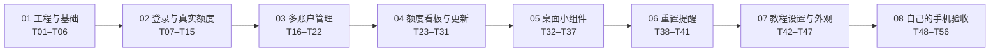
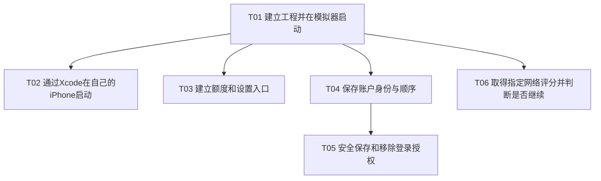
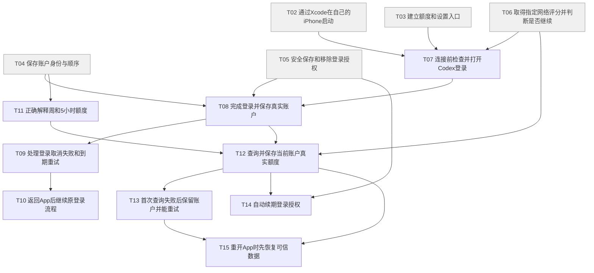
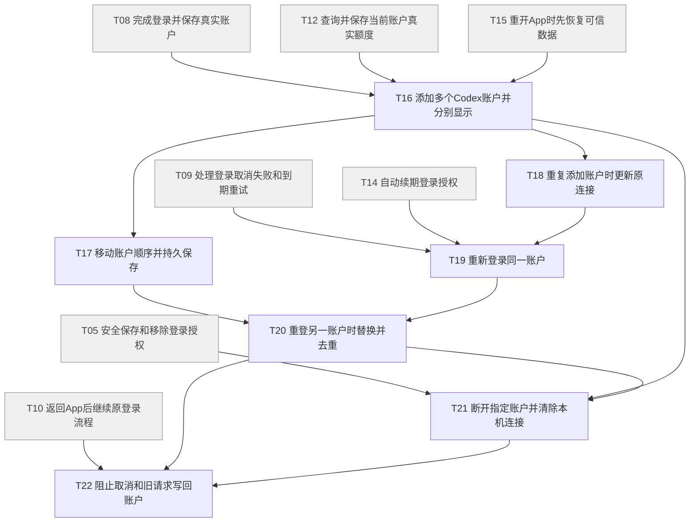
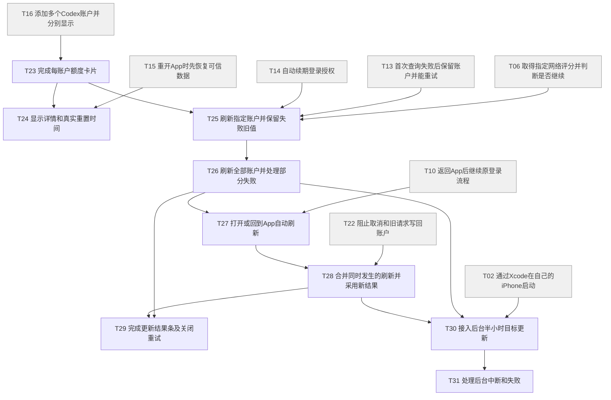
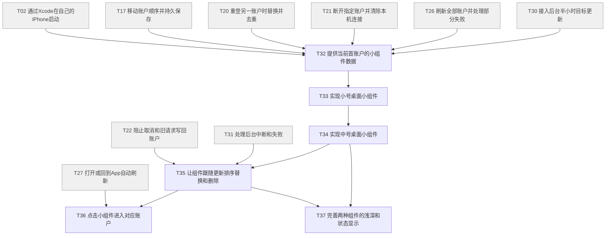
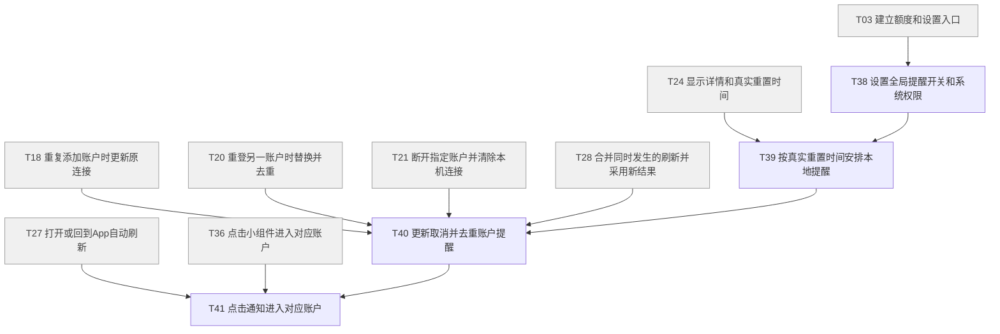
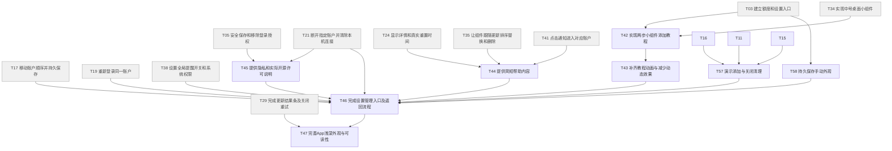
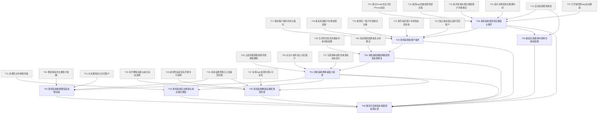

# Codex iPhone MVP 开发任务总览

确认日期：2026-10-10。**共 8 个阶段、58 个小任务。** 实时状态、待验事项和下一步统一查看 [项目进度](../项目进度.md)。本总览负责范围与依赖，不另维护一套进度统计。

**交付终点：通过 Xcode 装到自己的 iPhone，能实际使用并完成真机验收。** 不含测试分发、上架准备或发布；Figma 固定作为只读参考，不再修改。

此前需求于 2026-10-10 更新为 0.9，以下为历史实施进展；当前规则见下方 0.10 调整。动态套餐名称、居中间隔号、正常无适用额度与获取失败的规则，及各任务新增验收见[订阅识别与额度展示补充](订阅识别与额度展示补充.md)。T12 已实施并完成当前 Free 的真实展示自验；真实有额度查询仍待验。T13 经用户明确允许本次前置例外后实施，首次失败重试的隔离自验与真实 Free 恢复查询通过，有额度真实恢复继续待验；其后用户反馈的当前额度页样式差异已按确认方案修复，浅深及真机自验通过，用户已确认本阶段样式与恢复交互通过。部分卡片／时间／反馈基础在本轮接入，不表示 T23／T24／T29 的完整任务已完成。各任务实际进度以看板和追加验收记录为准，用户随后曾明确“不用执行 T14”，本次又重新启动并明确允许保留 T12 真实额度待验先实施。T14 已完成隔离续期及真实现有授权查询自验，用户已明确验收通过；T54 两次自然到期仍待验。用户随后明确启动 T15，要求先开发者自验，并将真实周／5 小时额度验收延后至多账户添加和删除功能就绪；T15 本阶段实现、自验及用户亲验现已通过；T12／T13／T15 真实有额度待验继续保留。用户随后明确启动 T16；不同账户追加与列表已实施，开发者自验后交付本人添加第二个真实账户，实际状态见看板；多账户阶段用户已确认通过，随后授权 T16 修正统一平台图标选择弹层，D-55 与任务验收记录补充该范围，修正已实施并获用户验收通过；五小时真实额度核对继续等增删就绪。用户随后明确启动 T17，排序已实现并通过模拟器自验，已安装手机；真机运行检查因锁屏待补。完成开发者自验后再交本人亲验，实际结果以 T17 验收和看板为准。

0.10 最新调整已同步：D-56 额度页集中管理和长按排序；D-57 设置底部演示添加，关闭清除全部样例、样例刷新本地模拟；D-58 持久手动浅深偏好。T17 旧入口已被取代；用户后续已授权开发，T17/T21/T25/T57/T58 本轮范围已实现、自验并更新手机，用户新版未亲验。真实五小时核对继续延期；详见项目进度和 T17 最终记录。

## 1. MVP 会实现什么

| 模块 | 你最终能做什么 |
|---|---|
| Codex 登录与多账户 | 连接已有账户；同页查看多个账户；移动排序、重新登录、去重替换和断开 |
| 额度看板 | 常显平台实际套餐名称，再看适用的周／5 小时真实额度；正常无适用额度与获取失败分别显示 |
| 自动与手动更新 | 打开／返回 App 自动刷新；点按钮刷新全部或单账户；后台按 30 分钟目标尽力更新 |
| 失败恢复 | 按既定网络检查执行；失败保留可信旧数据，简短提示并能重试或重新登录 |
| 桌面小组件 | 添加小号、中号；统一显示列表首账户的实际套餐及适用额度；点击进入对应内容 |
| 重置提醒 | 全局开关；依据真实时间收到预计重置提醒；点击打开对应账户 |
| 教程、设置与外观 | 两步组件教程、必要帮助／隐私／开源许可；App 默认跟随系统、手动选择持久优先；组件跟随系统浅深外观 |

其他平台、ChatGPT 聊天额度、API 余额、历史统计、锁屏小组件、低额度预警及额外设置均不加入本次范围。

## 2. 按什么顺序做

原任务按依赖执行；新增 T57／T58 在直接前置齐备且获授权后可先实施，不排在最终收口 T56 之后。实际能否开始以“直接依赖已完成并存档”为准。依赖图的箭头表示前者完成后才具备后者所需条件。等待真实通知、系统后台执行或自然授权到期时，可以先做前置已齐的独立任务；最终 T56 仍须等待全部必要验收通过。

上图表示推荐的阶段执行顺序；实际能力依赖以逐项表格及下方小任务图为准。

## 3. 每次交付与存档

每次交付一个小成果，附具体“操作 → 预期 → 实际结果”，并在 App 仓库建立包含任务编号的 Git 提交。每份任务文件都重复写明这一要求，便于单独交给下一次对话执行。基础任务由开发者提供可读的固定输入测试结果；有页面后按页面操作验收。

每次开始先读 [项目规则](../../AGENTS.md) 和 [项目进度](../项目进度.md)，完成或暂告一段落时主动更新进度、任务状态及验收记录，并随成果提交 Git。新对话可直接说“开始 T01”或“继续上次任务”。

执行、测试场景和存档的统一规则见[执行约定](执行约定.md)。验收结果保存到[记录目录](记录/README.md)。真实系统事件需要经过时间的，从开发时开始留证，证据具备后核验；未发生的结果保持待验，不假报通过。

## 4. 全部任务索引

点击任务名查看具体工作、逐步验收和本次 Git 存档要求。表中仅概括结果，技术细节在各任务文件。

### 阶段 01：工程与基础

先交付可运行的项目脚手架、目录职责、依赖和运行说明，再让自己的 iPhone 能启动 App，并具备账户和网络检查基础能力。

| 顺序与任务 | 本次可验收结果 | 直接依赖 |
|---|---|---|
| [T01 建立工程并在模拟器启动](01-工程与基础/T01-建立工程并在模拟器启动.md) | 有目录、依赖及运行说明的脚手架，模拟器能启动 | 无 |
| [T02 通过Xcode在自己的iPhone启动](01-工程与基础/T02-通过Xcode在自己的iPhone启动.md) | 在自己的手机桌面打开 App | [T01](01-工程与基础/T01-建立工程并在模拟器启动.md) |
| [T03 建立额度和设置入口](01-工程与基础/T03-建立额度和设置入口.md) | 能在额度、设置之间切换并看到无账户入口 | [T01](01-工程与基础/T01-建立工程并在模拟器启动.md) |
| [T04 保存账户身份与顺序](01-工程与基础/T04-保存账户身份与顺序.md) | 账户与顺序能够独立保存并重新读取 | [T01](01-工程与基础/T01-建立工程并在模拟器启动.md) |
| [T05 安全保存和移除登录授权](01-工程与基础/T05-安全保存和移除登录授权.md) | 授权可安全取回，删除指定账户不影响其他账户 | [T04](01-工程与基础/T04-保存账户身份与顺序.md) |
| [T06 取得指定网络评分并判断是否继续](01-工程与基础/T06-取得指定网络评分并判断是否继续.md) | 评分 49、50 和未知阻止，51 可继续 | [T01](01-工程与基础/T01-建立工程并在模拟器启动.md) |

### 阶段 02：登录与真实额度

完成真实登录、查询与保存，能够继续使用已有授权。

| 顺序与任务 | 本次可验收结果 | 直接依赖 |
|---|---|---|
| [T07 连接前检查并打开Codex登录](02-登录与真实额度/T07-连接前检查并打开Codex登录.md) | 连接入口选 Codex 图标后可复制一次性代码并打开默认浏览器 | [T02](01-工程与基础/T02-通过Xcode在自己的iPhone启动.md)、[T03](01-工程与基础/T03-建立额度和设置入口.md)、[T06](01-工程与基础/T06-取得指定网络评分并判断是否继续.md) |
| [T08 完成登录并保存真实账户](02-登录与真实额度/T08-完成登录并保存真实账户.md) | 官网确认后回 App，出现已验证的账户身份 | [T04](01-工程与基础/T04-保存账户身份与顺序.md)、[T05](01-工程与基础/T05-安全保存和移除登录授权.md)、[T07](02-登录与真实额度/T07-连接前检查并打开Codex登录.md) |
| [T09 处理登录取消失败和到期重试](02-登录与真实额度/T09-处理登录取消失败和到期重试.md) | 取消不添加账户，失败可重新开始且不假成功 | [T08](02-登录与真实额度/T08-完成登录并保存真实账户.md) |
| [T10 返回App后继续原登录流程](02-登录与真实额度/T10-返回App后继续原登录流程.md) | 浏览器往返和可恢复的中断不重复申请登录 | [T09](02-登录与真实额度/T09-处理登录取消失败和到期重试.md) |
| [T11 正确解释周和5小时额度](02-登录与真实额度/T11-正确解释周和5小时额度.md) | 真实窗口转换为剩余，缺失字段保持未知 | [T04](01-工程与基础/T04-保存账户身份与顺序.md) |
| [T12 查询并保存当前账户真实额度](02-登录与真实额度/T12-查询并保存当前账户真实额度.md) | 登录后自动取得实际套餐、适用额度及独立观测时间 | [T06](01-工程与基础/T06-取得指定网络评分并判断是否继续.md)、[T08](02-登录与真实额度/T08-完成登录并保存真实账户.md)、[T11](02-登录与真实额度/T11-正确解释周和5小时额度.md) |
| [T13 首次查询失败后保留账户并能重试](02-登录与真实额度/T13-首次查询失败后保留账户并能重试.md) | 真实获取失败时简短提示并重试，正常无适用额度不报错 | [T12](02-登录与真实额度/T12-查询并保存当前账户真实额度.md) |
| [T14 自动续期登录授权](02-登录与真实额度/T14-自动续期登录授权.md) | 授权到期时自动恢复查询，失败保留旧数据 | [T05](01-工程与基础/T05-安全保存和移除登录授权.md)、[T12](02-登录与真实额度/T12-查询并保存当前账户真实额度.md) |
| [T15 重开App时先恢复可信数据](02-登录与真实额度/T15-重开App时先恢复可信数据.md) | 离线重开仍能看到原账户和原成功快照 | [T12](02-登录与真实额度/T12-查询并保存当前账户真实额度.md)、[T13](02-登录与真实额度/T13-首次查询失败后保留账户并能重试.md) |

### 阶段 03：多账户管理

多个账户独立显示，排序、重登、去重和断开按约定工作。

| 顺序与任务 | 本次可验收结果 | 直接依赖 |
|---|---|---|
| [T16 添加多个Codex账户并分别显示](03-多账户管理/T16-添加多个Codex账户并分别显示.md) | 账户按添加顺序出现且各自数据独立；统一平台图标入口 | [T08](02-登录与真实额度/T08-完成登录并保存真实账户.md)、[T12](02-登录与真实额度/T12-查询并保存当前账户真实额度.md)、[T15](02-登录与真实额度/T15-重开App时先恢复可信数据.md) |
| [T17 移动账户顺序并持久保存](03-多账户管理/T17-移动账户顺序并持久保存.md) | 额度页长按拖动持久保存，无把手；移除设置账户区 | [T16](03-多账户管理/T16-添加多个Codex账户并分别显示.md) |
| [T18 重复添加账户时更新原连接](03-多账户管理/T18-重复添加账户时更新原连接.md) | 同邮箱重复添加只保留一条，原位置不变 | [T16](03-多账户管理/T16-添加多个Codex账户并分别显示.md) |
| [T19 重新登录同一账户](03-多账户管理/T19-重新登录同一账户.md) | 同号重登更新连接，取消或失败保留原记录 | [T09](02-登录与真实额度/T09-处理登录取消失败和到期重试.md)、[T14](02-登录与真实额度/T14-自动续期登录授权.md)、[T18](03-多账户管理/T18-重复添加账户时更新原连接.md) |
| [T20 重登另一账户时替换并去重](03-多账户管理/T20-重登另一账户时替换并去重.md) | 采用新身份保留原行位置，不出现身份差异确认 | [T17](03-多账户管理/T17-移动账户顺序并持久保存.md)、[T19](03-多账户管理/T19-重新登录同一账户.md) |
| [T21 断开指定账户并清除本机连接](03-多账户管理/T21-断开指定账户并清除本机连接.md) | 指定账户被移除，其他账户继续可用 | [T05](01-工程与基础/T05-安全保存和移除登录授权.md)、[T16](03-多账户管理/T16-添加多个Codex账户并分别显示.md)、[T20](03-多账户管理/T20-重登另一账户时替换并去重.md) |
| [T22 阻止取消和旧请求写回账户](03-多账户管理/T22-阻止取消和旧请求写回账户.md) | 旧响应不能恢复删除账户或覆盖新身份 | [T10](02-登录与真实额度/T10-返回App后继续原登录流程.md)、[T20](03-多账户管理/T20-重登另一账户时替换并去重.md)、[T21](03-多账户管理/T21-断开指定账户并清除本机连接.md) |

### 阶段 04：额度看板与更新

卡片、详情、手动与自动更新完整，失败反馈简短且数据可信。

| 顺序与任务 | 本次可验收结果 | 直接依赖 |
|---|---|---|
| [T23 完成每账户额度卡片](04-额度看板与更新/T23-完成每账户额度卡片.md) | 同页看清身份及两项剩余额度，进度含义正确 | [T16](03-多账户管理/T16-添加多个Codex账户并分别显示.md) |
| [T24 显示详情和真实重置时间](04-额度看板与更新/T24-显示详情和真实重置时间.md) | 展开详情可看套餐和成功时间，到点不自动改满 | [T15](02-登录与真实额度/T15-重开App时先恢复可信数据.md)、[T23](04-额度看板与更新/T23-完成每账户额度卡片.md) |
| [T25 刷新指定账户并保留失败旧值](04-额度看板与更新/T25-刷新指定账户并保留失败旧值.md) | 卡片刷新和重试只影响该账户 | [T06](01-工程与基础/T06-取得指定网络评分并判断是否继续.md)、[T13](02-登录与真实额度/T13-首次查询失败后保留账户并能重试.md)、[T14](02-登录与真实额度/T14-自动续期登录授权.md)、[T23](04-额度看板与更新/T23-完成每账户额度卡片.md) |
| [T26 刷新全部账户并处理部分失败](04-额度看板与更新/T26-刷新全部账户并处理部分失败.md) | 一户失败时其他成功账户正常更新 | [T25](04-额度看板与更新/T25-刷新指定账户并保留失败旧值.md) |
| [T27 打开或回到App自动刷新](04-额度看板与更新/T27-打开或回到App自动刷新.md) | 无需点击刷新，刚更新后返回也会自动查询 | [T10](02-登录与真实额度/T10-返回App后继续原登录流程.md)、[T26](04-额度看板与更新/T26-刷新全部账户并处理部分失败.md) |
| [T28 合并同时发生的刷新并采用新结果](04-额度看板与更新/T28-合并同时发生的刷新并采用新结果.md) | 同时触发不重复查询同账户，旧结果不盖新结果 | [T22](03-多账户管理/T22-阻止取消和旧请求写回账户.md)、[T27](04-额度看板与更新/T27-打开或回到App自动刷新.md) |
| [T29 完成更新结果条及关闭重试](04-额度看板与更新/T29-完成更新结果条及关闭重试.md) | 成功隐藏，失败保留可关闭，关闭后列表收紧 | [T26](04-额度看板与更新/T26-刷新全部账户并处理部分失败.md)、[T28](04-额度看板与更新/T28-合并同时发生的刷新并采用新结果.md) |
| [T30 接入后台半小时目标更新](04-额度看板与更新/T30-接入后台半小时目标更新.md) | 系统给予执行机会时自动查询并保存新结果 | [T02](01-工程与基础/T02-通过Xcode在自己的iPhone启动.md)、[T26](04-额度看板与更新/T26-刷新全部账户并处理部分失败.md)、[T28](04-额度看板与更新/T28-合并同时发生的刷新并采用新结果.md) |
| [T31 处理后台中断和失败](04-额度看板与更新/T31-处理后台中断和失败.md) | 后台失败保留旧值，执行结束后还能再调度 | [T30](04-额度看板与更新/T30-接入后台半小时目标更新.md) |

### 阶段 05：桌面小组件

主屏幕实际可添加小号和中号组件，统一跟随列表首账户。

| 顺序与任务 | 本次可验收结果 | 直接依赖 |
|---|---|---|
| [T32 提供当前首账户的小组件数据](05-桌面小组件/T32-提供当前首账户的小组件数据.md) | 共享结果始终对应列表首项，且不包含登录秘密 | [T02](01-工程与基础/T02-通过Xcode在自己的iPhone启动.md)、[T17](03-多账户管理/T17-移动账户顺序并持久保存.md)、[T20](03-多账户管理/T20-重登另一账户时替换并去重.md)、[T21](03-多账户管理/T21-断开指定账户并清除本机连接.md)、[T26](04-额度看板与更新/T26-刷新全部账户并处理部分失败.md)、[T30](04-额度看板与更新/T30-接入后台半小时目标更新.md) |
| [T33 实现小号桌面小组件](05-桌面小组件/T33-实现小号桌面小组件.md) | 主屏幕能添加小号并看见首账户两项额度 | [T32](05-桌面小组件/T32-提供当前首账户的小组件数据.md) |
| [T34 实现中号桌面小组件](05-桌面小组件/T34-实现中号桌面小组件.md) | 中号能添加，身份和额度与小号一致 | [T33](05-桌面小组件/T33-实现小号桌面小组件.md) |
| [T35 让组件跟随更新排序替换和删除](05-桌面小组件/T35-让组件跟随更新排序替换和删除.md) | 列表变化后准备正确组件内容并请求更新 | [T22](03-多账户管理/T22-阻止取消和旧请求写回账户.md)、[T31](04-额度看板与更新/T31-处理后台中断和失败.md)、[T34](05-桌面小组件/T34-实现中号桌面小组件.md) |
| [T36 点击小组件进入对应账户](05-桌面小组件/T36-点击小组件进入对应账户.md) | 点组件进入对应额度，旧目标失效时安全返回 | [T27](04-额度看板与更新/T27-打开或回到App自动刷新.md)、[T35](05-桌面小组件/T35-让组件跟随更新排序替换和删除.md) |
| [T37 完善两种组件的浅深和状态显示](05-桌面小组件/T37-完善两种组件的浅深和状态显示.md) | 浅深外观均能看清两窗口和数据更新时间 | [T34](05-桌面小组件/T34-实现中号桌面小组件.md)、[T35](05-桌面小组件/T35-让组件跟随更新排序替换和删除.md) |

### 阶段 06：重置提醒

全局开关控制真实预计重置提醒，点击进入正确账户。

| 顺序与任务 | 本次可验收结果 | 直接依赖 |
|---|---|---|
| [T38 设置全局提醒开关和系统权限](06-重置提醒/T38-设置全局提醒开关和系统权限.md) | 主动开启才询问权限，拒绝后不会反复打断 | [T03](01-工程与基础/T03-建立额度和设置入口.md) |
| [T39 按真实重置时间安排本地提醒](06-重置提醒/T39-按真实重置时间安排本地提醒.md) | 有效重置时间对应预计重置提醒，不宣称额度已恢复 | [T24](04-额度看板与更新/T24-显示详情和真实重置时间.md)、[T38](06-重置提醒/T38-设置全局提醒开关和系统权限.md) |
| [T40 更新取消并去重账户提醒](06-重置提醒/T40-更新取消并去重账户提醒.md) | 刷新不重复提醒，关开关或移除身份会取消待发提醒 | [T18](03-多账户管理/T18-重复添加账户时更新原连接.md)、[T20](03-多账户管理/T20-重登另一账户时替换并去重.md)、[T21](03-多账户管理/T21-断开指定账户并清除本机连接.md)、[T28](04-额度看板与更新/T28-合并同时发生的刷新并采用新结果.md)、[T39](06-重置提醒/T39-按真实重置时间安排本地提醒.md) |
| [T41 点击通知进入对应账户](06-重置提醒/T41-点击通知进入对应账户.md) | 通知打开正确账户并更新，旧通知不串号 | [T27](04-额度看板与更新/T27-打开或回到App自动刷新.md)、[T36](05-桌面小组件/T36-点击小组件进入对应账户.md)、[T40](06-重置提醒/T40-更新取消并去重账户提醒.md) |

### 阶段 07：教程、设置与外观

教程可照做，设置与说明可用，App 浅深外观完整。

| 顺序与任务 | 本次可验收结果 | 直接依赖 |
|---|---|---|
| [T42 实现两步小组件添加教程](07-教程设置与外观/T42-实现两步小组件添加教程.md) | 从首页和设置进入，能按两步说明实际添加组件 | [T03](01-工程与基础/T03-建立额度和设置入口.md)、[T34](05-桌面小组件/T34-实现中号桌面小组件.md) |
| [T43 补齐教程动画与减少动态效果](07-教程设置与外观/T43-补齐教程动画与减少动态效果.md) | 动画能说明添加动作，关闭动态效果也看得懂 | [T42](07-教程设置与外观/T42-实现两步小组件添加教程.md) |
| [T44 提供简短帮助内容](07-教程设置与外观/T44-提供简短帮助内容.md) | 能查看额度、更新、预计提醒及组件的必要说明 | [T24](04-额度看板与更新/T24-显示详情和真实重置时间.md)、[T35](05-桌面小组件/T35-让组件跟随更新排序替换和删除.md)、[T41](06-重置提醒/T41-点击通知进入对应账户.md) |
| [T45 提供隐私和实际开源许可说明](07-教程设置与外观/T45-提供隐私和实际开源许可说明.md) | 能查看保存删除范围及实际使用依赖的许可详情 | [T05](01-工程与基础/T05-安全保存和移除登录授权.md)、[T21](03-多账户管理/T21-断开指定账户并清除本机连接.md) |
| [T46 完成设置管理入口及返回流程](07-教程设置与外观/T46-完成设置管理入口及返回流程.md) | 设置各入口可用，操作后返回正确来源 | [T17](03-多账户管理/T17-移动账户顺序并持久保存.md)、[T19](03-多账户管理/T19-重新登录同一账户.md)、[T21](03-多账户管理/T21-断开指定账户并清除本机连接.md)、[T38](06-重置提醒/T38-设置全局提醒开关和系统权限.md)、[T43](07-教程设置与外观/T43-补齐教程动画与减少动态效果.md)、[T44](07-教程设置与外观/T44-提供简短帮助内容.md)、[T45](07-教程设置与外观/T45-提供隐私和实际开源许可说明.md)、[T57](07-教程设置与外观/T57-演示添加与关闭清理.md)、[T58](07-教程设置与外观/T58-持久保存手动外观.md) |
| [T47 完善App浅深外观与可读性](07-教程设置与外观/T47-完善App浅深外观与可读性.md) | 所有自有页面遵守系统默认／手动偏好，信息和操作清楚可读 | [T29](04-额度看板与更新/T29-完成更新结果条及关闭重试.md)、[T46](07-教程设置与外观/T46-完成设置管理入口及返回流程.md) |
| [T57 演示添加与关闭清理](07-教程设置与外观/T57-演示添加与关闭清理.md) | 无需真实登录添加样例，模拟刷新；关闭清除全部演示且真实数据不变 | T16／T11／T15 已交付基础；真实额度延期例外见任务 |
| [T58 持久保存手动外观](07-教程设置与外观/T58-持久保存手动外观.md) | 首次按系统，手动浅深选择立即生效并在重开后保持 | [T03](01-工程与基础/T03-建立额度和设置入口.md) |

### 阶段 08：真机验收

在自己的手机上逐项核验并保存可自用版本。

| 顺序与任务 | 本次可验收结果 | 直接依赖 |
|---|---|---|
| [T48 真机验收登录真实额度与重开](08-真机验收/T48-真机验收登录真实额度与重开.md) | 自己的手机能登录、显示真实额度并重开继续用 | [T02](01-工程与基础/T02-通过Xcode在自己的iPhone启动.md)、[T10](02-登录与真实额度/T10-返回App后继续原登录流程.md)、[T13](02-登录与真实额度/T13-首次查询失败后保留账户并能重试.md)、[T14](02-登录与真实额度/T14-自动续期登录授权.md)、[T24](04-额度看板与更新/T24-显示详情和真实重置时间.md)、[T27](04-额度看板与更新/T27-打开或回到App自动刷新.md) |
| [T49 真机验收多账户操作](08-真机验收/T49-真机验收多账户操作.md) | 两个真实账户的排序、重复、替换、移除均符合约定 | [T17](03-多账户管理/T17-移动账户顺序并持久保存.md)、[T18](03-多账户管理/T18-重复添加账户时更新原连接.md)、[T20](03-多账户管理/T20-重登另一账户时替换并去重.md)、[T21](03-多账户管理/T21-断开指定账户并清除本机连接.md)、[T22](03-多账户管理/T22-阻止取消和旧请求写回账户.md)、[T48](08-真机验收/T48-真机验收登录真实额度与重开.md) |
| [T50 真机验收刷新网络检查及失败恢复](08-真机验收/T50-真机验收刷新网络检查及失败恢复.md) | 自动和手动刷新正确，失败能恢复且无假数据 | [T28](04-额度看板与更新/T28-合并同时发生的刷新并采用新结果.md)、[T29](04-额度看板与更新/T29-完成更新结果条及关闭重试.md)、[T49](08-真机验收/T49-真机验收多账户操作.md) |
| [T51 真机验收两种桌面小组件](08-真机验收/T51-真机验收两种桌面小组件.md) | 实际添加两种组件，变化和点击目标一致 | [T35](05-桌面小组件/T35-让组件跟随更新排序替换和删除.md)、[T36](05-桌面小组件/T36-点击小组件进入对应账户.md)、[T37](05-桌面小组件/T37-完善两种组件的浅深和状态显示.md)、[T50](08-真机验收/T50-真机验收刷新网络检查及失败恢复.md) |
| [T52 真机验收重置通知及权限往返](08-真机验收/T52-真机验收重置通知及权限往返.md) | 实际收到基于真实时间的提醒并打开正确账户 | [T40](06-重置提醒/T40-更新取消并去重账户提醒.md)、[T41](06-重置提醒/T41-点击通知进入对应账户.md)、[T46](07-教程设置与外观/T46-完成设置管理入口及返回流程.md)、[T51](08-真机验收/T51-真机验收两种桌面小组件.md) |
| [T53 真机验收后台更新与前台独立刷新](08-真机验收/T53-真机验收后台更新与前台独立刷新.md) | 系统实际执行时更新，回App仍独立刷新 | [T31](04-额度看板与更新/T31-处理后台中断和失败.md)、[T51](08-真机验收/T51-真机验收两种桌面小组件.md) |
| [T54 核验日常使用中的两次授权续期](08-真机验收/T54-核验日常使用中的两次授权续期.md) | 真实授权经过两次自然到期仍能继续查额度 | [T14](02-登录与真实额度/T14-自动续期登录授权.md)、[T48](08-真机验收/T48-真机验收登录真实额度与重开.md) |
| [T55 真机验收教程设置和浅深外观](08-真机验收/T55-真机验收教程设置和浅深外观.md) | 教程可照做，所有说明与浅深页面可读可返回 | [T43](07-教程设置与外观/T43-补齐教程动画与减少动态效果.md)、[T45](07-教程设置与外观/T45-提供隐私和实际开源许可说明.md)、[T46](07-教程设置与外观/T46-完成设置管理入口及返回流程.md)、[T47](07-教程设置与外观/T47-完善App浅深外观与可读性.md)、[T51](08-真机验收/T51-真机验收两种桌面小组件.md) |
| [T56 保存可自用版本和最终验收记录](08-真机验收/T56-保存可自用版本和最终验收记录.md) | 手机保留可用版本，任务结果与Git版本可追溯 | [T48](08-真机验收/T48-真机验收登录真实额度与重开.md)、[T49](08-真机验收/T49-真机验收多账户操作.md)、[T50](08-真机验收/T50-真机验收刷新网络检查及失败恢复.md)、[T51](08-真机验收/T51-真机验收两种桌面小组件.md)、[T52](08-真机验收/T52-真机验收重置通知及权限往返.md)、[T53](08-真机验收/T53-真机验收后台更新与前台独立刷新.md)、[T54](08-真机验收/T54-核验日常使用中的两次授权续期.md)、[T55](08-真机验收/T55-真机验收教程设置和浅深外观.md) |

## 5. 每个小任务的依赖图

为便于阅读按阶段分图，跨阶段前置也保留节点；与上表使用相同依赖。只有节点编号的名称可在索引中查找，节点内同时标注简短任务名。

### 01 工程与基础

### 02 登录与真实额度

### 03 多账户管理

### 04 额度看板与更新

### 05 桌面小组件

### 06 重置提醒

### 07 教程、设置与外观

### 08 真机验收

## 6. 什么算整个 MVP 做完

T01–T47 及 T57／T58 的成果完成并存档，T48–T55 的真机验收有真实结果，T56 保存实际可用版本和最终记录。任何必要真机步骤仍待验时，都不能宣布 MVP 已完成。用户可以从每份任务的验收表复现操作，不需要阅读实现细节。

[需求覆盖表](需求覆盖表.md)用于核对已确认要求没有遗漏；它是追溯索引，不增加功能。需求、技术研究和 Figma 历史记录中的旧执行安排，以本轮确认的自用终点和 Figma 固定参考为准。

本轮文档检查结果见[规划检查记录](规划检查记录.md)。

全面审核及本轮修订见[全面审核记录](全面审核记录-2026-10-10.md)。
