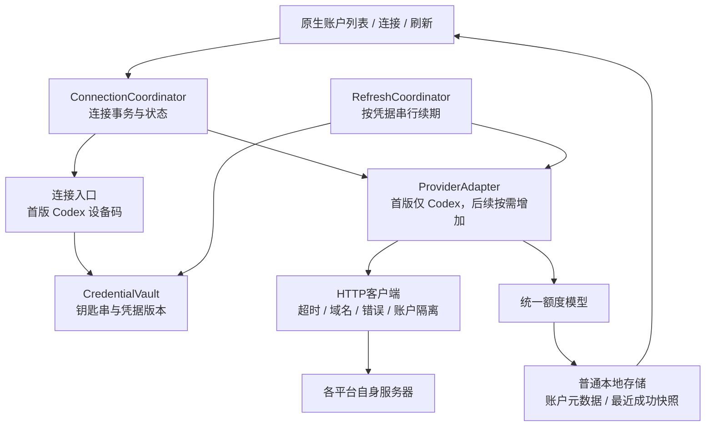
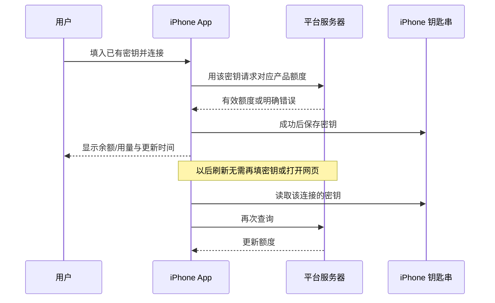
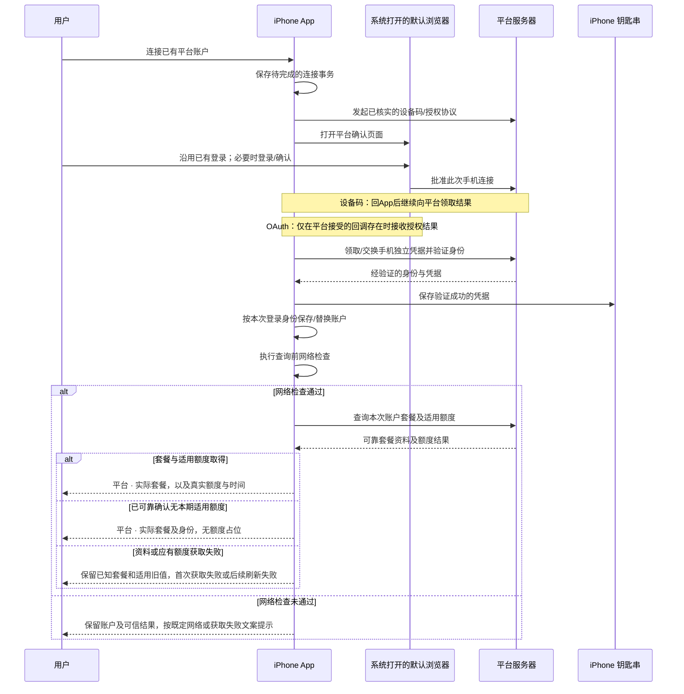

# 首版平台登录与额度连接方案

研究日期：2026-10-10（北京时间）  
适用对象：iPhone 额度查询 App。本文最初仅做技术研究，不开发 App、不做原型、不执行登录；后续开发按用户授权的任务推进，Figma 保持只读。
本地依据：`reference/CodexBar`，提交 `03a51bdcfc6f6804e005d7e5007de67bac82b494`，研究开始时工作区无修改。  
交付目录已核实为小写 `app/docs`，不是另建 `APP/DOCS`。

产品规则校订：2026-10-10，按用户最新确认与[需求文档 0.11](requirements.md)同步。**首版只交付 Codex；其余 12 个平台保留研究，不限制未来增加其他平台。** 产品规则含动态套餐名称、额度适用性及 D-55 统一平台图标入口；实现与验收以项目进度和各任务记录为准，不用研究标签代替实际进度。

## 0. 2026-10-10 最新产品规则（需求 0.11 / D-56～D-59）

本节与正文技术研究并行适用；历史第三方项目设置入口描述仅为来源证据，不是本 App 页面要求。实际实现及验收以项目进度为准。

- D-59：取消独立重新登录及指定行换号替换，移除菜单和失败提示中的入口及建议；T19/T20 不再实施。添加入口同邮箱更新原连接、不同邮箱追加，自动续期和失败重试继续保留。
- 本 App 删除设置的账户区域及管理子页，新增连接留在额度页；真实连接的平台图标弹层规则不变。额度卡片长按选中后上下拖动、让位动效、松手保存，不显示排序把手。排序仍按稳定本地标识操作同一持久列表，不交换身份文字或覆盖额度快照。
- 每卡「…」当前只提供刷新额度／删除账户；真实刷新仍按 §3.5 网络检查、续期和结果归属规则执行。删除只清理本 App 指定连接，保留其他账户，不取消订阅。
- 设置底部演示开关仅改变新增来源，开启后可反复生成不同演示身份和额度；演示刷新只使用本地模拟服务，禁止用真实凭据或向真实查询链路填假响应。演示与真实身份／存储标记明确区分，共用卡片、排序和单卡操作，不能把真实账户改成样例。
- 关闭演示开关时清除全部演示身份及样例结果、阻止迟到模拟请求写回；保留真实账户、授权、成功快照及真实账户相对顺序。不发基于演示数据的真实提醒，不把样例验收记为真实平台查询通过。
- App 外观以“无手动偏好／浅色／深色”内部状态表达；初始无偏好时按系统，手动浅深选择立即生效并持久保存，启动或系统变化不得覆盖它。本次不强制外部官网／系统配色，小组件维持系统外观。
- 新增演示属于获用户明确授权的产品功能，替代旧禁止产品演示入口的约定；不增加故障开关或技术设置。真实五小时余额仍按用户原安排延期。

## 1. 产品核心、范围与证据读法

**首版让用户在手机上查看自己已有 OpenAI 账户的 Codex 订阅额度，支持多个 Codex 账户，并在连接后自动查询。** 用户所说的“GPT”在这里指 OpenAI 账户下的 Codex 订阅，不扩展为 ChatGPT 聊天额度或 OpenAI API 余额。App 增加查看和监控能力，不带用户开户、购买套餐、充值或配置开发环境。

连接只给用户必要操作：**首版 Codex 优先在外部默认浏览器登录或确认已有账户。** 后续若接入密钥平台，再采用直接填写已有密钥的流程；首版不增加密钥输入页。不把“创建新密钥”“安装工具”“启用扩展”塞进常规连接流程。Apple、Google、邮箱等认证交给平台官网处理，App 不另造密码登录系统。

**浏览器选择与凭据回传是两个问题。** 网页交给系统按用户默认设置打开；默认 Chrome 的用户不应被要求转 Safari 重登。App 仍需通过平台的设备码领取、有效的授权回调或已证实的其他交接机制拿到查询凭据。普通 App 不能因打开了网页就读取其 Cookie；这属于接入研究要解决的问题，不能转化成要求用户抓 Cookie、找请求头或安装扩展。苹果系统提供的临时认证窗口可以使用，但只有实际减少操作且平台回调成立时才采用；“原生”不等于自动共享所有浏览器的登录状态。

【设计】内部采用“一套账户与额度框架，各平台一个小适配器”，**首版只实现和注册 Codex 适配器**，后续按需新增平台，不提前实现其登录入口、密钥页或后台任务。CodexBar 最值得提取的是请求、解析、额度语义与内部错误分类；Mac 发现凭据的办法需替换。其他平台保留真实查询链与交接研究缺口，不将“强制 Safari＋扩展”或“每次手动开网页看数”冒充已经解决的方案；这些研究不阻塞 Codex MVP。

本方案优先复用用户本人的账户查询能力，不把申请厂商查询授权设为所有平台的起点。但是已有官方客户端的 `client_id`、回调地址和特殊权限，不能因为能在源码中找到就推断独立手机 App 已获支持。首版验证 Codex 设备码与独立客户端接入；Grok、Antigravity 等平台的验证留到后续实际接入时。

本文保留 13 个平台的研究，**研究范围不等于首版交付范围**。第 3 章公共框架、第 4 章 Codex 及相关存储与验证是本期技术依据；第 5～16 章是后续平台资料。功能范围、操作和显示规则以用户最新确认及 `requirements.md` 为准。同一品牌的聊天会员、编程订阅、API 余额不能互相补位；后续余额查询也不能把同账户多个 key 当作多个独立钱包汇总。

当前产品规则（需求 0.13／D-61）：能简化就简化。被动刷新以每 30 分钟一次为目标；主动刷新由用户点击或有效下拉松手触发；打开或回到 App 另行自动刷新。取消独立重新登录和指定行换号替换；添加入口同平台同邮箱只保留最新成功连接，不同账户追加。用户只看简短结果，内部错误分类不直接变成界面提示。详细规则见第 3.3～3.6 节。

证据标签贯穿全文：

- **【源码】**：在上述本地提交的实现中确认；不等于已在 iPhone 上运行成功。
- **【官方】**：官方文档或官方公开源码补充确认；在线 `main` 会变，实施时应固定版本。
- **【设计】**：研究时提出的手机实现；后续是否已编写与验证，以任务记录为准。
- **【待验】**：研究时未登录、未真机运行；后续必须以实际验收记录证明支持，未验证部分继续保留。

源码定位使用“相对于 CodexBar 根目录的文件路径＋行号／函数名”，可点击引用会打开本机对应文件的起始行；全文中的 `~/.…` 是被研究程序的默认路径说明，不表示本次读取了用户这些文件。`research/codexbar-research.html`、`provider-inventory.json`、`codex-fetch-deep-dive.txt` 只作线索，关键链路均回查实现。

## 2. 13 个平台方案总表

下表为研究索引，**仅 Codex 属于首版，其余平台后续按授权接入**；研究不代表手机接入已验收。身份与凭据验证通过后保存绑定，再按当前账户资料显示“平台 · 实际套餐”。首次获取失败保留绑定及已知套餐，显示“获取失败”；可靠确认无本期适用额度则正常展示套餐，不报失败、不造额度。套餐识别与真实额度取得分别验收，见需求 SUB-01～07。接口不提供身份时不编造邮箱；无法可靠识别身份时不误删其他账户。

| 平台 | 本地实际产品／provider | 手机首选连接 | 凭据如何到 App | 主要数据与关键门槛 |
|---|---|---|---|---|
| Codex（首版） | OpenAI 账户下 Codex 订阅使用量，`codex` | 外部默认浏览器设备码 | 手机轮询 OpenAI，取得授权码和 PKCE verifier，再直接换令牌 | 周／5 小时窗口及重置；设备码开关、客户端标识、独立续期待验；附加 credits 不纳入 MVP，不是 OpenAI API 余额 |
| Claude | Claude / Claude Code 共享订阅额度，`claude` | 默认浏览器授权；官方一次性登录码回传候选 | 用户交回 `code#state`，手机核对事务后以 PKCE 换自己的 token；具体见本章 | 5 小时／每周／模型窗口；手机 client/scope、代码步骤与独立续期待验，不复制桌面 token |
| Grok | `grok`；CLI credits proxy 与网页订阅口径须区分 | 官方 Grok CLI 设备码协议的手机移植 | 手机轮询 xAI token endpoint 取得独立 bearer／refresh token | 优先源码可查的 credits；网页 WKE 密钥绑定不能靠复制 Cookie 解决 |
| Antigravity | Google Antigravity，`antigravity` | 原生 Google OAuth、独立 iOS 客户端的条件式方案 | 系统认证回调→App 校验 state/PKCE→直接换令牌 | 模型额度桶／重置；普通 Google client 是否获 consumer entitlement 是硬门槛，未通过不能宣称可连接 |
| Kimi | Kimi Code，`kimi`；开放平台另为 `moonshot` | 直接填写已有 Kimi Code key | 原生输入→该 key 的 usages 接口验证 | Code 订阅窗口；不是 Kimi 聊天会员或 Moonshot API 余额 |
| Cursor | Cursor 编程订阅，`cursor` | 官方 CLI 浏览器确认＋手机轮询的候选协议 | `/auth/poll` 领取 token；再验证能否用于同账户 usage-summary | 套餐内／按量用量；返回 token 的账务受众、轮换及团队作用域待验 |
| 智谱 GLM | `zai`，按 CN／国际区域区分 | 直接填写已有对应地区 key | 原生输入→同区quota／中国余额独立验证，至少一项有效 | GLM Coding Plan；CN API 余额独立列；特殊团队 ID 不强加给个人用户 |
| MiniMax | `minimax`，Coding／Token Plan | 直接填写已有 `sk-cp-` key | 原生输入→对应地区 remains 验证 | 专用计划剩余量；`sk-api-` 不混用，不引导重新开通套餐 |
| Qoder | Qoder 编程订阅，`qoder` | 默认浏览器既有认证方向；交接待补齐 | 已知 quota 需站点 Cookie；CLI token/PAT 的同口径查询能力待证 | 订阅 Credits／周期；不能把Mac读取Chrome存储当手机回传 |
| DeepSeek | `deepseek`，开放平台 API 余额 | 直接填写已有 API key | 原生输入→官方 `/user/balance` | 货币、总／赠送／充值余额；无需浏览器，不是聊天额度或每把 key 独立钱包 |
| OpenCode | `opencode`＋`opencodego`，有重叠 | Go 直接填已有 key；Zen 默认浏览器交接待补齐 | Go Bearer查usage；Zen需控制台会话或待证的同钱包key接口 | Go 窗口、Zen余额分别验证；不让用户选认证技术，不读取上游厂商所有账户 |
| Muse Code | `muse`，Meta Muse Code | 官方设备码＋默认浏览器；订阅访问与查询副作用待验 | 手机直接轮询Meta取得access_token；与所需dca/订阅权限的桥待验 | 保持Muse订阅口径；无副作用quota请求和token生命周期是发布门槛 |
| Command Code | `commandcode`，Command Code订阅 | 直接填写已有Command Code API key | 原生输入→官方`/alpha/whoami`→同org账务查询 | 官方CLI已有Bearer credits/订阅链；独立手机与各套餐key需验，无Cookie导出步骤 |

## 3. 公共连接框架

### 3.1 只保留五块公共能力

【设计】公共层负责流程、隔离和存储；平台层只回答“去哪登录、拿什么凭据、怎么查、怎么解释”。不引入自己的账户系统，不建代收所有用户令牌的服务器，不搬 CLI 进程、浏览器数据库解密、菜单栏、终端和桌面自动切号。



公共层职责：

1. `ConnectionCoordinator`：添加、取消、恢复事务；验证回程、身份与凭据后保存绑定；首次额度查询独立处理，失败不撤销已验证绑定。
2. `CredentialVault`：钥匙串读写、版本轮换、移除；不允许业务代码随处拼接全局 Cookie。
3. `RefreshCoordinator`：每 30 分钟目标的被动刷新、点击或下拉主动刷新、打开／回 App 独立自动刷新；共用网络检查、少量并发与限流退避，同一凭据的续期只执行一次。
4. 小型 HTTP 层：每个账户独立请求上下文；只向适配器白名单域名发凭据；处理重定向、超时、HTTP 与业务错误。
5. `SnapshotStore`：非敏感元数据和最近成功指标；失败保留旧值并明确标旧。

平台适配器负责固定配置与少量差异：产品/地区、连接种类、凭据字段、身份验证、工作区列表、query 请求和 parser、可选续期、错误映射。不能让公用层假定所有 Cookie 都有 refresh token、所有 API key 都能读订阅、所有平台都有每周额度。官方补充若找到比CodexBar更轻的同口径查询（如Command Code已有key的账务GET），采用该路径并单独验证，不为了复用桌面Cookie导入增加用户步骤。

**0.9 订阅资料约束。** 适配器从本次账户的可靠响应返回动态套餐名称／标识及其观测时间，不将套餐建成完整枚举或白名单；公共展示使用“平台 · 实际套餐”，保留平台名称，不做 Free→免费版等人工改名。已支持字段返回新名称时应正常展示，不能因未匹配名单而失败。名称识别不等于额度适用性：适配器还须区分可靠确认不适用、适用且取得、适用但获取失败、尚无法判断，空数组或未知名称不能自动变成不适用。平台协议与字段变化仍需验证，不能承诺任何接口变更都无需维护。

### 3.2 用户操作与凭据数据流

**当前 Codex 统一入口（D-55）。** 所有新增连接入口先打开原生底部平台图标弹层，初始较矮，支持上拉吸附至最大展开位置，超出内容在弹层内滚动。当前仅注册 Codex 的 OpenAI 图标，视觉不附平台名称，读屏保留名称；不展示其他研究平台或占位。选择层只负责展示与路由，打开／关闭不做网络检查或授权请求；点击 Codex 图标后才进入既有指定网络门控、设备码登录和身份核验。恢复尚未完成的持久登录直接继续原平台事务，不重新要求选择。后续平台通过增加可选项和独立连接处理接入，不把 Codex 凭据或额度逻辑用作跨平台全局状态。

**后续密钥平台参考，首版不实现：填一次，之后直接查询。** 点平台 → 原生输入框填写或主动粘贴已有密钥 → 点“连接” → App 调额度接口验证 → 成功后写入钥匙串并展示额度。无需先打开浏览器，没有创建新密钥步骤。只有产品/地区无法从已有连接上下文可靠确定且会影响请求目标时，才补充一次简单选择；不能靠把密钥发给多个地区来猜。首次失败保留输入供用户修正，不让用户重新填写无关信息。



**已有账户：默认浏览器完成平台必要的确认，凭据通过协议回到手机。** 浏览器打开的是平台认证页，不是 App 自建的登录网站。已有状态能继续用就继续用；平台因安全策略要求密码、验证码、SSO 时由平台处理，App 不主动要求登出再登录。



**系统认证窗口的定位。** `ASWebAuthenticationSession` 是 iPhone 提供的临时网页登录能力，App 交给系统一个平台授权地址，系统在匹配的回调发生时把结果交回 App；平台自己的登录页仍负责密码与第三方登录。仅当平台接受本客户端、回调地址、scope 与 PKCE，并且实测体验合适时使用；不能给普通官网登录链接随意添上 `redirect_uri` 就声称具备回调，也不能用它导出网站 Cookie。它是适配器内部选择，用户不必在“设备码/OAuth/WebView”之间做技术选型。依据：[Apple ASWebAuthenticationSession](https://developer.apple.com/documentation/authenticationservices/aswebauthenticationsession)。

**平台必要的一次性代码。** Codex 设备码等协议可能确实要求在官网填验证码；这是已有协议的真实步骤，应提供一次点击复制并保留事务。如果官方提供含代码的完整确认 URL，再优先用该 URL；没有证据不伪造自动填码。Claude 的手动授权码回传是另一个研究方向，不等于普通 API 密钥；具体证据和未解决参数见 Claude 章。不能因为实现方便，在本来可自动回调的平台再加一次复制。

### 3.3 默认浏览器优先的技术边界与处理办法

【设计】普通网页通过系统的 HTTPS 打开能力发起，尊重用户默认浏览器；不先探测用户装了哪些浏览器，不写“有 Chrome 就用 Chrome，否则 Safari”的自定顺序，也不要求改变默认设置。系统可能对站点的 Universal Link 使用关联 App，须在真机确认实际登录与返回流程；不能承诺每种链接都必然停留在浏览器。参考：[Apple 打开 URL](https://developer.apple.com/documentation/uikit/uiapplication/open(_:options:completionhandler:))。

对于每个平台，开发者必须先填完整这四项，才能把“连接”做成可用流程：

| 必须有的证据 | 要回答的具体问题 |
|---|---|
| 发起 | 哪个授权/设备码端点，哪些 client、scope、回调参数？普通官网登录页不等于授权入口 |
| 回传 | 手机通过哪个轮询端点或回调取得哪几个字段？是否还需一次 code→token 交换？ |
| 可查询 | 取得的凭据能否请求本章额度接口？CLI/API推理凭据不能直接假定可查网页账务 |
| 可持续 | 手机是否拥有自己的续期链？关闭浏览器后还能更新吗？过期后的操作是什么？ |

若源码只证明 Mac 读取网站 Cookie，则记录“查询实现已确认，iPhone 凭据交接未闭环”。下一步首先核查平台已有 CLI 的浏览器授权、设备码、可接受的原生回调或已有密钥的额度能力；不默认从申请一套第三方查询授权开始。候选协议有 client/服务端资格限制时记录具体限制，不能复制官方客户端秘密绕过去。

**不把未完成研究交给用户配置。** 首版推荐中移除强制 Safari、安装/启用扩展、导出 Cookie、抓 cURL、运行电脑 CLI、手填回调与 client ID。Safari Web Extension 确有经 Cookies API 和 native messaging 交接会话的系统机制，但它局限于 Safari 且需要额外启用/授权，不是默认浏览器通用方案；此处只保留未采纳路线的技术依据，不将其列为自动备用：[Apple Safari 扩展介绍](https://developer.apple.com/videos/play/wwdc2021/10104/)、[原生消息机制](https://developer.apple.com/documentation/safariservices/messaging-between-the-app-and-javascript-in-a-safari-web-extension)。`WKWebView` 的独立 Cookie 存储也不能取得外部浏览器既有登录，且嵌入式第三方认证存在限制，不能作为通用兜底：[Google 原生应用 OAuth](https://developers.google.com/identity/protocols/oauth2/native-app)。

**账户、地区、工作区尽量自动处理。** 日常查询沿用本次登录已验证的产品/地区/scope；服务端明确返回唯一有效工作区则直接使用并显示名称，不再让用户确认一遍。返回多个且无法判断归属时，展示真实名称让用户选一次并记住；不能取第一条凑数，也不要求输入内部 ID。没有身份接口时自动生成“平台名称 1”等本地显示名称，不阻断查看，也不新增首版账户改名入口。只有没有枚举接口而确实依赖额外 ID 的特殊团队场景，才记为该场景的接入缺口，不将手填 ID 偷渡进常规流程。

**添加账户以验证后的实际身份为准。** D-59 已取消独立重新登录及指定行换号替换。添加入口新身份与凭据验证通过后再提交，取消或登录失败不删除原账户。同平台同可靠邮箱只保留最新成功连接，不弹“账户已存在”，不把两个账户的额度相加。不同邮箱作为新账户追加。

账户默认按添加顺序排列并支持手动移动，顺序持久保存。添加入口重复登录更新已有行并保留位置，其余账户相对顺序不变。已验证的服务端身份或作用域变化时，不沿用旧身份／作用域的额度、请求结果和待发提醒；同步列表及小组件的当前首个账户。没有指定行重登入口或换号替换流程。

普通刷新失败保留有效凭据与可信数据，提供简短结果与重试，不提供重新登录入口或建议。开发者发现凭据交接缺口时在技术记录中说明，不把内部排查转给用户。其他 12 个平台后续再接入，其研究缺口不作为 Codex 首版交付要求。


### 3.4 数据结构草图

【设计】以下是边界草图，不是需照抄的完整代码。首版只实现 Codex 所需路径；密钥、Cookie、多产品和多工作区条目用于说明扩展边界，不要求首版建设完整平台框架或对应界面。账户是“这个人”，作用域是“这个人的某个订阅/工作区”；共享同一令牌的多个工作区共用一个 `credentialRef`，续期不能各自进行。

```swift
struct ConnectedAccount {
    let localID: UUID
    let provider: ProviderID
    let product: ProductID             // 首版 codexSubscription；后续产品保持隔离
    let region: Region?
    let remoteUserID: String?          // 服务端验证；不能仅用邮箱当主键
    let verifiedEmail: String?         // 可靠邮箱用于同平台重复连接识别
    var displayOrder: Int             // 默认添加顺序；用户可移动并持久保存
    var displayName: String?           // 平台提供的显示名；未提供则为空，由界面使用简短兜底
    let credentialRef: UUID
    var scopes: [AccountScope]        // workspace/org/team；无此能力为 personal
}
struct SubscriptionInfo {
    let rawPlan: String?              // 本次平台返回的原始标识；开放字符串，不是套餐枚举
    let displayName: String?          // 平台实际显示名称；缺失时使用实际标识，不编造名称
    let observedAt: Date              // 套餐资料成功观测时间，与额度时间独立
    let provenance: Provenance        // 同账户、产品、scope 的可信来源，不存秘密
}
enum QuotaApplicability {
    case applicable, notApplicable, unresolved // 明确语义，不由数组是否为空推断
}
struct AccountScope {
    let id: String
    let label: String?
    let kind: ScopeKind               // personal / organization / team / workspace
}
enum ConnectionState {
    case connecting, awaitingUser, verifying, connected
    case needsReauthentication, unavailable, removed
}
enum MetricValue<T> {
    case known(T)                     // known(0) 就是明确的零
    case unlimited                    // 仅服务端明确不限量时使用
    case unsupported                  // 已确认没有这个指标功能
    case unavailable(Reason)          // 尚未取得 / 接口失败 / 无权限 / 解析失败
}
struct QuotaMetric {
    let key: String                    // 平台稳定字段＋scope＋模型/窗口
    let kind: MetricKind               // subscriptionUsage / credit / apiBalance / spend
    let unit: Unit                     // percent / requests / tokens / credit / currency(code)
    let used: MetricValue<Decimal>
    let limit: MetricValue<Decimal>
    let remaining: MetricValue<Decimal>
    let resetsAt: Date?
    let period: Period?                // rolling / calendar / billing，不硬编码5h/7d
    let observedAt: Date?              // 本指标最后成功观测时间；从未取得则为空
    let provenance: Provenance         // endpoint/parserVersion/product/scope，去除秘密
}
struct FetchResult {
    let subscription: SubscriptionInfo? // 可先取得套餐，后续额度仍可能失败
    let applicability: QuotaApplicability
    let metrics: [QuotaMetric]
    let fetchedAt: Date               // 本次完成时间；不是所有指标的成功时间
    let partialErrors: [MetricError]
}
enum ConnectionAction {              // 适配器选择，用户不选技术方案
    case enterExistingKey(KeyHints)
    case openDefaultBrowser(URL)     // 设备码或平台的浏览器授权协议
    case systemAuthorization(AuthRequest)
    case pasteOneTimeCode(CodeHints) // 仅协议确需手动交回时，例如Claude候选
    case verifyPendingResult
}
protocol ProviderAdapter {
    func beginConnection() async throws -> ConnectionAction
    func accept(_ result: LoginResult) async throws -> VerifiedCredential
    func listScopes(_ credential: VerifiedCredential) async throws -> [AccountScope]
    func fetch(_ credential: VerifiedCredential, scope: AccountScope) async throws -> FetchResult
    func renewIfNeeded(_ credential: VerifiedCredential) async throws -> CredentialUpdate
}
```

`CredentialEnvelope` 只在钥匙串内：`kind`、`payload`、`credentialVersion`、`obtainedAt`、可选 `expiresAt`、`issuer/clientID`、经验证的 subject 与 scope 绑定、续期所有者。OAuth payload 包括 access/refresh token，必要时 id token；Cookie payload 保留 name/value/domain/path/secure/httpOnly/expiry 等属性及确有必要的 CSRF 配对值；API key payload 保存 key 和产品区域；浏览器绑定密钥必须另行证明可迁移，不能只当一个字符串。

`ConnectionAction` 是公共层执行的平台动作，不是让用户选择认证种类的菜单。`beginConnection/accept`只在已经核实并通过发布验证的协议上运行；尚缺回传的研究项不能返回一个普通官网URL后假装流程可完成。多工作区共用一个凭据但各有快照；API key指纹仅可判断重复密钥，不能证明不同key对应不同钱包，默认不汇总跨连接余额。

**零、不适用、未知与失败必须分开**：服务端确认值 `0` 才显示 0；可靠确认无本期适用额度时仅显示身份及实际套餐，不保留空额度区域。首次获取失败显示“获取失败”，已有可信结果的更新失败保留原值原时间并提示“刷新失败”。字段缺失、解析异常、空列表或新套餐名都不能推断为免费、不适用或零；只有已核实的协议语义可作判断依据，例如 Grok 的已存在空 Cent 对象，详见该章。`has_credits=false`、预算用完、权限不足保留各自语义。只有单位与作用域一致才计算比例；金额用 Decimal，币种不同不相加；到重置时间不直接改成 100%。

套餐资料取得、额度不适用以及额度取得是三个不同结果。保存套餐不能改写额度成功时间；确认无适用额度不生成假数值快照。确认套餐变更后旧指标不再冒充新订阅，待新适用指标取得后更新组件与提醒；查询失败本身不改变已知套餐。旧请求须校验本次账户、scope、generation 和最新订阅状态，不能在套餐变化后写回失效额度。此草图保留必要语义，不要求首版搭建其他平台框架。

### 3.5 保存、续期、刷新与移除

| 数据 | 保存位置 | 处理规则 |
|---|---|---|
| access/refresh token、key、Cookie、必要 CSRF、短期 device transaction secrets | iPhone 钥匙串 | 按 `credentialRef` 隔离；不打印；不进入 analytics；凭据包单条原子替换 |
| 授权码、PKCE verifier、尚未验证的登录结果 | App 自己的钥匙串临时条目 | 按事务保存；短时有效、一次消费；身份与凭据验证通过后保存正式绑定；首次额度查询失败不撤销绑定，不为登录引入共享扩展 |
| platform/product/region、可靠身份、顺序、scope、credentialRef、动态套餐名称／标识及其观测时间 | 普通本地存储 | 元数据不等于凭据；套餐来源绑定当前账户，删除时一起清理 |
| 额度适用性、快照、各自最后成功时间、获取结果、parser 版本 | 普通本地存储 | 套餐与额度成功时间独立；不存原始认证响应或 Cookie header |

【设计】手机独立的 OAuth 轮换链和设备事务选 `kSecAttrAccessibleAfterFirstUnlockThisDeviceOnly`，`kSecAttrSynchronizable=false`，避免两台设备争用同一旋转 refresh token；重启后未首次解锁是“凭据暂不可读”，不是登出。已有 API key 也先由当前 App 的钥匙串保管，正常使用中不要求重复填写；它与旋转 token 的生命周期不同，不根据 OAuth 限制推导“所有 key 永远不可迁移”。本文只落实当前手机的保存和读取，不额外设计云账户、同步或迁移流程，也不将“换机一律全部重连”视作已确认的产品要求。依据：[Apple 钥匙串可访问性](https://developer.apple.com/documentation/Security/kSecAttrAccessibleAfterFirstUnlockThisDeviceOnly)。钥匙串可用不等于 App 有持续后台运行权。

刷新采用以下固定行为，不增加用户频率设置：

| 触发方式 | 当前规则 |
|---|---|
| 后台自动刷新 | 以每 30 分钟刷新全部已绑定账户为目标；后台由系统允许时尽力执行，不依赖常驻，不承诺关闭 App 后准点执行 |
| 主动刷新 | 用户点击或有效下拉松手时触发；下拉及顶部刷新查全部账户，卡片刷新只查该账户，重试沿用原范围 |
| 打开或回到 App | 独立自动刷新全部已绑定账户，不等下一次半小时周期，也不因缓存新或刚完成后台刷新而免除；先显示可信缓存，轻量更新 |
| 登录验证通过 | 保存或替换绑定后查询本次账户套餐与适用额度；资料失败保留绑定，确认不适用正常展示，不生成假额度成功时间 |

同一时刻相同账户的在途查询可合并，避免重复并发；不同账户独立处理，部分失败不抹掉其他账户成功结果。可用少量并发和平台限流退避控制请求，这些不成为用户设置。`429` 遵守 `Retry-After`，没有时指数退避；断网、超时、5xx 保留凭据和最后成功快照。403 在内部识别权限、风控与组织限制，不一概删除登录。

以上触发同时更新实际套餐资料，不能因曾为免费账户而永久跳过查询；可复用同一可靠响应，不强制增加网络往返。实时获取指每次正常更新从平台取得，不增加持续连接、用户设置或绕过既定网络门控。套餐名、适用性或应有指标缺失时保留失败，不让总体 HTTP 200 冒充所有数据成功。

**已登录账户刷新反馈（D-60）。** 用户点击全量／单卡刷新、有效下拉松手及失败重试，才在本次所涉及卡片的套餐下拉箭头右侧显示小转圈，各户结束各自停止；不弹顶部更新条或成功提示、不提供取消刷新。打开／回前台及后台自动刷新静默进行，成功直接采用新值，失败才使用可关闭的顶部简短失败条（后台不弹前台窗口）。关闭失败条仅隐藏结果，不清数据和原时间。刷新反馈按用户意图与账户范围关联，自动在途查询被手动复用时只给用户点选范围显示进度。不新增五分钟限制；登录流程不在此次展示调整范围内，内部任务中断和旧结果保护保留。已确认规则不代表已实现。

**网络检查与简短反馈。** 按需求 NET-01～09，添加账户的实际授权前，以及所有入口的实际额度查询前，使用 `https://ip.net.coffee/claude/` 的指定评分；有效分数必须 > 50 才继续。有效低分时提示“网络不达标，无法更新”（连接前为“网络不达标，无法连接”）；未取得有效评分同样不继续，不能把未知当低分。其余首次获取失败显示“获取失败”，已有可信结果的刷新失败显示“刷新失败”；登录未完成简短提示“登录未完成，请重试”。技术原因只在内部处理，不向用户罗列，不提供重新登录入口或建议。查看缓存无需新检查；后台不自动打开登录页或弹窗。

App 将动态套餐资料、额度适用性、可信快照与各自原时间供组件读取。组件固定列表首账户，按“平台 · 实际套餐”与适用周／5 小时额度展示；可靠确认无本期适用额度时仅显示身份与套餐，失败单独处理，不跳到后面账户。确认套餐变化后取消失效指标的提醒。组件无独立账户选择器或查询链路，实际显示仍受系统调度影响。

同一 `credentialRef` 的刷新、续期、重连提交和 key 替换经过同一个串行执行者。每次请求绑定 `expectedCredentialVersion + generation`，写凭据或快照前再次比较；旧请求的 `Set-Cookie`、refresh 响应和额度结果不能覆盖新登录。临时结果按事务一次性认领，重复回调不得覆盖正在验证的条目。到期前按平台策略续期；401 最多尝试一次适用的续期并重试查询。返回新 refresh token 时连同 access token、过期时间、版本一起保存；只有确认钥匙串写成功才发布新版本。网络超时但可能已被服务器消费的续期请求属于结果不明，不能无限重发旧令牌；再次读取本地新版本后仍不能恢复，或平台返回 reused/invalid_grant，在内部标记授权不可恢复；对外使用简短失败提示和重试，不自动打开登录页。不同账户互不影响。

Cookie 没有通用续期 API。若后续确已打通可接受的会话取得方式，普通查询收到同域有效 `Set-Cookie` 时，在账户隔离的临时 Cookie 存储中合并并原子保存；网站明确要求认证时，才回到该平台已验证的原连接流程，不固定要求 Safari 或安装扩展。静态 key 通常不续期，也不因时间过去就要求更换；平台明确撤销/过期后提示“更新密钥”，用户填入自己可用的 key，服务端验证后替换。断网、限流、套餐权限问题不触发此提示。

移除账户：先保存删除标记及待清理的 credentialRef/事务引用，阻断该账户新查询并增加 generation→取消任务→无其他 scope 引用时删除钥匙串正式与临时凭据→确认删除成功后清理快照与元数据。若中途失败/进程被杀，保留清理记录，下次启动继续；不能先丢掉凭据引用，也不能向用户谎称已删干净。用户只需在 App 点“移除连接”，不必再去官网注销。它不等于取消订阅、退出全部浏览器或撤销原有 API key；已有 key 可能还供用户其他工具使用，不能擅自撤销。仅对已证明完全独立于用户其他客户端的本 App 授权，才可按该协议结束此授权。

### 3.6 浏览器期间暂停、退出和回前台

设备码在跳浏览器前保存 `transactionID/provider/clientID/device_auth_id(or device_code)/user_code/interval/startedAt/deadline`；敏感部分进钥匙串。App 进入后台可以停止轮询，回前台重读该事务，在原到期时间内继续，不能每次返回重新申请一套码。超时、用户取消、已消费的事务不重放。浏览器确认成功不保证自动回 App，界面明确提示用户返回。

对 Codex 这类分两步交换的协议，还要持久化 `polling → codeReceived → exchanging → tokensReceived → verified` 阶段。授权码、verifier 和未验证 token 暂存钥匙串并设短期清理策略；收到 code 后回前台应继续换 token，不再假设轮询结果可重复领取。兑换开始后若请求结果不明且没有保存 token，不能盲目重放单次授权码；无法可靠恢复就销毁该事务，由用户从添加入口重新开始。请求的尝试时间与指标的最后成功观测时间分开保存。

App 回前台自动读取待完成事务：设备码继续领取结果，已收到的授权码继续交换，已取得的凭据继续验证并查额度；已绑定账户按第 3.5 节独立自动刷新，同一在途查询可合并。用户不需要再点“我已登录”证明状态，也不重新选平台和重填已有内容；后台无需盯着网页。回到 App 只表示恢复流程，不等于登录成功。页面未打开、用户取消和平台拒绝在内部区分；用户取消就返回，需要提示时只显示简短的“登录未完成，请重试”，不罗列原因。重试复用仍有效的事务，过期才重新发起。

系统 OAuth 会话如进程被杀，回调是否仍能恢复须按 API 和平台实测；最低保证是检测未完成事务、销毁旧 state/verifier 并重新发起，而不是猜测登录成功。密钥流返回时只恢复安全输入页，不主动抓取剪贴板。

【官方】后台任务由系统决定运行时机，短暂延长执行也有时限，见 [Apple 后台策略](https://developer.apple.com/documentation/backgroundtasks/choosing-background-strategies-for-your-app)。首版以每 30 分钟被动刷新为目标，不依赖后台常驻、不让短任务持续等待用户网页登录；只有系统给机会时做可完成的小批查询，并保留最后成功时间。打开或回到 App 的自动刷新独立触发，不等待后台调度。

## 4. Codex：独立设备码登录，直接查 Codex 订阅用量

### 4.1 CodexBar 的真实链路

【源码】菜单操作进入 [Sources/CodexBar/Providers/Codex/CodexProviderImplementation.swift:308](/Users/iceflying/codex/订阅用量监控/reference/CodexBar/Sources/CodexBar/Providers/Codex/CodexProviderImplementation.swift:308) → [CodexLoginFlow.swift:5](/Users/iceflying/codex/订阅用量监控/reference/CodexBar/Sources/CodexBar/Providers/Codex/CodexLoginFlow.swift:5) → [Sources/CodexBar/CodexLoginRunner.swift:19](/Users/iceflying/codex/订阅用量监控/reference/CodexBar/Sources/CodexBar/CodexLoginRunner.swift:19) → [CLILoginRunner.swift:31–34](/Users/iceflying/codex/订阅用量监控/reference/CodexBar/Sources/CodexBar/CLILoginRunner.swift:31)，实际启动可执行文件并传 `login`。网页登录由官方 `codex` 工具发起，CodexBar 没有在这条链路中读取浏览器 Cookie，也没有自行处理 Apple/Google 的密码。

【官方】官方普通浏览器登录由 [login/src/server.rs](https://github.com/openai/codex/blob/main/codex-rs/login/src/server.rs) 建立 localhost 回调、生成 state/PKCE、打开官方授权页面；网页把 authorization code 回给本地 CLI，CLI 向 `/oauth/token` 换令牌并调用 `persist_tokens_async`。登录缓存可以是 auth.json 或官方工具自己的凭据存储，详见 [Codex Authentication](https://learn.chatgpt.com/docs/auth)。这与“网页登录把 Cookie 自动交给所有程序”是两回事。

【源码】本地 CodexBar 的直接 OAuth 读取器 [Sources/CodexBarCore/Providers/Codex/CodexOAuth/CodexOAuthCredentials.swift:97–190](/Users/iceflying/codex/订阅用量监控/reference/CodexBar/Sources/CodexBarCore/Providers/Codex/CodexOAuth/CodexOAuthCredentials.swift:97) 主要读所选 `CODEX_HOME/auth.json`（默认 `~/.codex/auth.json`），字段为 `tokens.access_token`、`refresh_token`、`id_token`、`account_id`、`last_refresh`，并从 JWT 提取 exp。可选读取 legacy/OpenCode 外部源是显式开关，不是普通首选。**官方 CLI 支持 keyring，不等于本地这个读取器已支持任意官方存储后端**；环境不匹配可能改走 CLI 查询。

管理多账户另有 [ManagedCodexAccountService.swift:74,232](/Users/iceflying/codex/订阅用量监控/reference/CodexBar/Sources/CodexBar/ManagedCodexAccountService.swift:74)：在各自 managed Codex home 调 `codex login`，再读取身份；普通菜单入口仍是 ambient login，[CodexLoginFlow.swift:6–8](/Users/iceflying/codex/订阅用量监控/reference/CodexBar/Sources/CodexBar/Providers/Codex/CodexLoginFlow.swift:6) 已明说不能混作同一入口。切号不能把不同 home 的凭据和额度混用。

直接额度链为 [CodexProviderDescriptor.swift:378–474](/Users/iceflying/codex/订阅用量监控/reference/CodexBar/Sources/CodexBarCore/Providers/Codex/CodexProviderDescriptor.swift:378) 的 `CodexOAuthFetchStrategy` → `CodexOAuthUsageFetcher.fetchUsage`：

```http
GET https://chatgpt.com/backend-api/wham/usage
Authorization: Bearer <access_token>
ChatGPT-Account-Id: <account_id，存在时>
Accept: application/json
```

【源码】精确请求在 [CodexOAuthUsageFetcher.swift:379–423](/Users/iceflying/codex/订阅用量监控/reference/CodexBar/Sources/CodexBarCore/Providers/Codex/CodexOAuth/CodexOAuthUsageFetcher.swift:379)。[CodexAuthenticatedHTTPTransport.swift:42–49](/Users/iceflying/codex/订阅用量监控/reference/CodexBar/Sources/CodexBarCore/Providers/Codex/CodexAuthenticatedHTTPTransport.swift:42) 使用 ephemeral session，明确关闭 Cookie 存储与自动 Cookie 设置。这是“不需要 Cookie”的直接代码证据。

解析 `rate_limit.primary_window/secondary_window`（`used_percent`、窗口秒数、reset 时间）、`additional_rate_limits`、`plan_type`、可选 `credits`、个人/组织 spend control。并非每个套餐都有同样窗口和余额。附加请求包括 `/wham/rate-limit-reset-credits`、`/accounts/{id}/remaining_balance`、`/accounts/{id}/spend-controls/current-user/monthly-usage`，均在同一 fetcher 中；它们与主窗口可部分成功，不应因为附加余额缺失就将窗口清零。首版接入 usage 主链的动态套餐资料以及适用的周／5 小时额度与重置时间，按真实返回标识窗口；credits、额外额度、支出控制等保留研究，不纳入 MVP。

工作区列表由 [CodexOpenAIWorkspaceResolver.swift:37,61–94](/Users/iceflying/codex/订阅用量监控/reference/CodexBar/Sources/CodexBarCore/Providers/Codex/CodexOpenAIWorkspaceResolver.swift:37) 请求 `GET https://chatgpt.com/backend-api/accounts`，携带 bearer 和可选当前 account header。`account_id` 是准确查询作用域的重要部分。产品列表仍按同平台可靠邮箱去重并采用最新成功登录；内部同时保存本次身份与 scope，不相加、不串用旧工作区数据。沿用本次授权已确认的工作区；只有平台授权确实需要时才完成必要选择，不额外建设首版工作区管理页面。无权限不能回退成另一个工作区的额度，也不同邮箱继续作为独立账户追加。

**续期核查**：【源码】[CodexProviderDescriptor.swift:465–474](/Users/iceflying/codex/订阅用量监控/reference/CodexBar/Sources/CodexBarCore/Providers/Codex/CodexProviderDescriptor.swift:465) 对需续期的共享凭据直接返回 `nativeRefreshRequired` 或 `readOnlySource`；不会调用刷新器消费别人管理的 refresh token。某些模式可退回 CLI/app-server，由官方工具续期；指定 workspace 时该回退被限制（同文件 339–366），防止作用域串号。[CodexTokenRefresher.swift](/Users/iceflying/codex/订阅用量监控/reference/CodexBar/Sources/CodexBarCore/Providers/Codex/CodexOAuth/CodexTokenRefresher.swift) 虽有刷新实现，也不能证明当前 usage 路径拥有完整安全写回链。手机必须独立取得、独立保存和轮换自己的令牌。

另有 [CodexWebDashboardStrategy.swift](/Users/iceflying/codex/订阅用量监控/reference/CodexBar/Sources/CodexBarCore/Providers/Codex/CodexWebDashboardStrategy.swift) 调 `OpenAIDashboardBrowserCookieImporter` 的 Mac 浏览器导入/网页补充路径；这是另一条数据源，不参与本文设备码主链。二者不可拼接成“codex login 后读取 Cookie”。

【官方】ChatGPT 的 Google/Microsoft/Apple 或邮箱登录由 OpenAI 的登录网站和身份提供方处理；CodexBar 不实现这些按钮。官方认证文档确认这些登录类别，但具体设备码账户/企业 SSO/安全设置兼容性仍需验收。

**0.9 实施约束。** 本 App 已有解析器保留 `plan_type` 开放字符串；后续展示使用当前可靠返回，不能把 CodexBar 的套餐美化或枚举当作必须照搬的规则。若仅返回原始标识，保留标识；优先使用平台实际提供的显示名称，不为迎合示例擅自改名。已签名但较旧的登录资料不能永久代替本次套餐查询。当前真实样本只有 30 天窗口，不能转成周／5 小时；需结合平台可靠套餐资料确认 Free 无本期适用窗口的正常状态，不能把所有全未知输入放行为成功。T12 的这项修订尚未实施，原结果见项目进度。

### 4.2 手机推荐：默认浏览器确认，手机向 OpenAI 领取自己的凭据

【设计】连接用户已有 ChatGPT/Codex 订阅，手机直接访问 OpenAI 认证服务器领取独立凭据；不创建 API key，不新增平台账户，不需要自建代收令牌服务器。默认浏览器已有会话有效时直接确认，仅在官网要求时重新登录。

1. 点“连接 Codex”即由 App 申请代码，不要求所有用户先去设置页。个人 device code login 开关、组织管理员的 workspace permissions 是平台依赖；只有服务端明确表示禁用时才说明对应设置，不能把网络故障也说成需要开开关。【官方】该机制仍标 beta，见认证文档 Headless devices 部分；用户不需另开 API 账户。
2. 手机 `POST https://auth.openai.com/api/accounts/deviceauth/usercode`，JSON `{client_id}`。保存返回的 `device_auth_id`、`user_code`（源码兼容 `usercode`）、`interval`。官方解析允许 interval 为字符串；手机做格式和最小间隔检查，避免无效值忙轮询。
3. 显示代码与复制按钮，通过系统打开 `https://auth.openai.com/codex/device`。官网负责登录和输入一次性码；源码没有证明存在可预填代码的 verification_uri_complete，不能承诺用户无需输入/粘贴。已有浏览器登录可减少重复输入，但用户仍需确认正确账户。
4. 用户返回 App 后，在原事务中 `POST /api/accounts/deviceauth/token`，JSON `{device_auth_id,user_code}`。成功返回的是 `authorization_code`、`code_verifier`、`code_challenge`，**还不是最后的 access token**。官方轮询将 403/404 视为等待，其他错误退出；申请 usercode 的 404 则提示设备码不可用，不能把两个阶段的 404 混为一谈。源码客户端最多等 15 分钟，手机按最初开始时间计时；不保证服务器结果保留更久。
5. 手机向 `POST https://auth.openai.com/oauth/token` 发送表单：`grant_type=authorization_code`、相同 `client_id`、`code`、`code_verifier`、`redirect_uri=https://auth.openai.com/deviceauth/callback`。这里的 redirect_uri 是协议固定参数，**不是要求网页回调 iPhone localhost**。随后取得 `access_token/refresh_token/id_token`。
6. 临时保存在钥匙串，解析身份线索，通过经验证的服务端流程确认本次身份与凭据后正式保存绑定。不同邮箱追加，同平台同邮箱按第 3.3 节更新原连接。再按网络检查规则查询额度；动态读取本次账户套餐及额度适用性，首次获取失败显示“获取失败”，可靠确认无本期适用额度则只展示身份与套餐；不沿用其他身份的数据。JWT 解码仅作线索，不能把未经验证的 claim 当成功依据；如果具体实现只有 usage 才能完成身份核验，须如实记录仍在验证，不能凭空声称已验证绑定。

【官方源码】主依据为用户指定的 [device_code_auth.rs](https://github.com/openai/codex/blob/main/codex-rs/login/src/device_code_auth.rs) 的 `request_device_code`、`poll_for_token`、`complete_device_code_login`，以及 [oauth/client.rs](https://github.com/openai/codex/blob/main/codex-rs/login/src/oauth/client.rs) 的 `exchange_code`。本次直接读取官方仓库时记录 main 提交为 `165299214855c2e48facf9bb3bc3c0fc277ee639`（2026-10-10）；在线页面与本地 CodexBar 不同版本，实施时应再固定一致快照。

实施状态（2026-10-10）：T08 已实现固定 JWKS 双令牌签名核验、身份绑定及网络检查后的最小 usage 身份核对，隔离检查以及真实 iPhone 登录／身份核验／保存／重开均通过。具体证据见 [T08 验收](mvp任务清单/记录/T08-验收.md)；不据此宣称额度查询、续期或发布资格已验证。T10 已接入原事务及领取／兑换／核验阶段持久恢复、取消标记和不明兑换的安全重试；真实往返及本人确认的完成状态见 [T10 验收](mvp任务清单/记录/T10-验收.md)，不把隔离恢复测试写成真实登录通过。

【T18 实现状态，2026-10-10】添加入口已按验证后的同平台邮箱原位置更新连接，先保存新凭据再原子提交元数据；同身份及同作用域保留旧观测值与原成功时间，变化时清除不适用快照。旧凭据引用在清理成功前持久保留，失败下次重试；隔离功能及手机页面自验通过，真实本人重复登录／重开尚待验，见 [T18 记录](mvp任务清单/记录/T18-验收.md)。D-59 已取消 T19/T20 的卡片重登／换号；T22 完整并发验收仍单独保留。

### 4.3 独立续期、复用和发布验证

【本 App 实现状态，2026-10-10】T14 的隔离续期／失败保护和真实现有手机授权查询已通过开发者验收，详见 [T14 记录](mvp任务清单/记录/T14-验收.md)。当前真实授权未到期，未强制续期；两次自然到期仍由 T54 核验，T12／T13 真实周／5 小时结果待验保留。以下发布验证仅为研究边界，本次交付仍止于 Xcode 安装自用。

【官方源码】[auth/manager.rs](https://github.com/openai/codex/blob/main/codex-rs/login/src/auth/manager.rs) 的 `request_chatgpt_token_refresh` 与 `oauth_client_id` 使用 `/oauth/token`，JSON `grant_type=refresh_token`、`client_id`、`refresh_token`；响应 token 字段可能是可选替换项。当前官方代码默认 client ID 为 `app_EMoamEEZ73f0CkXaXp7hrann`，支持环境覆盖；这是官方客户端身份依赖，绝不是任意自造 ID 都可用的证据。CodexBar 的刷新辅助类还传 `scope=openid profile email`，手机以已经验证的官方协议版本为准，不机械合并两版请求。

【设计】后续刷新正常无需用户操作：读取手机令牌→近到期时串行 refresh→原子保存轮换结果→发 usage。账户/工作区绑定仍要验证。`refresh_token_expired/reused/invalidated`、`invalid_grant` 在内部标记授权不可恢复；对外刷新统一简短提示“刷新失败”，保留重试，不自动弹出登录页。网络错误保留旧凭据与旧数据；T14 已实现发送前持久标记及收到结果后的候选保存，已收到的结果可重试核验／保存。若请求结果不明且未保存新结果，则不得重放可能已消费的旧 refresh token，后续可从已有添加入口连接账户，按同邮箱去重规则更新授权，不增加独立重登入口。移除按公共规则删除手机副本，不读取/改写电脑 auth.json。

可提取 `CodexUsageResponse`、窗口标准化、additional limits/spend control 映射、无 Cookie HTTP 构造、workspace 解析。需要改造注入的 HTTP transport、错误与可选指标语义、账户 scope 参数；必须替换 CLI 启动、文件发现、共享凭据 ownership、Mac Cookie importer 和 managed home 机制。不要整包链接 `CodexBarCore` 后假设已支持 iOS。

【待验】必须分别通过：设备码关闭时提示可操作；开启后在真实 iPhone 默认浏览器完成一次新授权；回 App/进程重启后在有效期内继续同一事务；正确账户/工作区的 usage 成功；自然过期后的至少两次 refresh 轮换成功；电脑和手机独立会话互不破坏。还要验证既有官方 public client 在独立发布 App 场景的服务端接受范围及 scope；代码可调用不等于发布承诺。若该客户端资格/设备码不可用，本路线暂不开放“连接成功”，不拿 OpenAI API key 或复制电脑 refresh token 替代 Codex 订阅。

## 5. Claude：Claude 订阅用量；网页 Extra usage 钱包是补充项

> 后续扩展研究：本平台不纳入当前 Codex MVP；本章设计与验证在后续明确接入时适用。

**对应范围与推荐。**【源码】本地实现同时有 Claude Code OAuth、Claude CLI `/usage`、claude.ai 网页会话、Admin API 四种来源，不能把它们说成一个登录入口。本章研究的是用户 Claude 订阅的会话/周用量，包括服务端返回的模型专属窗口；网页中的 Extra usage 余额另列。Admin API 组织用量不等于 Pro/Max 订阅额度，不应拿 API Key 替代订阅登录。【设计】手机优先验证默认浏览器授权、官方一次性登录码回传及独立OAuth查询，具体流程与手机验证条件见下文。

**CodexBar 实际链路。**

- 【源码】应用自动查询优先 OAuth，再 CLI，再网页；命令行版自动顺序另有差异。[Sources/CodexBarCore/Providers/Claude/ClaudeSourcePlanner.swift:169–205](/Users/iceflying/codex/订阅用量监控/reference/CodexBar/Sources/CodexBarCore/Providers/Claude/ClaudeSourcePlanner.swift:169) 明确区分这两种运行环境。主动登录的 [Sources/CodexBar/ClaudeLoginRunner.swift:5–6,76–97](/Users/iceflying/codex/订阅用量监控/reference/CodexBar/Sources/CodexBar/ClaudeLoginRunner.swift:5) 在终端伪终端中运行 `claude auth login --claudeai`，代按“打开浏览器”的回车，并等待 CLI 报成功。网站登录、验证码和身份提供方交互由官方 CLI 与 Claude 网站负责，CodexBar 没有实现 Apple/Google/邮箱登录按钮。
- 【源码】网页登录后不是把 Cookie 回传给 CodexBar：官方 CLI 完成自身登录，将凭据存到其存储中；CodexBar 再读取。[ClaudeOAuthCredentials.swift:14–28,2925–2933](/Users/iceflying/codex/订阅用量监控/reference/CodexBar/Sources/CodexBarCore/Providers/Claude/ClaudeOAuth/ClaudeOAuthCredentials.swift:14) 涉及 `Claude Code-credentials` Mac 钥匙串服务、配置目录的 `.credentials.json` 与 CodexBar 自己按配置档案隔离的缓存。凭据模型有 `accessToken`、`refreshToken`、`expiresAt`、`scopes`、订阅/档位信息。[ClaudeUsageFetcher.swift](/Users/iceflying/codex/订阅用量监控/reference/CodexBar/Sources/CodexBarCore/Providers/Claude/ClaudeUsageFetcher.swift) 校验 `user:profile` scope；不能把只可推理的长期 token 默认视作可查额度。
- 【源码】[ClaudeOAuth/ClaudeOAuthUsageFetcher.swift:60–109,149–170](/Users/iceflying/codex/订阅用量监控/reference/CodexBar/Sources/CodexBarCore/Providers/Claude/ClaudeOAuth/ClaudeOAuthUsageFetcher.swift:60) 发送 `GET https://api.anthropic.com/api/oauth/usage?cedar_ember=1`，带 `Authorization: Bearer <accessToken>`、`anthropic-beta: oauth-2025-04-20`、JSON Accept/Content-Type，以及源码生成的 Claude CLI User-Agent；可选参数被拒绝时退回 `/api/oauth/usage`。资料请求另用 `/api/oauth/profile`。`282–318,370–395` 解析 `five_hour`、`seven_day`、`seven_day_oauth_apps`、`seven_day_opus`、`seven_day_sonnet`、其他专属窗口、`extra_usage` 与 `resets_at`。某个字段不存在就没有该窗口，不应生成一个 0% 窗口。
- 【源码】续期必须看所有权：[ClaudeOAuthCredentials.swift:1547–1597](/Users/iceflying/codex/订阅用量监控/reference/CodexBar/Sources/CodexBarCore/Providers/Claude/ClaudeOAuth/ClaudeOAuthCredentials.swift:1547) 对 `.claudeCLI` 凭据抛出“交给 CLI 续期”，对环境注入的过期 token 不会续期，只对 `.codexbar` 所有的凭据直接刷新。[ClaudeOAuthDelegatedRefreshCoordinator.swift:386–398](/Users/iceflying/codex/订阅用量监控/reference/CodexBar/Sources/CodexBarCore/Providers/Claude/ClaudeOAuth/ClaudeOAuthDelegatedRefreshCoordinator.swift:386) 经 `ClaudeStatusProbe.touchOAuthAuthPath` 唤起官方 CLI，再确认凭据实际发生变化。直接刷新辅助路径在 [ClaudeOAuthCredentials.swift:23–28,1392–1406](/Users/iceflying/codex/订阅用量监控/reference/CodexBar/Sources/CodexBarCore/Providers/Claude/ClaudeOAuth/ClaudeOAuthCredentials.swift:23)，POST `https://platform.claude.com/v1/oauth/token`，表单为 `grant_type=refresh_token`、`refresh_token`、CLI 公共 `client_id=9d1c250a-e61b-44d9-88ed-5944d1962f5e`。有这个辅助函数不代表已经有独立手机初始授权回调。
- 【源码】另一条网页路径从 Mac 浏览器 Cookie 库读取 `.claude.ai` 的 `sessionKey`，也接受手动 Cookie；成功查询后缓存到 CodexBar 凭据缓存。见 [ClaudeWeb/ClaudeWebAPIFetcher.swift:510–586](/Users/iceflying/codex/订阅用量监控/reference/CodexBar/Sources/CodexBarCore/Providers/Claude/ClaudeWeb/ClaudeWebAPIFetcher.swift:510)、[Sources/CodexBarCore/CookieHeaderCache.swift:1011–1035](/Users/iceflying/codex/订阅用量监控/reference/CodexBar/Sources/CodexBarCore/CookieHeaderCache.swift:1011)。它不是上述 CLI OAuth 的必要步骤。网站会话失效时菜单直接打开 claude.ai；见 [Sources/CodexBar/Providers/Claude/ClaudeProviderImplementation.swift:324–339](/Users/iceflying/codex/订阅用量监控/reference/CodexBar/Sources/CodexBar/Providers/Claude/ClaudeProviderImplementation.swift:324)。
- 【源码】网页请求先 `GET https://claude.ai/api/organizations`，再 `GET https://claude.ai/api/organizations/{orgUUID}/usage?cedar_ember=1`，均带 `Cookie: sessionKey=<值>`、`Accept: application/json`。附加余额走 `/api/organizations/{orgUUID}/prepaid/credits`，超额消费限额走 `/overage_spend_limit`；这些是可选补充，失败不应抹掉成功的订阅用量。见 [ClaudeWebAPIFetcher.swift:596–675,1245–1318](/Users/iceflying/codex/订阅用量监控/reference/CodexBar/Sources/CodexBarCore/Providers/Claude/ClaudeWeb/ClaudeWebAPIFetcher.swift:596)。组织选择可指定 UUID，否则源码优先聊天组织、再非纯 API 组织；手机仅在多个可用组织且无法确定目标时才让用户选，不照抄“第一项”隐式选择；这是网页支路能力，不代表OAuth任意切组织。见 `818–835`。
- 【源码】网页 `Set-Cookie` 可能轮换 `sessionKey`，源码用 `ClaudeWebSessionKeyRenewalTracker` 接收并有条件覆盖缓存，避免较旧请求覆盖较新凭据；见 `1105–1186`。401 与 Cloudflare challenge 有不同错误，后者重复登录未必解决。OAuth 429 尊重 `Retry-After` 并有 token 范围的限流闸门。切换账户应清理该账户正在执行的旧请求，不能让其结果覆盖新账户；本地档案、Cookie 缓存、组织 UUID 和 OAuth 账户所有者已有隔离逻辑，可提取思想。
- 【官方】Claude 登录帮助明确网页的 Google 和邮箱安全链接两种方式；没有依据在本方案承诺 Apple 登录。[Claude 登录帮助](https://support.claude.com/en/articles/13189465-log-in-to-your-claude-account)。邮箱链接需按平台要求回到发起登录的同一浏览器会话，必要时使用平台提供的验证码。这些网页接口的稳定性仍需验证；不能把 CodexBar 的 CLI User-Agent 直接包装为已获官方支持的手机接口。

### 推荐：默认浏览器授权，手机接收官方一次性登录码并直接换令牌

【设计】后续纳入 Claude 时，监控用户已有 Claude 订阅，优先验证**默认浏览器＋官方手动登录码＋手机 PKCE 换令牌**。本次不采纳“改用 Safari 并安装扩展”作为连接要求，也不让用户为了查订阅额度另开 Console/API 账户或新建 key。一次性登录码是官方认证流程必要的交接动作，与 API key 是两种东西；此候选尚未通过真实 iPhone 登录验证。

【源码】CodexBar 默认读 Claude CLI OAuth token，携带 bearer 调 `GET https://api.anthropic.com/api/oauth/usage?cedar_ember=1`，资料接口为 `/api/oauth/profile`；`user:profile` 是本地查询链检查的必要 scope。上文已区分 CLI 入口、Mac 共享凭据和续期所有者。另有网页 Cookie 查询链，继续记录为 CodexBar 已有实现，但不与此次选定的 OAuth 手机链混用。

【官方发行包】已检查的 2.1.72 快照把手动授权地址构造为：

```text
https://claude.ai/oauth/authorize
  ?code=true
  &client_id=9d1c250a-e61b-44d9-88ed-5944d1962f5e
  &response_type=code
  &redirect_uri=https://platform.claude.com/oauth/code/callback
  &scope=<本次实际申请的 scope>
  &code_challenge=<SHA256(verifier) 的 base64url>
  &code_challenge_method=S256
  &state=<随机值>
```

`loginWithClaudeAi` 选择订阅登录；不是 Console 登录，也不调用创建 API key 的后续代码。包中的手动输入按 `authorization_code#state` 拆分；换 token 的 JSON 为 `grant_type=authorization_code, code, redirect_uri, client_id, code_verifier, state`，发送到 `POST https://platform.claude.com/v1/oauth/token`。这给出了登录码怎样变成手机凭据的具体中间步骤。官网负责 Google/邮箱等认证，App 不自行实现这些密码登录。

**手机操作与内部数据流。**【设计】

1. 点连接后，App 为这一次登录生成随机 state 和 PKCE verifier，将其与 provider/clientID/redirectURI/开始时间/短期截止时间放入钥匙串中的待连接事务。verifier 不进入浏览器 URL。
2. 用系统打开 URL 的能力进入用户默认浏览器。官网已有会话有效时直接选账户或授权；不主动设置强制重登参数。必须让用户知道授权的是自己的已有 Claude 订阅。
3. 官网显示一次性登录码时，用户复制完整码并返回 App，点击原生“粘贴登录码”。App 不自动读取剪贴板，不要求用户复制 Cookie、refresh token 或电脑凭据。
4. App 拆分 code/state，严格核对返回 state 等于该事务的原 state，核对事务未过期且未消费，再用原 verifier 和完全相同 clientID/redirectURI 向官方 token endpoint 交换。不得仅凭“粘贴了一段字符串”就算登录成功。
5. token 响应先入钥匙串暂存区，验证实际 scope 含查询所需权限，再请求 `/api/oauth/profile` 与 `/api/oauth/usage`。资料返回的 account UUID/organization UUID 与用量共同验证后，才能正式保存并显示该订阅。OAuth profile 的本地解析依据为 `ClaudeOAuthUsageFetcher.swift:225–246`；这一路有 account UUID 字段，不能与网页 `/api/account` 仅解析邮箱的情况混写。
6. 以后刷新读取本机令牌并直接请求用量；接近过期时由本 App 唯一续期 actor 消费自己取得的 refresh token，保存轮换结果，再继续查询。用户无需每次打开浏览器。失效才重新走授权；移除仅删除该连接凭据、事务与快照，不登出用户默认浏览器中的 Claude。

**权限与 client 依赖不能省略。**【官方发行包／待验】所检官方 CLI 完整登录默认 scope 并不只读额度：含 `user:profile`、`user:inference`、`user:sessions:claude_code`、`user:mcp_servers`，还合并 `org:create_api_key`。因此不能把整套默认 scope 原样申请后对用户说“只获取额度”。本地源码只证明用量链需要 user:profile；**仅申请 user:profile 能否得到可续期的令牌，必须实测**，也不能凭空添加未证实的 offline_access。开发验证先固定只查额度所需的实际 scope 组合；若平台必须要求更广权限，就明确记录其要求和影响，不能静默扩大。公共 CLI client ID 不是 secret，但独立手机客户端是否被接受仍需验收，不冒充已经支持注册任意手机回调。

**暂停、续期与账户。**【设计】浏览器期间 App 暂停没有本地监听器丢失问题：state/verifier/事务仍在钥匙串；返回后恢复粘贴页。App 被杀但事务有效时也可恢复；已兑换的码不重复消费，结果不明且无法恢复 token 时废弃事务重新开始。CLI 使用的短网络超时不应成为手机等待用户操作的期限；以平台有效期和本 App 明示的短期事务策略管理。Keychain 保存 access/refresh token、expiresAt、scope、issuer/clientID、credentialVersion 与账户绑定；普通库保存本地 ID、已验证 account/organization UUID、显示名和指标快照。切组织要以所选 OAuth 凭据实际作用域为准，不能将网页 Cookie 路线“枚举全部组织”能力无依据地移植到 OAuth token。token/profile 未提供跨组织选择能力时，每次授权得到一个经验证的组织 scope；需要另一组织时新建独立授权连接，不篡改 token 或假造可用组织列表。

**复用与验收。**【设计】主复用范围改为 `ClaudeOAuthUsageFetcher`/profile 解码、窗口与日期解析、限流、OAuth 续期请求与错误分类；把共享凭据所有者改成本 App 自有，补安全写回、轮换与并发隔离。Mac CLI/PTy、钥匙串探测、文件探测仍替换掉。网页解析保留作研究资产；其 `five_hour:null` 合成 0 的原有做法不能进入统一指标展示。`claude setup-token` 的一年期推理 token 不作为额度登录捷径：官方文档称其用于模型请求，本地用量链还要求 profile scope。

【待验】后续正式接入 Claude 前须完成：固定当前官方发行版的 authorize/manual redirect/code 格式；默认浏览器已登录账户能得到完整手动码；原生粘贴后使用本 App 的 verifier 成功换 token；最小权限候选可读取 profile/usage 并续期；手机与电脑分别取得的 refresh 链互不争用；取消、错误 state、过期码、杀 App、重复粘贴都不串账户。若代码交换或 client/scope 不兼容，记录“默认浏览器 OAuth 交接尚未闭环”的具体失败阶段并继续核查该协议；不能因此把 Safari 扩展写成用户已接受的方案，也不能把 Claude 从 13 平台研究范围移掉。ASWebAuthenticationSession 只有在平台已接受本 App 回调且确实减少步骤时才替换手动码；现有证据不足以承诺这一步。

**发行版本与官方依据。** [Claude Code认证文档](https://code.claude.com/docs/en/authentication)确认浏览器无法回本地客户端时可以粘贴登录码。另静态核实官方发布的 [@anthropic-ai/claude-code@2.1.72/cli.js](https://cdn.jsdelivr.net/npm/@anthropic-ai/claude-code@2.1.72/cli.js)，SHA-256 `fda04f688d59624f87ec29919693b3ab7e1e64117747234d8e1b6974249f5b88`；常量 `rYA`/`Z7`，`wW1`构造URL，`yk8`换token，`U56.startOAuthFlow`/`handleManualAuthCodeInput`及登录UI的 `split("#")` 是定位入口。该快照不是当前最新版；当前文档仍描述手动码机制，实施须再固定目标发行版参数。本次只读公开代码，未运行CLI。

## 6. Grok：SuperGrok/Grok Build 的 credits，而非 xAI API 余额替代品

> 后续扩展研究：本平台不纳入当前 Codex MVP；本章设计与验证在后续明确接入时适用。

**对应范围与推荐。**【源码】`.grok` 提供者连接的是 Grok CLI/网页登录账户与 SuperGrok credits。当前解析器还可显示服务端提供的 Grok Build、Chat、Imagine、App Builder 分项和 prepaid 美元钱包；不要把每个产品的所有限速桶、X Premium 权益或 xAI Console API 余额都当成已覆盖。【设计】手机推荐**外部默认浏览器设备码授权，App 自己领取 OAuth token，再调用 CLI credits proxy**。本地没有完整 device flow，但 xAI 官方源码已有，适合补齐手机登录；独立发布的客户端可用性仍待验证。

**CodexBar 实际链路。**

- 【源码】自动策略为 CLI→OAuth proxy→网页 Cookie→OAuth gRPC，见 [Sources/CodexBarCore/Providers/Grok/GrokProviderDescriptor.swift:123–141](/Users/iceflying/codex/订阅用量监控/reference/CodexBar/Sources/CodexBarCore/Providers/Grok/GrokProviderDescriptor.swift:123)。CLI 路径启动 `grok agent stdio`，以 JSON-RPC 初始化，再调用 `x.ai/billing`；见 [GrokRPCClient.swift:22–49,109–126](/Users/iceflying/codex/订阅用量监控/reference/CodexBar/Sources/CodexBarCore/Providers/Grok/GrokRPCClient.swift:22)。用户先用官方 `grok login`，网页认证、凭据保存和官方 CLI 的续期由官方工具负责。CodexBar 自己还提供粘贴 bearer/Cookie、“打开 token 文件”设置；[Sources/CodexBar/Providers/Grok/GrokProviderImplementation.swift:20–27,38–74](/Users/iceflying/codex/订阅用量监控/reference/CodexBar/Sources/CodexBar/Providers/Grok/GrokProviderImplementation.swift:20) 并不是 App 自建完整 OAuth 登录器。
- 【源码】[GrokAuth.swift:114–197](/Users/iceflying/codex/订阅用量监控/reference/CodexBar/Sources/CodexBarCore/Providers/Grok/GrokAuth.swift:114) 读取 `$GROK_HOME/auth.json` 或 `~/.grok/auth.json`，首选 `https://auth.x.ai::<clientID>` scope，兼容旧 `https://accounts.x.ai/sign-in`。条目 `key` 是 access token，并有 `refresh_token`、`expires_at`、`auth_mode`、`oidc_issuer`、`oidc_client_id`、`user_id`、`email`、`team_id`、`principal_type`。这条直接 HTTP 路径没有主动使用 refresh_token：过期检查直接失败，不能说 CodexBar 已带全套 Grok 自动续期。
- 【源码】直接主请求为 `GET https://cli-chat-proxy.grok.com/v1/billing?format=credits`，头为 `Authorization: Bearer …`、`x-xai-token-auth: xai-grok-cli`、`Accept: application/json`；见 [GrokCreditsProxyFetcher.swift:7–43](/Users/iceflying/codex/订阅用量监控/reference/CodexBar/Sources/CodexBarCore/Providers/Grok/GrokCreditsProxyFetcher.swift:7)。辅助套餐信息为 `GET https://cli-chat-proxy.grok.com/v1/settings`，同样认证，见 [GrokCLISettingsFetcher.swift:9,20–32](/Users/iceflying/codex/订阅用量监控/reference/CodexBar/Sources/CodexBarCore/Providers/Grok/GrokCLISettingsFetcher.swift:9)。取出 `config.creditUsagePercent`、当前/计费周期开始结束、`onDemandCap/onDemandUsed` 可计算的占比、`subscriptionTier`、`productUsage`、`prepaidBalance.val`；钱包 `val` 是 cents，转美元除 100。百分比缺失保留 unknown，不能用周期存在推断为 0。钱包有一个严格的协议例外：在已核实的 Proto3 Cent 对象结构中，`prepaidBalance:{}` 表示标量默认 0；整个 `prepaidBalance` 缺失、null或非法则是 unknown，不把两者混淆（[GrokCreditsProxyFetcher.swift:112–140](/Users/iceflying/codex/订阅用量监控/reference/CodexBar/Sources/CodexBarCore/Providers/Grok/GrokCreditsProxyFetcher.swift:112)）。见 [GrokCreditsProxyFetcher.swift:46–140](/Users/iceflying/codex/订阅用量监控/reference/CodexBar/Sources/CodexBarCore/Providers/Grok/GrokCreditsProxyFetcher.swift:46)。
- 【源码】旧网页接口 `POST https://grok.com/grok_api_v2.GrokBuildBilling/GetGrokCreditsConfig` 使用 gRPC-web protobuf、Cookie 和/或 Authorization、Origin/Referer，见 [GrokWebBillingFetcher.swift:161–162,248–270](/Users/iceflying/codex/订阅用量监控/reference/CodexBar/Sources/CodexBarCore/Providers/Grok/GrokWebBillingFetcher.swift:161)。[GrokCreditsProxyFetcher.swift:7–8](/Users/iceflying/codex/订阅用量监控/reference/CodexBar/Sources/CodexBarCore/Providers/Grok/GrokCreditsProxyFetcher.swift:7) 特别说明网页接口增加浏览器 WKE keypair 依赖；**只导入 Cookie 不一定足够**。[GrokRemainingResetsFetcher.swift:133–134](/Users/iceflying/codex/订阅用量监控/reference/CodexBar/Sources/CodexBarCore/Providers/Grok/GrokRemainingResetsFetcher.swift:133) 的重置券库存接口为 `https://grok.com/prod_mc_billing.ConsumerUiSvc/GetRemainingResets`，属于可选 enrichment，不应作为基础额度成功的条件。
- 【源码】身份里保存 user/team/principal；团队额度缺失可能只显示身份，“团队不可用”见 [GrokStatusProbe.swift:87–118](/Users/iceflying/codex/订阅用量监控/reference/CodexBar/Sources/CodexBarCore/Providers/Grok/GrokStatusProbe.swift:87)。一次查询先捕获一套 credential，后续辅助查询不随 auth.json 在 await 期间变动而串账户；见 [GrokProviderDescriptor.swift:474–492](/Users/iceflying/codex/订阅用量监控/reference/CodexBar/Sources/CodexBarCore/Providers/Grok/GrokProviderDescriptor.swift:474)。本地 auth 文件、CLI 子进程、Chrome Cookie 导入、`~/.grok/sessions` token 日志都是 Mac/桌面依赖，手机不要搬。
- 【官方】官方登录资料说明默认 `grok login` 走 auth.x.ai 网页，`--device-auth`/`--device-code` 可设备码登录，官方 CLI 会保存并刷新自己的凭据。[Grok 官方认证说明](https://github.com/xai-org/grok-build/blob/main/crates/codegen/xai-grok-pager/docs/user-guide/02-authentication.md)。具体 Apple/Google/邮箱可选项在上述 CodexBar 和 device-flow 源码中均未实现；由 xAI 验证页面及其身份提供方处理，本研究不承诺三者全部可用。

【设计】用户连接已有 Grok 账户，默认浏览器保留可用登录；不另开 xAI API 账户、不创建 key。返回 App 自动继续原事务，正常刷新不再打开浏览器；官方返回完整确认URL时优先采用，减少填码。

**手机凭据如何到达 App。**【官方】补全依据是官方 [`xai-grok-login/src/device_code.rs`](https://github.com/xai-org/grok-build/blob/main/crates/codegen/xai-grok-login/src/device_code.rs) 的 `request_device_code`/`complete_device_code_login`：申请地址为 `POST https://auth.x.ai/oauth2/device/code`，表单含 `client_id, scope, referrer`；结果有 `device_code,user_code,verification_uri,verification_uri_complete?,interval,expires_in`；确认后 App 向 `/oauth2/token` 以 `grant_type=urn:ietf:params:oauth:grant-type:device_code`、device_code、client_id 领取 token。404 是该部署未开启；pending 继续、slow_down 增加间隔、denied/expired 终止。

【设计】用户点连接→App 申请设备码并保存短期私密 device_code→显示短码，用户点复制/打开验证页→默认浏览器使用已有登录态完成确认→用户返回 App→App 恢复按 interval 轮询，拿到本机独立 token→入钥匙串→请求 credits proxy→显示额度。若有服务端返回的完整验证 URL 可省输码，仍向用户显示要确认的码/账户。不依赖浏览器回传 Cookie，也不要求 App 在浏览器打开期间常驻后台；回前台检查 expiresAt 后续查，过期重新申请。verification URI 仅接受固定官方 HTTPS origin 白名单，不能执行任意服务端 URL。

【官方】官方 [`config.rs`](https://github.com/xai-org/grok-build/blob/main/crates/codegen/xai-grok-login/src/config.rs) 当前公共 CLI client ID 为 `b1a00492-073a-47ea-816f-4c329264a828`，默认 scope 包含 `openid profile email offline_access grok-cli:access api:access`，还包含 conversation/workspace 读写权限；设备码请求带 CLI referrer 和 client surface/version 头。公共 ID 不是 secret，但**可读源码不证明独立手机产品可持续共用这个注册项**。手机验收先确定查询所需最小 scope（候选去除 conversation/workspace 写权限），拒绝时记录“scope 不兼容”，不要为了查额度静默申请无关写权限。对服务端要求的 client identity 需明确记录兼容性依赖，不能自称官方 CLI。

**保存、刷新与账号工作区。**【官方】官方 [`oidc/protocol.rs`](https://github.com/xai-org/grok-build/blob/main/crates/codegen/xai-grok-login/src/oidc/protocol.rs) 通过 issuer discovery 得到 token endpoint；刷新表单为 `grant_type=refresh_token, refresh_token, client_id`，团队身份另有 `principal_type/principal_id`，区分终止类 invalid_grant/invalid_client 与临时失败。【设计】Keychain 保存 token 对、到期时间、issuer/clientID、scope 与 principal 绑定；普通库存 userID/teamID 和快照。公共 actor 为每套凭据串行续期，成功原子替换新 access/refresh token，没返回新 refresh token 才保留原值。首次连接保存全新链，不复制电脑 auth.json。平时前台刷新或重置点到来后拉数据；401 至多尝试一次适用刷新；只有 invalid_grant、invalid_client、明确撤销等终止错误转重登。刷新或查询的超时、断网、429/5xx保留凭据与旧数据，按策略重试。多个账户、团队必须有不同 `connectionID`，不能仅靠 email；团队无 usage 字段就是“尚未提供团队额度”。移除清理对应 Keychain、pending code、缓存并取消旧请求；不影响电脑 Grok 的登录。

**复用与验证。**【设计】直接提取 `GrokCreditsProxyFetcher`、`GrokPlan`、productUsage/余额解析、可选 settings 查询；不用 `GrokRPCClient`、CookieImporter、本地日志扫描。新增独立 `DeviceCodeConnector + OAuthRefresher`，在公共框架注册 `CredentialEnvelope.oauth`；WKE 网页仅保留研究，不作为要求换浏览器或装扩展的登录补丁。【待验】独立签名 iPhone 可申请设备码且完成领取；未安装 Grok 的手机可直查；最小 scope 下有正确 credits、套餐和周期；等待 access token 真过期后可续期；手机与电脑轮流刷新不争用 refresh chain；后台暂停超过 interval 后可恢复，超过 expires_in 明确过期；团队与个人区分、零余额/余额缺失区分。任何一项失败都不能退成“API 余额就是 Grok 订阅额度”。

## 7. Antigravity：编程产品配额；手机登录有明确客户端门槛

> 后续扩展研究：本平台不纳入当前 Codex MVP；本章设计与验证在后续明确接入时适用。

**对应范围与推荐。**【源码】`.antigravity` 对应 Antigravity 应用、IDE 扩展与 agy/antigravity CLI 的 Gemini 及 Claude/GPT 模型家族配额，不是 Gemini 网页聊天额度或 AI Studio/API 金额。[AntigravityProviderDescriptor.swift:24–35,94–99](/Users/iceflying/codex/订阅用量监控/reference/CodexBar/Sources/CodexBarCore/Providers/Antigravity/AntigravityProviderDescriptor.swift:24) 显式标为实验能力，不提供账户余额；各模型家族可分别有会话与周窗口，不能硬合并成一个“账户总周额度”。【设计】手机选定**原生 Google OAuth + 远端 quota 查询**作为唯一独立接入研发路线；先用自有 iOS OAuth client 验证服务端是否接受该账户 entitlement。**此路线尚不能承诺可用于发布**，下文有源码证明的阻断条件。若验收失败，该平台保留“连接能力待完成”，不能悄悄换成 Gemini 或要求复制电脑 refresh token。

**CodexBar 实际链路。**

- 【源码】默认自动模式先看运行中的官方 App，再 CLI HTTPS、IDE，再可用的 OAuth，最后离线快照；显式 OAuth 才只走远端。见 [Sources/CodexBarCore/Providers/Antigravity/AntigravityProviderDescriptor.swift:220–249](/Users/iceflying/codex/订阅用量监控/reference/CodexBar/Sources/CodexBarCore/Providers/Antigravity/AntigravityProviderDescriptor.swift:220)。本地探针枚举进程，提取 `--csrf_token`、端口等，对 `http(s)://127.0.0.1:<port>/exa.language_server_pb.LanguageServerService/GetUserStatus` 请求，携带 `X-Codeium-Csrf-Token`；见 [AntigravityStatusProbe.swift:847–850,1119–1183,1716–1729](/Users/iceflying/codex/订阅用量监控/reference/CodexBar/Sources/CodexBarCore/Providers/Antigravity/AntigravityStatusProbe.swift:847)。CLI 还可启动受限 `/usage` 查询。手机不具备另一应用的进程、私有目录和语言服务器，不能复用这一入口。
- 【源码】本地同时**已经有自建 Google OAuth 登录**，不是只有读取电脑凭据。[Sources/CodexBar/Providers/Antigravity/AntigravityLoginRunner.swift:24–96](/Users/iceflying/codex/订阅用量监控/reference/CodexBar/Sources/CodexBar/Providers/Antigravity/AntigravityLoginRunner.swift:24) 先找到 OAuth client，再启动 localhost 回调监听器，`NSWorkspace.shared.open` 打开默认浏览器；Google 回调带 code/state，校验 state 后换 token，最终保存。Google 账号选取和验证由 Google 网页做；源码没有 Apple/独立邮箱认证。授权 URL `https://accounts.google.com/o/oauth2/v2/auth`，scope `cloud-platform`、`userinfo.email`，`access_type=offline`、`prompt=select_account consent`。换 token 为 POST `https://oauth2.googleapis.com/token`，含 code、client_id、client_secret、redirect_uri、authorization_code；见 [AntigravityLoginRunner.swift:112–164](/Users/iceflying/codex/订阅用量监控/reference/CodexBar/Sources/CodexBar/Providers/Antigravity/AntigravityLoginRunner.swift:112)。
- 【源码】客户端不由用户创建：[AntigravityOAuthCredentialsStore.swift:136–215](/Users/iceflying/codex/订阅用量监控/reference/CodexBar/Sources/CodexBarCore/Providers/Antigravity/AntigravityOAuthCredentialsStore.swift:136) 从环境指定或已安装官方 Antigravity.app 的资源/二进制发现配套 `clientID + clientSecret`。consumer client ID 为 `1071006060591-tmhssin2h21lcre235vtolojh4g403ep.apps.googleusercontent.com`，注释说应用里还带另一客户端，用错会拿到所有桶 100% 的占位配额。这里记录公开 ID 以便追溯，不读取或抄出本机安装应用里的 secret。
- 【源码】凭据为 `access_token,refresh_token,expiry_date,id_token,email,project_id,client_id,client_secret`；保存到 `~/.codexbar/antigravity/oauth_creds.json` 的私有文件，支持 token account JSON 多账号；见 [AntigravityOAuthCredentialsStore.swift:3–31,95–122,414–473](/Users/iceflying/codex/订阅用量监控/reference/CodexBar/Sources/CodexBarCore/Providers/Antigravity/AntigravityOAuthCredentialsStore.swift:3)。远端 fetcher 在到期前 60 秒刷新，向 Google token URL 发 refresh grant，保存新 access token/expiry/id_token。见 [AntigravityRemoteUsageFetcher.swift:100–131,520–586](/Users/iceflying/codex/订阅用量监控/reference/CodexBar/Sources/CodexBarCore/Providers/Antigravity/AntigravityRemoteUsageFetcher.swift:100)。源码的 `updatedCredentials` 未替换返回的新 refresh_token；手机应补上，不能照抄忽略轮换。
- 【源码】远端先 POST `https://cloudcode-pa.googleapis.com/v1internal:loadCodeAssist`，body 带 `metadata`（ideType=ANTIGRAVITY、platform=PLATFORM_UNSPECIFIED、pluginType=GEMINI）；再 POST `.../v1internal:retrieveUserQuotaSummary`，有 project 时 body `{"project":"…"}`，否则 `{}`。缺少 summary 时退到 `fetchAvailableModels`，必要时 `retrieveUserQuota`。均用 `Authorization: Bearer <Google access_token>`、JSON Content-Type；源码 User-Agent 固定兼容家族 `antigravity/hub/2.9.1 darwin/arm64` 等。见 [AntigravityRemoteUsageFetcher.swift:39–61,134–220,223–319,380–436](/Users/iceflying/codex/订阅用量监控/reference/CodexBar/Sources/CodexBarCore/Providers/Antigravity/AntigravityRemoteUsageFetcher.swift:39)。返回模型/家族剩余比例、重置时间、套餐、邮箱；summary 解析在 [AntigravityQuotaSummaryParser.swift:4–22,46–83,104–123](/Users/iceflying/codex/订阅用量监控/reference/CodexBar/Sources/CodexBarCore/Providers/Antigravity/AntigravityQuotaSummaryParser.swift:4)。余额不支持；不能把本地 token×公开 API 价格估算当实际余额。
- 【源码】若没有 project，代码可能 POST `.../v1internal:onboardUser` 并重复 loadCodeAssist 找 project；见 [AntigravityRemoteUsageFetcher.swift:333–375](/Users/iceflying/codex/订阅用量监控/reference/CodexBar/Sources/CodexBarCore/Providers/Antigravity/AntigravityRemoteUsageFetcher.swift:333)。这是开户/初始化副作用，手机额度查询不自动执行，也不把完成初始化当默认连接步骤；只说明当前未取得该账户已有权益，区分未开通与client不兼容。无权限 403 与失效 401 要区分。
- 【源码】最关键的保护在 [AntigravityRemoteUsageFetcher.swift:134–142,624–640](/Users/iceflying/codex/订阅用量监控/reference/CodexBar/Sources/CodexBarCore/Providers/Antigravity/AntigravityRemoteUsageFetcher.swift:134)：当 `loadCodeAssist` 返回 `GOOGLE_TOS_NOT_SUPPORTED_BY_CLIENT` 且没有项目时要求重新认证，拒绝展示 100% 占位值。仅“Google 登录成功”不等于“拿到 Antigravity 配额”。多账号必须与 email/sub/project 绑定，不能将本机正在运行的另一个官方账号的配额拼过来。

**为何不能直接搬 Mac 登录。**【官方】Google 已明确 iOS OAuth client 不再支持 loopback redirect，桌面类型仍支持。[Google loopback 迁移说明](https://developers.google.com/identity/protocols/oauth2/resources/loopback-migration)。【设计】手机又可能在浏览器期间暂停，即使某个 desktop client 偶尔能跑 localhost，也不能据此当发布架构。`client_secret` 从 Mac 安装包发现、注册的回调地址和 consumer entitlement 都是 Mac 路线的外部依赖。把 redirect_uri 改成自定义 scheme/自建 HTTPS 回调，并不会自动让第三方注册的 client 接受它；搭一个中转服务器也消除不了这个条件。

【设计】服务已有 Google/Antigravity 账户。Google iOS OAuth client 配置由开发团队完成，用户不需要创建Cloud项目、API key、计费账户或购买Gemini额度。登录若成功但consumer entitlement不接受此client，是App接入未完成，不能让用户重新开户绕过。

**选定手机实施路径及凭据交付。**【设计】使用本产品的 Google iOS OAuth client（与 Bundle ID、反向 client-ID URL scheme 匹配），选用 AppAuth-iOS 的系统认证会话和每账户独立 `OIDAuthState`，便于满足多账户要求。申请本地源码确定的 `cloud-platform`、`userinfo.email` scope，并加入 OIDC `openid` 以取得稳定 sub，使用 PKCE S256、随机 state、offline access。用户点连接→系统认证页尽量沿用已有Google状态，仅在有多个身份或平台要求时选择账户并授权→Google 回调到已注册本 App 的 URL scheme，带 code/state→App 将 URL 交给当前授权 session 校验，AppAuth 向 Google token 端点用 code、client_id、redirect_uri、code_verifier 换 token→完成回调返回 `OIDAuthState`→将该账户认证状态存 Keychain→调用 loadCodeAssist 验证 entitlement→取真实 quota summary→显示。不照搬桌面每次强制 `prompt=select_account consent`，首次权限确认或平台要求时才显示；认证页不是 App 的 WKWebView；浏览器共享状态受系统认证会话机制约束，不承诺与所有默认浏览器共享。暂停后回调可唤回；若系统终止了当前授权会话且安全恢复所需的 state/verifier 不全，明确重新发起登录，不接受孤立回调 code。

【官方】Google 的 [原生 OAuth 说明](https://developers.google.com/identity/protocols/oauth2/native-app)明确 iOS client、PKCE、注册回调、code 交换和 refresh grant；[AppAuth-iOS 官方项目](https://github.com/openid/AppAuth-iOS)提供 `OIDAuthState.authState(byPresenting:)` 完成授权与换 token，以及 `performActionWithFreshTokens`/Swift `performAction` 取有效 token。**这些只确认移动认证和 token 交付机制，不确认 Antigravity 接受自有 client。** 不把桌面 client_secret 带入手机，也不把 Google iOS SDK 默认的 singleton currentUser 当全部账号的存储。

**续期、多账户、删除与框架。**【设计】每个 connection 有独立 Keychain 认证状态与一个串行 actor；AppAuth 管理该状态的刷新，公共 `CredentialVault` 负责保存，不再让 CodexBar 直接刷新器操作同一 refresh token。API 通过该账户的 `performAction` 获取短期 access token；状态更新回调将最新 token/expiry/refresh token 原子存回 Keychain。正常刷新不再打开认证页。Keychain 记录包含 OAuth token 对、issuer/clientID、scope、认证状态版本；普通库存连接标识、Google sub/email、projectID、配额快照，账户/项目明确绑定。无效 refresh grant→需要重新登录，网络失败→保留旧配额。移除一个连接时删除其认证与缓存，取消该账户请求；若选择撤销 Google 授权，先明确其影响范围，不能连带退出同一 Google 账户在 Safari 和其他 App 中的状态。两账户并行查询和轮换必须进入验收，不允许使用“最后登录账户”的全局 access token。

**复用范围和明确门槛。**【设计】复用远端请求 body、配额 summary/model 解析、模型分组及 null 处理，替换 Google 登录 runner、localhost listener、文件凭据存储、Mac client discovery、进程/SQLite/JSONL 探测。公共框架接 `nativeOAuth`，provider adapter 的 `validateCredential` 必须先过 client entitlement 检查；不允许响应只含空桶就设置 connected。客户端身份/User-Agent 依赖作为兼容性项目记录，而非悄悄伪装官方应用。

【待验】成功标准不是拿到 Google token，而是：独立签名、未安装官方桌面软件的 iPhone，用自己注册的 iOS client 登录后，`loadCodeAssist` 没有 client 不支持原因，指定账户的 project/tier 正确；至少一个真实配额桶与官方产品同时点开的额度一致，消耗后确有变化、非恒定 100%；access token 到期后持续续期成功；两个账号/项目切换不串账，删除后不能再查。**若 consumer client 限制仍拒绝，自有 Google 登录这条链就不成立：停止把它列为可发布连接方式，保留已完成的 adapter/解析研究；进一步工作必须解决被接受的移动 client/官方可移植授权入口，而不是换一个 Google scope 或读取手机浏览器 Google Cookie。** 本次未找到能消除这个限制的 CodexBar 现成手机登录机制。

## 8. Kimi：研究对应 Kimi Code 订阅，不等于 Moonshot API 余额

> 后续扩展研究：本平台不纳入当前 Codex MVP；本章设计与验证在后续明确接入时适用。

### CodexBar 已经做了什么

【源码】平台 ID 是 `kimi`。设置页直接写明“Kimi Code subscription usage”，另一个 `Moonshot / Kimi Open Platform` 平台才负责中国开放平台余额（[Sources/CodexBar/Providers/Kimi/KimiProviderImplementation.swift:53–131](/Users/iceflying/codex/订阅用量监控/reference/CodexBar/Sources/CodexBar/Providers/Kimi/KimiProviderImplementation.swift:53)）。因此手机卡片应叫“Kimi · Code 订阅”；不能把“Kimi K2”这种模型名称当作独立账户系统，也不能拿 Moonshot API key 冒充 Kimi 订阅登录。[KimiRegion.swift:3–29](/Users/iceflying/codex/订阅用量监控/reference/CodexBar/Sources/CodexBarCore/Providers/Kimi/KimiRegion.swift:3) 区分中国 `kimi.com` 和国际 `kimi.ai`。

【源码】真实入口是设置页选地区与来源，填 `Kimi Code API key`，或打开所选区域的 `/code/console` 登录后导入 Cookie。没有该 provider 自己实现的 Apple/Google/邮箱登录器；这些方式由官方网页/CLI 处理，源码不能证明当前网页分别提供哪些按钮。Auto 的实际顺序为：显式 Code key → 可用的 Kimi Code CLI 凭据 → 网页会话。网页内部又优先显式覆盖；自动来源尝试 Kimi Desktop token、浏览器 `kimi-auth`、localStorage `access_token`、环境变量，凭据失效才尝试下一个（[KimiProviderDescriptor.swift:117–160,185–269,315–415](/Users/iceflying/codex/订阅用量监控/reference/CodexBar/Sources/CodexBarCore/Providers/Kimi/KimiProviderDescriptor.swift:117)）。

三条凭据到程序的路径必须分清：

1. **Code key**：用户将已有有效 Code key 粘贴进设置；配置转成 `KIMI_CODE_API_KEY`，由 `KimiSettingsReader.apiKey` 取出。网页登录不会自动把这个 key 回传给 CodexBar。
2. **CLI 凭据**：CodexBar 只读 `~/.kimi-code/credentials/kimi-code.json` 的 `access_token`、`refresh_token`、`expires_at`；要求有效期至少还剩 60 秒。由于文件不记录签发主机，只允许中国区域、没有自定义 OAuth/API 主机的情形。它不主动刷新 CLI 管理的凭据；过期提示重新用官方 CLI 登录，或改配 Code key（[KimiSettingsReader.swift:36–100,163–180](/Users/iceflying/codex/订阅用量监控/reference/CodexBar/Sources/CodexBarCore/Providers/Kimi/KimiSettingsReader.swift:36)，[KimiAPIError.swift:28–36](/Users/iceflying/codex/订阅用量监控/reference/CodexBar/Sources/CodexBarCore/Providers/Kimi/KimiAPIError.swift:28)）。
3. **网页登录会话**：Mac 的 `KimiCookieImporter` 用 SweetCookieKit 读浏览器数据库，取 `kimi-auth`；还读 Chromium localStorage 的 `access_token`，或 Kimi Desktop 的 Chromium Cookie SQLite。凭据是已登录网页落到电脑磁盘后被读取，不是 OAuth 回调（[KimiCookieImporter.swift:25–26,60–98](/Users/iceflying/codex/订阅用量监控/reference/CodexBar/Sources/CodexBarCore/Providers/Kimi/KimiCookieImporter.swift:25)、[KimiDesktopAuthToken.swift:9–100](/Users/iceflying/codex/订阅用量监控/reference/CodexBar/Sources/CodexBarCore/Providers/Kimi/KimiDesktopAuthToken.swift:9)）。

【源码】当前设置 `kimiAPIKey` 和 `kimiManualCookieHeader` 写 `ProviderConfig.apiKey/cookieHeader`，实际落 CodexBar 配置 JSON；旧 `KeychainKimiTokenStore` 是遗留迁移来源，不能仅看到类名就说当前配置一定保存在钥匙串。多网页账户由 token accounts 存不同标签与 Cookie；无工作区枚举 API。中国/国际区域要与凭据一起绑定。证据：[KimiSettingsStore.swift:25–38](/Users/iceflying/codex/订阅用量监控/reference/CodexBar/Sources/CodexBar/Providers/Kimi/KimiSettingsStore.swift:25)、[SettingsStore+Config.swift:14–32,48–55](/Users/iceflying/codex/订阅用量监控/reference/CodexBar/Sources/CodexBar/SettingsStore+Config.swift:14)、[Config/CodexBarConfigMigrator.swift:320,464](/Users/iceflying/codex/订阅用量监控/reference/CodexBar/Sources/CodexBar/Config/CodexBarConfigMigrator.swift:320)。配置路径解析见 [Sources/CodexBarCore/Config/CodexBarConfigStore.swift:128–159](/Users/iceflying/codex/订阅用量监控/reference/CodexBar/Sources/CodexBarCore/Config/CodexBarConfigStore.swift:128)：优先显式/XDG 配置，现有 `.codexbar/config.json` 仍兼容，默认 `.config/codexbar/config.json`。

【源码】额度请求如下（以下文件均在 `Sources/CodexBarCore/Providers/Kimi/`）：

| 路径 | 请求与身份 | 返回与用途 |
|---|---|---|
| Code API / CLI | `GET https://api.kimi.com/coding/v1/usages`；国际替换为 `api.kimi.ai`；`Authorization: Bearer <Code key 或 CLI access_token>`、`Accept: application/json` | 旧格式 `usage`、`limits[].detail/window`；新格式 `usages.limit_5h/limit_7d/limit_month_total.used_ratio/reset_time`；可含 `user.membership.level` 与 `version`。 |
| 网页必需数据 | `POST https://www.kimi.com/apiv2/kimi.gateway.billing.v1.BillingService/GetUsages`；国际同路径 `www.kimi.ai`；JSON `{"scope":["FEATURE_CODING"]}` | 只选 `scope == FEATURE_CODING`；周用量、短周期用量、重置时间。 |
| 网页附加数据 | 同主机 `POST /apiv2/kimi.gateway.membership.v2.MembershipService/GetSubscription` 及 `GetSubscriptionStats`，body `{}` | 套餐名、共享订阅总池 `subscriptionBalance.amountUsedRatio/expireTime`、`ratelimitCode7d`。附加接口失败不抹掉主用量。 |

Code API 的主体与解析证据：[KimiUsageFetcher.swift:11–55,166–195](/Users/iceflying/codex/订阅用量监控/reference/CodexBar/Sources/CodexBarCore/Providers/Kimi/KimiUsageFetcher.swift:11)，[KimiModels.swift:7–105](/Users/iceflying/codex/订阅用量监控/reference/CodexBar/Sources/CodexBarCore/Providers/Kimi/KimiModels.swift:7)。CLI 路径额外带 `X-Msh-Platform: kimi_code_cli`、版本、设备 ID 等头；这是现有桌面调用，不应照抄为手机假身份（[KimiSettingsReader.swift:62–77](/Users/iceflying/codex/订阅用量监控/reference/CodexBar/Sources/CodexBarCore/Providers/Kimi/KimiSettingsReader.swift:62)）。网页请求同时带 `Authorization: Bearer <kimi-auth>` 和 `Cookie: kimi-auth=<token>`，以及 `Content-Type`、`Origin`、`Referer: .../code/console`、`connect-protocol-version: 1`、`x-language`、`x-msh-platform: web`、`r-timezone`；JWT 中 `device_id/ssid/sub` 分别映射设备、会话、traffic 头（[KimiUsageFetcher.swift:103–136,198–211,292–364](/Users/iceflying/codex/订阅用量监控/reference/CodexBar/Sources/CodexBarCore/Providers/Kimi/KimiUsageFetcher.swift:103)）。

【源码】`used_ratio` 是 0–1，展示要乘 100；共享月度总池用 `amountUsedRatio`，不是 `kimiCodeUsedRatio`；Code 周池与 membership 周池一致时去重。缺字段不保证有月度总池，更不产生现金余额（[KimiModels.swift:58–85](/Users/iceflying/codex/订阅用量监控/reference/CodexBar/Sources/CodexBarCore/Providers/Kimi/KimiModels.swift:58)、[KimiUsageSnapshot.swift:137–176](/Users/iceflying/codex/订阅用量监控/reference/CodexBar/Sources/CodexBarCore/Providers/Kimi/KimiUsageSnapshot.swift:137)）。Code 401 是 key 失效；403 是权限或额度拒绝，代码没有把它一律当失效；网页 401/403 归为网页 token 失效（[KimiUsageFetcher.swift:118–128,344–354](/Users/iceflying/codex/订阅用量监控/reference/CodexBar/Sources/CodexBarCore/Providers/Kimi/KimiUsageFetcher.swift:118)）。自动扫描其他浏览器账户可用于桌面发现，但手机已绑定账户绝不能因为一次 401 偷换另一账户。

【官方】会员指南确认控制台可创建 Code API key，创建后只显示一次；Code 账户和开放平台账户/密钥不是一套东西。官网还明确要求第三方工具保留真实身份标识。参见 [Kimi Code 会员指南](https://www.kimi.com/en/help/kimi-code/membership-guide)、[CLI 入门的账号体系说明](https://www.kimi.ai/help/kimi-code/cli-getting-started)。官方 CLI 也有设备授权，但这不等于本地 CodexBar 提供了可直接搬到独立 iPhone App 的 OAuth 实现；手机接入不把桌面 CLI 凭据复制到手机。

### iPhone 推荐：粘贴已有 Kimi Code key，自动查订阅额度

【设计】用户点“连接 Kimi”后直接看到“粘贴已有 Kimi Code key”。保留一个紧凑的“中国／国际”选择并记住上次选择；不根据手机语言猜地区，不在失败后把密钥发往另一区域。用户粘贴后 App 自动调用该地区 `/coding/v1/usages`，解析出有效窗口就保存到钥匙串并展示。已有 key 不需要经过浏览器；仅在用户需要查找时，提供“打开已有密钥页面”，用手机默认浏览器打开对应 `/code/console`，尽量沿用当前登录。浏览器与 App 间的交付是用户明确粘贴 key，没有 Cookie 自动转移，也不要求创建一枚新 key。

【设计】卡片标“Kimi · Code 订阅”，只显示真实返回的 5 小时、周、月或其他窗口。API key 路线未返回可信邮箱/账户 ID，因此连接用本地 UUID 标识，可选填写“工作账号”等标签；标签不是服务端认证身份，不要求用户输入邮箱来“证明”所属账户。没有工作区枚举依据，不额外塞一个工作区必填项。`Moonshot API key` 与 Code key 不通用；误填时说明产品不匹配，不能把开放平台余额展示成 Code 订阅额度。

【设计】`KimiAdapter` 接公共 `apiKey` 流程。钥匙串按连接 UUID 保存 `{apiKey, region, credentialVersion}`；普通存储保存产品、标签和带时间的快照。以后刷新直接带该 key 查询同一区域，不打开网页。401 提示更换失效密钥；403 区分权限/额度拒绝，保留旧快照，对外仅显示简短失败提示及必要恢复操作。静态 key 没有 refresh token；用户换一枚已有可用 key 后，先验证，再由连接 actor 原子提交新版本，旧版本的迟到响应不得回写。移除仅删除本地凭据、缓存与待处理流程；远端撤销密钥是另一个操作。

【设计】复用 API 请求、`KimiModels`、窗口与去重解析、`KimiRegion`；替换磁盘 CLI reader、环境变量、浏览器 Cookie 数据库、SQLite 和设置 UI。真实 App 标识不能照搬 `kimi_code_cli`。月度共享总池只有网页附加接口提供时，标“本次连接未取得”，不要求所有用户再走网页登录，也不把缺失写零。确需补全该总池时，下一研究目标是官方 Kimi Code 的设备授权链及相同身份验证：已有官方 `/login` 机制能证明设备授权存在，但本地 CodexBar 的只读 CLI 文件方案不能完成手机独立登录；本次未把它认定为可发布手机方案。默认浏览器只是登录页面的承载方，必须查清如何领回手机独立 token 及其续期后才能启用这项增强。

【待验】用用户已有且授权用于验证的两区域 Code key，比对真实返回的窗口和控制台；已有 key 连接无需创建或重登；Moonshot key 被正确识别为产品不匹配；缺窗口、403、断网不产生零；换 key 与迟到请求不串账户；杀掉 App 再打开后可直接刷新。共享总池增强另外验收，不能冒充首个 API key 连接已经覆盖。

## 9. Cursor：已有订阅用量，优先验证官方浏览器轮询登录

> 后续扩展研究：本平台不纳入当前 Codex MVP；本章设计与验证在后续明确接入时适用。

### CodexBar 已经做了什么

【源码】平台 ID `cursor`，对应 Cursor 账户套餐、计划内用量、按需消费、团队预算等，不是把用户填到 Cursor 中的 OpenAI/Anthropic key 的余额加总。入口 `CursorProviderImplementation.runLoginFlow` → `StatusItemController.runCursorLoginFlow` → `CursorLoginRunner`。Runner 打开 `https://authenticator.cursor.sh/`，解析一个具体可读的浏览器（不是随便开一个浏览器却读另一个），每隔约 2 秒轮询该浏览器 Cookie，调用额度接口验证候选账户，成功后提交 Cookie 缓存；用户选/确认账户后才替换当前会话（[Sources/CodexBar/Providers/Cursor/CursorProviderImplementation.swift:47–50](/Users/iceflying/codex/订阅用量监控/reference/CodexBar/Sources/CodexBar/Providers/Cursor/CursorProviderImplementation.swift:47)、[CursorLoginFlow.swift:5–50](/Users/iceflying/codex/订阅用量监控/reference/CodexBar/Sources/CodexBar/Providers/Cursor/CursorLoginFlow.swift:5)、[Sources/CodexBar/CursorLoginRunner.swift:129–148,203–276,297–346,408–440](/Users/iceflying/codex/订阅用量监控/reference/CodexBar/Sources/CodexBar/CursorLoginRunner.swift:129)、[CursorLoginBrowserRouter.swift:9–55](/Users/iceflying/codex/订阅用量监控/reference/CodexBar/Sources/CodexBar/CursorLoginBrowserRouter.swift:9)）。

【源码】**凭据进入 CodexBar 的真正通道是 Mac 读取浏览器存储**。`CursorCookieImporter` 查找 `WorkosCursorSessionToken`，也容纳 next-auth、WorkOS、Auth.js 命名的会话 Cookie；检查域 `cursor.com/www.cursor.com/cursor.sh/authenticator.cursor.sh`。不是浏览器把 `code` 回调到 CodexBar，也没有“打开登录页就拿到 token”的魔法（[CursorStatusProbe.swift:19–39,107–183](/Users/iceflying/codex/订阅用量监控/reference/CodexBar/Sources/CodexBarCore/Providers/Cursor/CursorStatusProbe.swift:19)）。Google/Apple/邮箱登录由 Cursor 及其身份服务网页处理，本地代码不分别实现这些分支；不能从 Cookie 名反推所有入口均可用。

【源码】普通刷新还支持手动 Cookie、已验证缓存、持久 session Cookie、Cursor 桌面已有认证。后者只读 `~/Library/Application Support/Cursor/User/globalStorage/state.vscdb` 中 `cursorAuth/accessToken`，从 JWT 得到用户 ID，转换成 `WorkosCursorSessionToken=<userId>%3A%3A<accessToken>` 后仍走网页 API；不是另一个“额度 OAuth”接口，也没有替 Cursor 主动刷新 access token（[CursorAppAuth.swift:108–155,210–270](/Users/iceflying/codex/订阅用量监控/reference/CodexBar/Sources/CodexBarCore/Providers/Cursor/CursorAppAuth.swift:108)，[CursorStatusProbe+AppAuth.swift:8–12](/Users/iceflying/codex/订阅用量监控/reference/CodexBar/Sources/CodexBarCore/Providers/Cursor/CursorStatusProbe+AppAuth.swift:8)、[CursorStatusProbe+SessionResolution.swift:242–284](/Users/iceflying/codex/订阅用量监控/reference/CodexBar/Sources/CodexBarCore/Providers/Cursor/CursorStatusProbe+SessionResolution.swift:242)）。

【源码】缓存存储需区分：选中的浏览器 Cookie 缓存 `CookieHeaderCache` 走 `KeychainCacheStore`；`CursorSessionStore` 另有受限权限的 `Application Support/CodexBar/cursor-session.json`；手动多账户 Cookie 由配置 token accounts 保存。旧 Keychain/缓存、桌面数据库、网页 session 并非同一个存储（[Sources/CodexBarCore/CookieHeaderCache.swift:419–434,944–945,1029](/Users/iceflying/codex/订阅用量监控/reference/CodexBar/Sources/CodexBarCore/CookieHeaderCache.swift:419)；[CursorStatusProbe.swift:632–710](/Users/iceflying/codex/订阅用量监控/reference/CodexBar/Sources/CodexBarCore/Providers/Cursor/CursorStatusProbe.swift:632)）。会话失效会清理失效缓存/重新发现，但选定的账户禁止无声回退其他账号；交互登录持有条件写入门，避免旧刷新覆盖新登录（[CursorStatusProbe+SessionResolution.swift:343–377](/Users/iceflying/codex/订阅用量监控/reference/CodexBar/Sources/CodexBarCore/Providers/Cursor/CursorStatusProbe+SessionResolution.swift:343)、[CursorLoginFlow.swift:6–30](/Users/iceflying/codex/订阅用量监控/reference/CodexBar/Sources/CodexBar/Providers/Cursor/CursorLoginFlow.swift:6)）。

【源码】关键请求与数据（基础域为 `https://cursor.com`）：

| 请求 | 身份/参数 | 内容及是否必需 |
|---|---|---|
| `GET /api/usage-summary` | `Cookie: <已验证会话>`，`Accept: application/json` | 主查询；`billingCycleStart/End`、`membershipType/limitType`、`individualUsage.plan/onDemand/overall`、`teamUsage.pooled/onDemand`、各类 `used/limit/remaining`、`autoPercentUsed/apiPercentUsed/totalPercentUsed`。 |
| `GET /api/auth/me` | 同 Cookie | `sub/email/name`，用于绑定真实账户及团队成员匹配；CodexBar 将其视为可选。 |
| `POST /api/dashboard/get-sand-usage-status` | 同 Cookie、JSON `{}`、`Origin` | 附加额度，5 秒预算，失败不影响主查询。 |
| `GET /api/usage?user=<sub>` | 同 Cookie | 老套餐请求次数；非所有套餐都有，不能失败即判断无额度。 |
| `POST /api/dashboard/teams`；`POST /api/dashboard/get-team-spend` | 前者 `{}`；后者 `{"teamId":...,"page":1,"pageSize":50,"sortBy":"name","sortDirection":"asc"}`；同 Cookie、Origin、Referer | 仅团队方案附加查询。根据本人 email 从完整分页中找本人预算，不能展示其他成员消费。 |

证据：[CursorStatusProbe.swift:1254–1494](/Users/iceflying/codex/订阅用量监控/reference/CodexBar/Sources/CodexBarCore/Providers/Cursor/CursorStatusProbe.swift:1254)；[CursorTeamSpend.swift:64–134](/Users/iceflying/codex/订阅用量监控/reference/CodexBar/Sources/CodexBarCore/Providers/Cursor/CursorTeamSpend.swift:64)。团队选择先看 `portal-selected-team-id`/`team_id`，否则只有一个团队才自动取；有多个团队又没有可信选择时返回未知，而不是挑第一个（[CursorTeamSpend.swift:32–54](/Users/iceflying/codex/订阅用量监控/reference/CodexBar/Sources/CodexBarCore/Providers/Cursor/CursorTeamSpend.swift:32)）。金额主体为 cents，要除 100；团队 `effectivePerUserLimitDollars/monthlyLimitDollars` 则已经是美元。百分比 `0.36` 表示 0.36%，不能再次乘 100；`breakdown.total` 代表消耗组成，不是配额总数（[CursorStatusProbe+UsageSummary.swift:18–89](/Users/iceflying/codex/订阅用量监控/reference/CodexBar/Sources/CodexBarCore/Providers/Cursor/CursorStatusProbe+UsageSummary.swift:18)）。

【官方】[Cursor CLI 认证文档](https://docs.cursor.com/en/cli/reference/authentication) 确认官方 CLI 有浏览器登录及 User API Keys，但没有因此证明其 key 可用于上述个人 dashboard 端点；不能擅自改用 User API Key 或管理员分析接口代替本人的订阅查询。查阅时 [Cursor 登录域迁移公告](https://cursor.com/help/troubleshooting/sign-in-domains) 已说明登录页从 `authenticator.cursor.sh` 向 `accounts.spacex.ai/accounts.x.ai` 迁移，文中称 10 月 30 日结束旧入口回退，Cursor 网站/API 主机不变。这是【官方】当前信息，与【源码】旧常量不同；后续正式接入 Cursor 前要重新验证真实重定向链。导航可经过新认证域，但这不授权收集这些域所有 Cookie；导入最小化仍只取确实用于 Cursor 查询的会话。

### 新补充：官方 CLI 已有默认浏览器到程序的轮询交接

【官方实现，2026-10-10 静态核查】[Cursor CLI 认证文档](https://cursor.com/docs/cli/reference/authentication)明确使用默认浏览器。[官方安装器](https://cursor.com/install)当时指向版本 `2026.10.01-e373342`；只读下载其[公开 darwin/arm64 发行包](https://downloads.cursor.com/lab/2026.10.01-e373342/darwin/arm64/agent-cli-package.tar.gz)，没有安装、执行 CLI、登录或读取用户凭据。包内 `dist-package/index.js` 的模块 `../cursor-config/dist/auth/login.js` 与 `dist-package/3762.index.js` 的 `./src/commands/login.ts` 明确实现：

1. 本地生成 32 字节随机数，base64url 成 `verifier`；`challenge = base64url(SHA256(verifier))`；另生成随机 `uuid`。
2. 默认浏览器打开 `https://cursor.com/loginDeepControl?challenge=<challenge>&uuid=<uuid>&mode=login&redirectTarget=cli&supportsSelectedTeamLogin=true`。网页负责真正登录与账号/团队选择；具体 Apple、Google、邮箱选项仍以官网为准。
3. 程序发送 `GET https://api2.cursor.sh/auth/poll?uuid=<uuid>&verifier=<verifier>`，带 `Content-Type: application/json`。404 表示继续等；轮询由 1 秒渐增至 10 秒，最多 150 次；连续三次非等待型错误退出。`403` 的 `sign_in_policy_violation` 是组织设备策略限制，不能解释成 Cookie 丢失或反复重试。
4. 成功响应要求 `accessToken`、`refreshToken`，登录调用方另读取可选 `selectedTeamId`，保存后用 Dashboard `GetMe` 补充身份。它没有从浏览器读取 Cookie，也没有本地回调服务器。正常生产路径的这段交接未见 `client_id`/`client_secret` 参数；`redirectTarget=cli` 仍是官方客户端约定，不能因此推断任意第三方移动客户端已被服务端支持。

【官方实现】同一模块另有 `POST https://api2.cursor.sh/auth/exchange_user_api_key`，`Authorization: Bearer <已有 Cursor User API key>`、JSON `{}`，换回 `accessToken/refreshToken`。`./src/auth-refresh.ts` 在 token 临近到期时，采用**已保存 User API key 再交换**的方式。浏览器登录拿到了名为 `refreshToken` 的字段，但在这个发行版本中没有找到该字段主动兑换新 access token 的实现；不能仅凭字段名承诺完整续期。上述结论应与原有【源码】“CodexBar 不刷新桌面凭据”分开。

### iPhone 推荐研究路线：默认浏览器确认，App 从服务器领 token，再查本人额度

【设计】优先验证上面的官方浏览器轮询协议，而不是要求用户切 Safari/启用扩展。用户点“连接 Cursor”→ App 创建独立的 attempt UUID、verifier/challenge，并把 verifier 等敏感临时信息存钥匙串 → 用默认浏览器打开官方 `loginDeepControl` 页面 → 用户沿用已有网站登录并确认账户 → 手动返回 App → App 恢复 `/auth/poll`，由服务器把 token 直接交给 App。App 在浏览器期间可能暂停，所以不依赖持续后台轮询；返回前台用同一个 attempt 继续，超时/取消清理后再发起。verifier 不能放进浏览器登录 URL、普通日志或统计；官方轮询把它放查询参数，手机网络日志也必须整段脱敏。成功 token 一收到就先安全保存为候选，避免领取后 App 被系统结束而丢失；完成身份与额度验证后才提交为正式连接。

【设计＋待验】取得 token 后，沿用本地 `CursorAppAuth.swift:146–175` 已确认的转换规则：解析 access token 的 `sub`，取 `|` 分隔后的最后一段并验证字符集，得到 user ID，构成 `WorkosCursorSessionToken=<userId>%3A%3A<accessToken>`，先请求 `https://cursor.com/api/auth/me` 核对真实身份，再请求 `GET /api/usage-summary` 取得该用户的套餐额度。JWT 中未验证的 `sub` 只是构造请求的线索，最终以服务端身份响应为准。**这里还缺一段必须实测的桥：CLI 轮询签发的 token 是否与 CodexBar 已支持的桌面 access token 一样，被这两个个人网页 API 接受。** 官方 CLI 包没有使用 `/api/usage-summary`，所以拿到 token、`GetMe` 成功、或能调用 Agent 都不能算额度连接成功；也不能拿团队 Admin API 代替这个检验。

【设计】正常用户入口只有“连接 Cursor”。若用户本来就有 Cursor User API key，可放次要入口“使用已有密钥”，直接粘贴后由 App 调 `/auth/exchange_user_api_key`；不要求新建。它与个人 API 的适配仍必须通过同一组 `auth/me`＋`usage-summary` 验证，不因为官方叫 User key 就默认可用。验证通过后，已有 key 的后续 token 更新可按官方实现再次交换；浏览器路线在本次没有找到可靠 refresh grant 前，按实际到期提示再次打开默认浏览器确认，尽量复用会话，不杜撰静默续期。

【设计】钥匙串按账户 UUID 保存手机独立的 access token、返回的 refresh token、可选既有 User key、到期时间、credentialVersion；不能复制电脑认证链。普通存储保留服务端 user ID、脱敏显示名、所选 team ID 与快照。个人连接不要求团队输入；服务端列出多个团队时，展示真实团队列表供用户选一次，只有一个时可默认选中。`selectedTeamId` 先作为候选，核对 `/api/dashboard/teams` 的合法成员关系；还需验证它如何映射网页 summary 的选择 Cookie，不能直接把 CLI 的 `x-cursor-team-id` 头假定对网页 API 同样生效。没有可靠团队选择时先显示已经核实的个人用量，团队数据标“待选择”，不猜第一个团队，不把两种来源重复相加。

【设计】已连接刷新保持原生：读本账户凭据→必要的已验证续期→本人用量主查询→独立附加项→更新快照。每账户一个串行 actor，轮换与重连用版本比较提交；无效身份变重连，403 先区分组织策略/权限；网络失败保留旧值与时间。删除账户撤销本地 attempt 与版本，清钥匙串和快照，迟到登录/查询结果不能复活它。提取 `CursorStatusProbe`、`CursorTeamSpend` 的纯 HTTP/解析与金额单位，调整 macOS/Linux 编译条件以供 iOS 使用；[CursorStatusProbe+UsageSummary.swift:20](/Users/iceflying/codex/订阅用量监控/reference/CodexBar/Sources/CodexBarCore/Providers/Cursor/CursorStatusProbe+UsageSummary.swift:20) 的20–21、59–61、80–86行将缺值落0的分支改成 unavailable。替换浏览器扫描、SQLite、Mac runner与文件会话存储，不搬CLI执行环境。

【待验】这条路线为首选**待验证连接方案**，当前不能标“可发布”。通过标准是：独立签名 iPhone App，在 Safari 和非 Safari 默认浏览器都能使用已有网页状态完成确认；返回 App 后能领取自身 token；`auth/me` 身份与浏览器账户一致，`usage-summary` 数值与个人官方面板一致；多团队选择生效；到期后可恢复连接且不会每天无故反复重登；已保存 User key 的交换与轮换（若提供此入口）成功；取消、挂起、杀进程、两个账户并发与删除都不串凭据。若 token 只能用于 Agent 而不能查个人额度，这个结果必须明确留为阻断项，继续查官方网页签发路径/移动认证接口；不能改成强制 Safari 扩展并把问题写成已解决。

**官方发行包追溯。** SHA-256：`629e51de43a0b7fb3b86f5ebc7e579f7df7df941b39f29e82945cde750145afc`。压缩代码按上文模块名及 `startLogin`、`waitForResult`、`loginWithApiKey` 定位；`./src/auth-refresh.ts` 核实User key再交换；不是凭空给单行文件造行号。


## 10. 智谱 GLM：实现对应 `zai` 的中国区域，国际 z.ai不能悄悄替代

> 后续扩展研究：本平台不纳入当前 Codex MVP；本章设计与验证在后续明确接入时适用。

### CodexBar 已经做了什么

【源码】`ZaiProviderDescriptor` 显示名 `z.ai / GLM`，有 `.global`（`api.z.ai`）与 `.bigmodelCN`（`open.bigmodel.cn`）；设置明确两地区 key不能互换（[ZaiProviderDescriptor.swift:53–81](/Users/iceflying/codex/订阅用量监控/reference/CodexBar/Sources/CodexBarCore/Providers/Zai/ZaiProviderDescriptor.swift:53)、[ZaiAPIRegion.swift:3–62](/Users/iceflying/codex/订阅用量监控/reference/CodexBar/Sources/CodexBarCore/Providers/Zai/ZaiAPIRegion.swift:3)、[Sources/CodexBar/Providers/Zai/ZaiProviderImplementation.swift:35–70](/Users/iceflying/codex/订阅用量监控/reference/CodexBar/Sources/CodexBar/Providers/Zai/ZaiProviderImplementation.swift:35)）。本章“智谱 GLM”研究默认中国区 GLM Coding Plan；国际 z.ai是同一个小模块的显式区域选项，不代表智谱清言聊天订阅。中国区额外查到的按量 API余额必须单独标为“开放平台余额”。

【源码】入口是设置区选地区 → `Open regional API keys`打开中国 `https://bigmodel.cn/usercenter/proj-mgmt/apikeys`，国际 `https://z.ai/manage-apikey/apikey` → 用户复制 key粘贴原生安全输入框。当前配置持久化 `apiKey`，也接受环境变量；中国还读 `BIGMODEL_API_KEY/ZHIPU_API_KEY/ZHIPUAI_API_KEY/GLM_API_KEY`及指定本地 key文件（[ZaiSettingsReader.swift:6–52](/Users/iceflying/codex/订阅用量监控/reference/CodexBar/Sources/CodexBarCore/Providers/Zai/ZaiSettingsReader.swift:6)）。网页登录仅由官网处理；源码没有 Apple/Google/邮箱回调或登录换 token流程，哪种方式可用未由本代码证明。`KeychainZaiTokenStore`标注 legacy，当前设置走配置 JSON（[ZaiSettingsStore.swift:16–19](/Users/iceflying/codex/订阅用量监控/reference/CodexBar/Sources/CodexBar/Providers/Zai/ZaiSettingsStore.swift:16)、[Sources/CodexBar/ZaiTokenStore.swift:12–15](/Users/iceflying/codex/订阅用量监控/reference/CodexBar/Sources/CodexBar/ZaiTokenStore.swift:12)）。

【源码】真实查询实现不在 Swift fetcher里，而是 `ZaiProviderDescriptor.fetchPlan` → `ScriptFetchStrategy` → 打包 [Sources/CodexBarCore/Resources/Plugins/zai.js](/Users/iceflying/codex/订阅用量监控/reference/CodexBar/Sources/CodexBarCore/Resources/Plugins/zai.js)。Descriptor组装地区、scope、端点和 secret，JS声明 `auth:{type:"bearer",secret:"Z_AI_API_KEY"}`，HTTP桥自动加 `Authorization: Bearer <key>`（[ZaiProviderDescriptor.swift:131–185](/Users/iceflying/codex/订阅用量监控/reference/CodexBar/Sources/CodexBarCore/Providers/Zai/ZaiProviderDescriptor.swift:131)；[zai.js:1–45](/Users/iceflying/codex/订阅用量监控/reference/CodexBar/Sources/CodexBarCore/Resources/Plugins/zai.js:1)；[Sources/CodexBarCore/Plugins/ProviderPluginHTTPResponse.swift:272–294](/Users/iceflying/codex/订阅用量监控/reference/CodexBar/Sources/CodexBarCore/Plugins/ProviderPluginHTTPResponse.swift:272)）。没有 Cookie、官方 CLI或浏览器读取依赖。

| 请求 | 输入身份/参数 | 返回与解释 |
|---|---|---|
| `GET https://open.bigmodel.cn/api/monitor/usage/quota/limit`（国际 `https://api.z.ai`同路径） | Bearer key；团队加 `?type=2`与 `Bigmodel-Organization`、`Bigmodel-Project`头 | 必须 HTTP200、`success==true`、`code==200`、`data.limits`数组。识别 `TOKENS_LIMIT/CREDIT_LIMIT/TIME_LIMIT`；`unit/number/percentage/usage/currentValue/remaining/nextResetTime`，形成5小时、周与MCP等窗口。 |
| `GET .../api/monitor/usage/model-usage?startTime=...&endTime=...` | 同 key；团队加 `type=3`及同组织/项目头 | 可选小时/日 token统计，`x_time/modelDataList[].modelName/tokensUsage`，失败不影响额度。 |
| 仅中国：`GET https://www.bigmodel.cn/api/biz/account/query-customer-account-report` | 同 Bearer key；当前代码没附团队 scope头 | 可选独立账户余额：优先 `availableBalance`再 `balance`，以及 `rechargeAmount/giveAmount/totalSpendAmount`，单位人民币。5秒超时，失败不影响额度。国际无该能力。 |

【源码】额度解析按类型与窗口排序；有实际计数时校正百分比；`nextResetTime`按毫秒转时间。对于5小时窗口，过远的重置时间不猜时区修正。未知类型显示不可用；MCP兼容标记要保留。Balance对 `null/undefined`先过滤，避免 JavaScript `Number(null)==0`造成假零（[zai.js:44–112,168–215,217–255,266–332](/Users/iceflying/codex/订阅用量监控/reference/CodexBar/Sources/CodexBarCore/Resources/Plugins/zai.js:44)）。团队模式需要同时提供组织 ID与workspace/project ID，否则校验失败；没有自动枚举组织/工作区的实现（[ZaiProviderDescriptor.swift:17–48,145–180](/Users/iceflying/codex/订阅用量监控/reference/CodexBar/Sources/CodexBarCore/Providers/Zai/ZaiProviderDescriptor.swift:17)）。普通 API key没有 refresh token，也没有续期调用；失效由用户在官网轮换。

【官方】[智谱 Coding Plan套餐概览](https://docs.bigmodel.cn/cn/coding-plan/overview) 和 [国际 GLM Coding Plan概览](https://docs.z.ai/devpack/overview) 确认有5小时和周额度、套餐额度与普通账户余额不同；当前资料以积分描述部分套餐。上述监控接口和余额接口的精确契约主要由【源码】确定，不能把代码注释“verified”当作本次真机验证，也不能把 `CREDIT_LIMIT`直接展示成现金余额。

### iPhone 推荐：直接填已有密钥，分别查询可用额度与账户余额

【设计】点“连接智谱 GLM”→原生粘贴已有平台 key→自动查询。已有连接沿用已绑定地区；首次若无可确认的地区信息，仅让用户选一次“智谱中国 / 国际 z.ai”，以后记住；不先打开网站、不要求新建 key。需要查找已有密钥时才用默认浏览器打开该区域官方 key 页。已有 key 本身就是 App 得到凭据的明确通道，不需要浏览器 Cookie 或登录回调。

【设计】普通个人连接只填 key，不展示组织 ID、项目 ID 字段。现有团队请求必须同时有这两个参数，但源码没有自动枚举接口；因此团队作用域的简洁连接仍需补齐，不能将“用户去官方设置抄两个内部 ID”直接定成常规连接流程。优先核查已有凭据上下文或团队列表接口能否返回它们；无证据时记录该场景的准确缺口，保留团队接入研究。开发验证阶段可用已授权的已知scope测试请求，不能把测试配置变成普通用户必填表。团队请求二者缺一不发送半套 scope；更换账户/地区/项目时作为同一绑定整体更新，个人请求必须清除旧团队头。接口未给可靠邮箱时使用本地 UUID＋可选标签，不额外收集邮箱或假装验证账户身份。

【设计】中国区把 Coding Plan quota 和账户 API 余额作为**两个独立结果**查询；各自有成功时间与错误。quota 返回 5 小时/周/MCP 等窗口，余额请求返回人民币；不把积分额度转现金。原 CodexBar 是主 quota 成功后附加余额，手机需要改为互不遮挡：已有 key 只有余额权限时，成功余额仍可显示，“Coding Plan”标未取得/无该套餐，而非因 quota 失败把余额也丢掉；反之余额失败不挡额度。首次连接至少验证一个用户已有服务的有效结果才成功，不能只有 HTTP200 或全空数组；明确鉴权失败与没有相应套餐区分。当前实现未核实国际区现金余额查询，标“本连接暂未支持该指标”（`unavailable(.notImplemented)`），不能推断平台没有钱包；中国余额接口失败标 `unavailable`，只有实际返回 0 才是 `known(0)`。团队模式获得的中国余额仍叫“账户 API 余额”，不能叫项目预算。

【设计】`GLMAdapter` 接公共 `apiKey`，钥匙串按连接存 `{apiKey, region, credentialVersion}`；普通存储保留 scope、组织/项目 ID、标签和每项快照。以后直接带已有 key 与绑定 scope 刷新，不打开浏览器；没有自行延长静态 key 的机制。401 或明确无效 key 业务码要求更换；403 先看权限、项目、风控等原因，不能笼统等于密钥失效。用户粘贴其他已有 key 后验证再原子替换，移除删本地凭据/快照，远端撤销另行操作。

【设计】复用地区路由、端点、`zai.js` 的严格解析及既有 fixture；把固定解析译成 Swift，保持 null 与真正 0 的区别；不搬插件运行时、环境变量或电脑 key 文件搜索。另改 fetch 编排，让中国余额与 quota 能独立成功。

【待验】用已有中国与国际 key 分别验证；个人不需要组织/项目；至少两个已授权项目不串头；只有余额、只有 Coding Plan、二者都有分别展示正确；无套餐、权限拒绝、接口结构变化和断网不会伪造零；真实零余额显示 ¥0.00。监控端点与中国账户余额端点对于不同类型已有 key 的接受范围需要实测后记录，不能先保证所有 GLM key 通用。

## 11. MiniMax：优先专用 `sk-cp-` key查询 Token/Coding Plan

> 后续扩展研究：本平台不纳入当前 Codex MVP；本章设计与验证在后续明确接入时适用。

### CodexBar 已经做了什么

【源码】平台 ID `minimax`，现实现覆盖 Token Plan/旧 Coding Plan，可包含不同服务额度、5小时与周窗口、points balance、网页订阅元数据和账单。它不证明能查普通聊天 App会员，也不应把points写成人民币或美元 API余额。`MiniMaxAPIRegion`分国际 `platform.minimax.io/api.minimax.io`与中国 `platform.minimaxi.com/api.minimaxi.com`，注意中国是 `minimaxi`，不是 `minimax.com`（[MiniMaxAPIRegion.swift:3–72](/Users/iceflying/codex/订阅用量监控/reference/CodexBar/Sources/CodexBarCore/Providers/MiniMax/MiniMaxAPIRegion.swift:3)）。

【源码】设置区有 API token输入、地区选择、打开 Token Plan官网按钮和Cookie来源。API key和手动Cookie都写当前配置 JSON，旧Keychain store是迁移保留。`MINIMAX_CODING_API_KEY`优先于`MINIMAX_API_KEY`；前缀`sk-cp-`识别为订阅key，`sk-api-`识别为标准key。Auto遇到后者直接走网页策略，API策略也拒用标准key：**并非任何 MiniMax API key都能查订阅**（[Sources/CodexBar/Providers/MiniMax/MiniMaxProviderImplementation.swift:86–121](/Users/iceflying/codex/订阅用量监控/reference/CodexBar/Sources/CodexBar/Providers/MiniMax/MiniMaxProviderImplementation.swift:86)、[MiniMaxAPISettingsReader.swift:3–41](/Users/iceflying/codex/订阅用量监控/reference/CodexBar/Sources/CodexBarCore/Providers/MiniMax/MiniMaxAPISettingsReader.swift:3)、[MiniMaxProviderDescriptor.swift:128–175](/Users/iceflying/codex/订阅用量监控/reference/CodexBar/Sources/CodexBarCore/Providers/MiniMax/MiniMaxProviderDescriptor.swift:128)）。没有单独 Apple/Google/邮箱原生登录；平台网页负责实际认证，源码不能证明具体按钮支持情况。

【源码】凭据进入程序有两路：专用 key由用户在官网复制粘贴；网页模式则Mac读Cookie数据库，并从同一浏览器profile的localStorage/sessionStorage/IndexedDB找access token与group ID，按source label配对以避免拿A浏览器Cookie配B浏览器token。Cookie/cURL手动输入可解析 `Authorization: Bearer`以及`x-group-id/minimax_group_id_v2/group_id`。这说明有些账户只拿 Cookie还不够，网页Bearer token和group上下文也可能需要（[MiniMaxCookieHeader.swift:15–45](/Users/iceflying/codex/订阅用量监控/reference/CodexBar/Sources/CodexBarCore/Providers/MiniMax/MiniMaxCookieHeader.swift:15)、[MiniMaxProviderDescriptor.swift:218–285,359–426](/Users/iceflying/codex/订阅用量监控/reference/CodexBar/Sources/CodexBarCore/Providers/MiniMax/MiniMaxProviderDescriptor.swift:218)、[MiniMaxLocalStorageImporter.swift:149–239,242–346,381–455,572–601](/Users/iceflying/codex/订阅用量监控/reference/CodexBar/Sources/CodexBarCore/Providers/MiniMax/MiniMaxLocalStorageImporter.swift:149)）。网页查询缓存使用 `CookieHeaderCache`；无可直接搬用的登录回调或refresh-token续期器。

【源码】API路线：`MiniMaxAPIFetchStrategy.fetch` → `MiniMaxUsageFetcher.fetchUsage(apiToken:region:)` → `fetchUsageOnce` → `fetchAPIUsageOnce` → `MiniMaxUsageParser.parseCodingPlanRemains`。同一地区依次尝试：

- `GET https://api.minimax.io/v1/token_plan/remains`；中国 `https://api.minimaxi.com/v1/token_plan/remains`。
- 在代码规定的失败情况下回退旧 `GET https://api.minimax.io/v1/api/openplatform/coding_plan/remains`；中国换`api.minimaxi.com`。
- 请求头 `Authorization: Bearer <订阅key>`、`Accept: application/json`、`Content-Type: application/json`、`MM-API-Source: CodexBar`。手机应换真实App标识并验证服务端是否接受，不冒充CodexBar。

代码还有国际默认key被拒后向中国重试的升级兼容逻辑；手机已有显式region，应去掉自动跨地区发密钥，仅在用户重新选择地区后重试。证据：[MiniMaxUsageFetcher.swift:101–197](/Users/iceflying/codex/订阅用量监控/reference/CodexBar/Sources/CodexBarCore/Providers/MiniMax/MiniMaxUsageFetcher.swift:101)。

【源码】网页路线先 `GET https://platform.minimax.io/user-center/payment/coding-plan?cycle_type=3`（中国`platform.minimaxi.com`），带Cookie及可能的Bearer；尝试解析HTML/`__NEXT_DATA__`，缺主用量再调用`GET https://platform.minimax.io/v1/api/openplatform/coding_plan/remains`，必要时回退`https://www.minimax.io`同路径（中国两者为`platform.minimaxi.com/www.minimaxi.com`），并加`GroupId`查询上下文，辅以`x-requested-with: XMLHttpRequest`、Origin、Referer。还可对同区域platform主机查`GET /account/amount?page=...&limit=100&aggregate=false`；订阅元数据另走`GET https://www.minimax.io/v1/api/openplatform/charge/combo/cycle_audio_resource_package?biz_line=2&cycle_type=3&resource_package_type=7`（中国`www.minimaxi.com`），带Cookie和可选`x-group-id`，解析`current_subscribe_end_time_ts/current_subscribe_end_time`与`renewal_trigger_time_ts/renewal_date`（[MiniMaxSubscriptionMetadata.swift:12–84,234–237](/Users/iceflying/codex/订阅用量监控/reference/CodexBar/Sources/CodexBarCore/Providers/MiniMax/MiniMaxSubscriptionMetadata.swift:12)）。这些属于可选增强，不应因账单缺失而把配额写0（[MiniMaxUsageFetcher.swift:22–99,259–359,383–455,472–638](/Users/iceflying/codex/订阅用量监控/reference/CodexBar/Sources/CodexBarCore/Providers/MiniMax/MiniMaxUsageFetcher.swift:22)）。

【源码】解析非常容易看反：`model_remains[].current_interval_usage_count`和`current_weekly_usage_count`在这个接口是**剩余数**，不是已用数。`current_interval_total_count/current_weekly_total_count`是总量，已用应为总量减剩余；新格式可能只给`current_interval_remaining_percent/current_weekly_remaining_percent`，且count为0占位，必须优先比例，不能展示“已用0/总量0”。`start_time/end_time/remains_time`及对应weekly字段提供窗口/重置。模型名映射服务，`general`桶与旧文本模型分别识别；非文本模型不要无依据展示weekly。响应还可能含`points_balance`，作为积分余额，不标货币（[MiniMaxUsageFetcher.swift:650–714,799–810,839–949](/Users/iceflying/codex/订阅用量监控/reference/CodexBar/Sources/CodexBarCore/Providers/MiniMax/MiniMaxUsageFetcher.swift:650)、[MiniMaxModelRemains.swift:20–59](/Users/iceflying/codex/订阅用量监控/reference/CodexBar/Sources/CodexBarCore/Providers/MiniMax/MiniMaxModelRemains.swift:20)、[MiniMaxUsageFetcher+ModelMapping.swift:4–49](/Users/iceflying/codex/订阅用量监控/reference/CodexBar/Sources/CodexBarCore/Providers/MiniMax/MiniMaxUsageFetcher+ModelMapping.swift:4)）。HTTP401/403与业务`status_code==1004`等识别凭据失败，HTML登录页面也识别为未登录；没有可用额度数据是解析失败，不是零。

【源码】多账户UI主要支持多个Cookie header；API策略缺账户邮箱/身份信息，多工作区没有自动发现，只有网页模式group ID上下文。因此手机多key可由公共框架扩展，但不能宣称现代码能证明每个key属于哪个email。[MiniMaxUsageSnapshot.swift:123–140](/Users/iceflying/codex/订阅用量监控/reference/CodexBar/Sources/CodexBarCore/Providers/MiniMax/MiniMaxUsageSnapshot.swift:123)身份字段email/organization明确为nil。

【官方】[MiniMax Token Plan页面](https://platform.minimax.io/subscribe/token-plan) 明确专用`sk-cp` key及Bearer查询用量，并给`https://www.minimax.io/v1/token_plan/remains`示例；这个官方示例主机和本地代码的`api.minimax.io`不同。两者不能静默视作等价，发布验证需分别确认区域、HTTP重定向与key受众，再锁定固定allowlist；不要把携带凭据的跨域跳转随意放行。该页面确认套餐有5小时、周共享额度，但具体返回类型仍以实际API字段解析，不能把宣传token量当实时额度。

### iPhone 推荐：直接粘贴已有 Token/Coding Plan key，自动查询

【设计】“连接 MiniMax”直接提供已有密钥输入和中国/国际地区选择；用户粘贴订阅 key 后 App 自动查 `/v1/token_plan/remains`，只在源码规定的同地区兼容情况回退旧 coding-plan 端点。解析有效用量后存钥匙串，显示实际返回的 5 小时、周、服务窗口与积分余额；不要求先打开官网、创建新 key 或重新登录。需要查找已有 key 时才给同区域官方 Token Plan 页，交给手机默认浏览器打开。

【设计】`sk-cp-` 是现有订阅密钥的有用识别线索；`sk-api-` 是普通 API key，现有 Code/Token Plan 查询不接受它。误填时明确“这枚密钥属于按量 API，当前连接查 Token/Coding Plan”，允许换成用户已有订阅 key；不能把失败说成账号没有余额，不能引导购买来完成连接。未知的新前缀不能只靠字符串就永久拒绝，应使用同区域受控查询验证。普通 API 现金余额是另一个产品覆盖项，目前代码的 Token Plan/积分不能冒充它；若后续确定展示这部分，继续确认标准 key 的余额查询契约，保持明确研究状态，不因支持订阅就声称 MiniMax 所有余额已覆盖。

【设计】`MiniMaxAdapter` 接公共 `apiKey`，钥匙串存 `{apiKey, region, credentialVersion}`，普通库保存产品、UUID、可选标签和快照。API 分支没有可靠 email/组织，不让用户必填邮箱或 group ID；group ID 只是网页分支的上下文，不该污染简单 key 输入。以后刷新完全原生，同区请求/解析/更新；key 无 refresh token。已知认证拒绝停止无意义重试，用户换已有可用 key 后先验证、再提交新版本；403 同时保留服务端权限/风控原因。移除清本地 key 与数据，远端撤销另行处理。

【设计】网页 Token Plan 页可能有订阅元数据、账单或旧套餐兼容信息，不将这些可选项设为所有用户的必经连接。确有已有套餐无法用当前订阅 key 取得额度时，进一步核查官方默认浏览器认证是否能向手机交回独立会话；本地源码的“读 Mac Cookie＋同 profile storage token/group”不能直接在 iPhone 复用。本次没有查到可发布的默认浏览器会话交付协议，不能写“网页完成自动保存”或把强制 Safari 扩展替换成默认流程。该已有套餐的完整覆盖列为具体待验项，保留已有 key 路线及 MiniMax 研究，是否实施由后续范围决定。

【设计】复用 API 请求、严格 remains 解析、模型/服务映射与地区；替换浏览器扫描、环境变量与桌面存储，默认不抓 HTML/账单。保留修正 `usedPercent ?? 0`、count 是剩余数、0 占位服从新百分比字段、points 不是货币。去掉跨地区自动试 key；官方 `www.` 示例与代码 `api.` 主机差异、携带 key 的重定向、真实 App 请求头按原章列入发布验证。

【待验】已有订阅 key 首次粘贴就能查，重开无需再登录；旧计数/新百分比与官网同窗一致；真正用尽、0 占位和缺字段分清；中国/国际不互发 key；换 key/多连接不串数据；标准 API key 不被误报成无余额，未覆盖的现金余额/旧网页套餐明确显示覆盖状态。具体订阅类型和可查询字段以真实接口验收为准。

## 12. Qoder：账户 Credits，国际站和中国站必须分开

> 后续扩展研究：本平台不纳入当前 Codex MVP；本章设计与验证在后续明确接入时适用。

### CodexBar 已经确认的做法

以下实现事实为【源码】；单独注明链接的外部补充为【官方】。

**对应范围。** `qoder` 是 Qoder 用量页上的 big-model Credits，不是任意模型 API 余额。实现同时识别 `qoder.com` 与 `qoder.com.cn`，分别请求各自站点，不能把一个站点的 Cookie 发给另一个。官方另说明 QoderWork 与 Qoder IDE/CLI 共用账户及 Credits，但这不证明所有新产品的每种奖励额度都已包含在当前接口里。[QoderWork 官方说明](https://docs.qoder.com/qoderwork/quick-start)

**真实入口与凭据传递。** 设置页提供自动导入与手工 Cookie/cURL 两种模式，以及“Open Qoder Usage”。自动模式只读 Chrome；用户先在 Qoder 网站登录，Chrome 保存本站会话，`ProviderPluginCookieBroker` 从桌面浏览器读取该域 Cookie，再把请求头交给 [qoder.js](/Users/iceflying/codex/订阅用量监控/reference/CodexBar/Sources/CodexBarCore/Resources/Plugins/qoder.js)。这不是 App 自己执行 OAuth，也没有“外部网页完成后自动回调 CodexBar”的协议。手工模式把粘贴的 Cookie/cURL 解析成会话；Qoder 路由器核对请求 origin，避免地区串用。Apple、Google、邮箱等由 Qoder 网页处理；上述实现不枚举或保证其中任何一种可用。

**保存与失效。** 自动 Cookie 经 `CookieHeaderCache` 进入 Keychain 缓存，按域隔离；手工 Cookie/多账户 token 走 `ProviderConfig` 私有配置文件，不应误写为全部使用钥匙串。脚本先试最新缓存，再按国际站、中国站顺序尝试浏览器候选会话；401/403 淘汰该会话，手工会话直接要求重登。不存在本模块可复用的 refresh-token 交换；网站负责其会话生命周期，桌面端重新导入新会话。多账户支持实质是多条 Cookie；没有返回可靠邮箱/组织标识，Swift 包装甚至显式将这些 identity 字段设为 `nil`。不会列工作区。

**额度查询。**

```text
GET https://qoder.com/api/v2/me/usages/big_model_credits
或 GET https://qoder.com.cn/api/v2/me/usages/big_model_credits
Cookie: <所选站点会话>
Origin: <同一站点 origin>
Referer: <同一站点 origin>/account/usage
Accept: application/json, text/plain, */*
X-Requested-With: XMLHttpRequest
Bx-V: 2.5.35
```

源码另外设置语言与桌面 Chrome User-Agent；这两项属于兼容性假设，手机须验证必要性。解析 `totalQuota.quotaSummary`，兼容 snake_case；读取 `usedValue/limitValue/remainingValue/usagePercentage`，若有 `sharedQuota.quotaSummary` 则加总；读取 `nextResetAt`（秒、毫秒或 ISO）。缺失/非法对象不是零。原脚本最终只输出百分比与 `used / total credits` 文本，没有把全部原始数值暴露给统一模型；手机应保留数值、原始单位和来源。

**源码锚点（均相对本地 `reference/CodexBar`）。**

- [Sources/CodexBarCore/Providers/Qoder/QoderProviderDescriptor.swift:7](/Users/iceflying/codex/订阅用量监控/reference/CodexBar/Sources/CodexBarCore/Providers/Qoder/QoderProviderDescriptor.swift:7)：产品、Chrome-only、手工字段、Cookie 多账户与策略；`:97`：清除无法证明的账户 identity。
- [Sources/CodexBar/Providers/Qoder/QoderProviderImplementation.swift:7](/Users/iceflying/codex/订阅用量监控/reference/CodexBar/Sources/CodexBar/Providers/Qoder/QoderProviderImplementation.swift:7)：设置入口与用量页链接；[Sources/CodexBarCore/Providers/Qoder/QoderCookieRouting.swift:6](/Users/iceflying/codex/订阅用量监控/reference/CodexBar/Sources/CodexBarCore/Providers/Qoder/QoderCookieRouting.swift:6)：地区 URL 与 Cookie/cURL origin 路由。
- [Sources/CodexBarCore/Resources/Plugins/qoder.js:20](/Users/iceflying/codex/订阅用量监控/reference/CodexBar/Sources/CodexBarCore/Resources/Plugins/qoder.js:20)：数值校验；`:41`：基础/共享额度；`:75`：会话候选；`:93`：实际接口、headers；`:107`：失效处理。
- [Sources/CodexBarCore/Plugins/ProviderPluginCookieBroker.swift:320](/Users/iceflying/codex/订阅用量监控/reference/CodexBar/Sources/CodexBarCore/Plugins/ProviderPluginCookieBroker.swift:320)：缓存读取；`:355`：存储；`:404`：按域 scope。

### iPhone 推荐方向：沿官方浏览器认证补齐手机登录，不要求用户切浏览器或配置扩展

【设计】服务用户已有的 Qoder 账户与 Credits。目标操作是“连接 Qoder→用当前默认浏览器确认自己的已有账户→返回 App 看额度”，已有登录能否免输密码由平台登录状态决定。地区沿用已保存账户的站点；首次连接无法判断国际站或中国站时，才让用户辨认自己使用的站点，不把地区选择变成每次刷新的步骤。

**当前没有完成这条登录链。**【源码】已经确认如何携带站点 Cookie 查询额度，Mac 通过读取 Chrome Cookie 取得它；【官方】已经确认 Qoder CLI 有浏览器认证、PAT 和自动 token refresh。[官方认证说明](https://docs.qoder.com/cli/authentication) 但这些事实尚不能证明普通 iPhone App 能从默认浏览器收到可调用该额度接口的凭据。`openURL` 只负责打开网页；`ASWebAuthenticationSession` 只有在平台支持相应回调时才能交回授权结果，不会把网站 Cookie 导出给 App。

**下一步采用一个明确的研究方向：补齐 Qoder 官方 CLI 浏览器认证的移动接入链。** 查清授权起点、回调或设备确认协议、客户端依赖、返回的凭据类型、续期端点，再核实这个凭据是否能直接调用 `big_model_credits`，或能通过已证实的交换得到该接口需要的手机独立会话。官方 PAT 的存在只能证明可登录 CLI，不能在未验证时把“填现有 PAT”承诺成可查额度。若已有 PAT 被证明确能查询同一账户 Credits，则使用用户已有 PAT 直接输入即可，不让用户为了本 App 新建账户、密钥或充值。

必须先完成上述协议证据和真机验证，才能把“浏览器确认→App 收到凭据”补入最终可执行连接流程。目前此平台记录为“额度请求已确认，手机登录回传待验证”，保留在后续扩展研究中，不是当前 MVP 阻断项；不得静默改成切 Safari、开扩展、手工抓 Cookie/cURL或默认 App 内网页，也不能仅凭用户返回 App 就显示“已连接”。这些额外操作均不属于已经确认的体验。

**取得合法凭据之后的链路已可设计。** 将其与 `qoder + region + localAccountID` 绑定保存在 iPhone 钥匙串；首次额度请求及结构校验成功才提交连接。接口没有可靠邮箱字段时，不增加一个必填的账户起名步骤，先用平台、地区及已返回的用量摘要辨认，用户需要时再设置别名。以后打开 App 或下拉刷新，适配器直接从钥匙串读取凭据，请求上文同站点接口，不重复登录。若最终采用 Cookie，保留 domain/path/expiry，并仅合并许可站点的有效 `Set-Cookie`；若最终采用 CLI token，按实际核实的续期契约管理，不能先虚构 refresh token。明确认证失效才重新认证，网络失败保留上次快照；删除连接清理本 App 的凭据、事务与缓存，不宣称已注销浏览器账户。

**复用与验证。** 复用地区路由、HTTP 请求、Credits 字段兼容与数值校验；替换桌面 Cookie 导入和配置存储，保留基础/共享额度来源，避免重复计算。成功标准必须同时包括：在既有默认浏览器完成已有账户认证；不安装扩展、不要求手工抓取会话；手机独立取得可用凭据；关闭浏览器后仍能原生更新；国际站/中国站和两个账户互不串用；`used/total/shared/reset` 与相同站点一致。只证明网页上能看到用量不算通过。

## 13. DeepSeek：API 平台余额，不是聊天会员额度

> 后续扩展研究：本平台不纳入当前 Codex MVP；本章设计与验证在后续明确接入时适用。

### CodexBar 已经确认的做法

以下实现事实为【源码】；单独注明链接的外部补充为【官方】。

**对应范围。** `deepseek` 指 `platform.deepseek.com` 的 API 账户资金与 API 用量。源码和官方余额接口都不能证明 DeepSeek 聊天网站的订阅额度。产品卡片明确写“DeepSeek API 余额”。

**两条真实凭据链。**

1. API 模式：设置页保存 API token 账户，或配置/环境提供 `DEEPSEEK_API_KEY`→`DeepSeekSettingsReader`/`ProviderTokenResolver`→`DeepSeekUsageFetcher.fetchUsage`。程序不负责执行网页登录，由用户提供已有的有效 API key；手输 key 保存在配置数据中，自动化环境 key 由环境所有者保存；没有 refresh token。
2. Web 模式：用户在 Chrome 登录 DeepSeek Platform→网页把 `userToken` 写进该 origin 的 localStorage→`DeepSeekPlatformTokenImporter` 枚举 Chrome profile 的 `https://platform.deepseek.com` localStorage，提取 `userToken`→用 Bearer 平台 token 请求。这里是 **localStorage token，不是 Cookie**。导入器能解包 JSON 中 `value/token/access_token/accessToken/userToken` 等形式；有多 profile 时要求明确选择，按已选 API token 账户/凭据范围绑定 browser profile。自动读取是 Mac 专属；token 在浏览器存储，导入校验还有内存缓存，不能概括为 CodexBar 统一保存一个可自动刷新的 OAuth 凭据。

`auto` 有 API key 时优先 API 余额，平台 token 可补充明细；无 key 时走 Web。Apple、Google、邮箱登录由 DeepSeek 官方网站处理，源码不证明具体可选方式，不应自行补写。

**查询与数据。** API 余额为：

```text
GET https://api.deepseek.com/user/balance
Authorization: Bearer <API key>
Accept: application/json
```

解析 `is_available`、`balance_infos[]` 的 `currency`、`total_balance`、`granted_balance`、`topped_up_balance`。金额是字符串；应使用 Decimal 保持精度、多币种分开显示。没有用量上限、没有定期重置就不画百分比。官方文档明确余额仅服务 API 调用。[DeepSeek 官方余额 API](https://api-docs.deepseek.com/api/get-user-balance/)

Web token 则请求（均为 GET，携带 `Authorization: Bearer <platform userToken>`、`Accept: application/json`、`x-client-platform: web`）：

- `/api/v0/users/get_user_summary`：普通钱包、赠送钱包；检查业务码后解码资金。
- `/api/v0/usage/by_api_key/amount` 和 `/cost`，传 `start/end/tz`：按 API key 的近 30 天 token/费用。
- 降级为 `/api/v0/usage/amount` 和 `/cost`，传 `month/year`：月汇总。当前月份按 UTC，按日时间段按本地偏移，二者不可混淆。

这些路径的 host 均为 `platform.deepseek.com`。Optional usage 失败不会消灭已取得的余额。API key 余额归 API key 所在账户，不能把另一 Chrome 账号的明细拼进来。Web 401/403 明确属于 token 失效；API 余额当前代码把非 200 泛化为 API error，手机需要更精细的认证错误分类。

**源码锚点。**

- [Sources/CodexBarCore/Providers/DeepSeek/DeepSeekProviderDescriptor.swift:5](/Users/iceflying/codex/订阅用量监控/reference/CodexBar/Sources/CodexBarCore/Providers/DeepSeek/DeepSeekProviderDescriptor.swift:5)：凭据/多 key；`:156`：模式选择；`:173`：API 余额与可选 Web 明细；[Sources/CodexBar/Providers/DeepSeek/DeepSeekProviderImplementation.swift:16](/Users/iceflying/codex/订阅用量监控/reference/CodexBar/Sources/CodexBar/Providers/DeepSeek/DeepSeekProviderImplementation.swift:16)：Chrome profile 选择。
- [Sources/CodexBarCore/Providers/DeepSeek/DeepSeekPlatformTokenImporter.swift:104](/Users/iceflying/codex/订阅用量监控/reference/CodexBar/Sources/CodexBarCore/Providers/DeepSeek/DeepSeekPlatformTokenImporter.swift:104)：Mac Chrome localStorage origin、`userToken`；`:418`：token JSON 解包。
- [Sources/CodexBarCore/Providers/DeepSeek/DeepSeekUsageFetcher.swift:8](/Users/iceflying/codex/订阅用量监控/reference/CodexBar/Sources/CodexBarCore/Providers/DeepSeek/DeepSeekUsageFetcher.swift:8)：官方余额字段；`:305`：精确端点；`:451`：API Bearer 请求；`:529`：明细与月汇总降级；`:734`：平台 headers；`:812`：网页钱包。
- [Sources/CodexBar/Providers/DeepSeek/DeepSeekSettingsStore.swift:5](/Users/iceflying/codex/订阅用量监控/reference/CodexBar/Sources/CodexBar/Providers/DeepSeek/DeepSeekSettingsStore.swift:5)、[Sources/CodexBarCore/Providers/DeepSeek/DeepSeekSettingsReader.swift:33](/Users/iceflying/codex/订阅用量监控/reference/CodexBar/Sources/CodexBarCore/Providers/DeepSeek/DeepSeekSettingsReader.swift:33)：profile/账号范围隔离。

### iPhone 推荐：直接填入已有 API key，验证后自动查余额

【设计】本项服务用户已经使用的 DeepSeek API 账户与余额。点击“连接 DeepSeek API”→在原生输入框填入或主动粘贴自己的**已有 API key**→App 在内存中请求 `GET https://api.deepseek.com/user/balance`，携带 `Authorization: Bearer <key>`→响应成功且字段有效后，将 key 保存到 iPhone 钥匙串，建立账户并显示各币种余额。已有密钥能直接填入时，整个连接过程不需要打开浏览器。

只有用户自己需要查看平台账户或寻找已有密钥时，才提供“打开官方平台”入口，使用当前默认浏览器。创建新 key、开户、订阅和充值都不属于默认连接步骤；不能因为返回余额为零就要求充值，也不能把 API key 描述为天然只读授权。若用户当前无法提供有效 key，此输入路线尚未完成，不伪称网页登录可以自动取到 key。

**后续刷新。** 从钥匙串取该账户 key，直接请求同一余额 API，按 `currency` 及 `total_balance/granted_balance/topped_up_balance` 更新；金额用 Decimal，缺字段不是零，API 余额不转成聊天会员额度。`is_available` 表示是否有足够余额供 API 调用，不代表 App 的登录连接是否成立。key 没有已确认的自动续期机制：只有服务端明确拒绝当前 key 时才要求更新，用户输入另一个有效的现有 key，经验证后原子替换；普通网络失败不要求用户重填。删除连接只删除本 App 的 key 和缓存，服务器撤销是另一项操作。

**账户和复用。** 公共 adapter 为 `.apiKey`，能力为 API balance；多账户按本地账户 ID 隔离。接口不返回可靠身份就不编造邮箱；别名可选，不强制用户额外命名。凭据指纹只能发现重复 key，不能证明不同 key 属于不同人，也不能据此把两个 key 的账户余额相加。复用 endpoint、余额解码与货币语义，改造 Decimal、错误分类和钥匙串存储即可。

【源码】浏览器 `userToken` 与 API key 是不同凭据；Web 明细仍保留为已研究能力。本首选路线不需要为余额引入浏览器存储读取。以后若要接入明细，必须另行补齐默认浏览器到 App 的 `userToken` 交接和同账户验证；目前不能把“打开官网”当成该步骤已解决，也不以 Safari 扩展作为默认补足办法。

**成功标准。** 用户已有 key 一次输入即可取得原账户余额；日常刷新不再开网页或粘贴；撤销/替换、离线、真零和缺字段分别正确处理；多币种、多个账户与凭据轮换互不影响；无 Web 凭据时不编造明细、重置时间或聊天订阅数据。验证使用已有账户，不以新开户或充值作为前置条件。

## 14. OpenCode：一个品牌入口，明确区分 Go 订阅和 Zen 资金

> 后续扩展研究：本平台不纳入当前 Codex MVP；本章设计与验证在后续明确接入时适用。

### CodexBar 已经确认的做法

以下实现事实为【源码】；单独注明链接的外部补充为【官方】。

**命名核对。** 仓库有 `opencode`（显示 OpenCode）与 `opencodego`（显示 OpenCode Go）两套实现。OpenCode 本身还是能连接多模型厂商的编程工具，因此“OpenCode 额度”只能指其自营账户产品，不能理解为工具里所有上游模型的额度。官方说明 Zen 是按请求付费的模型网关、Go 是订阅；在本 App 中保留“OpenCode”品牌入口，明确标注 `Go 订阅` 与 `Zen 余额/支出`。[官方 Providers](https://opencode.ai/docs/providers/)；[官方 Zen](https://opencode.ai/docs/zh-cn/zen/)

**桌面连接。** `opencode` 设置页采用自动浏览器 Cookie 或粘贴 Cookie、多会话账号；可手填 workspace。用户先在 `https://opencode.ai/auth` 登录；`OpenCodeCookieImporter` 读取浏览器会话，`OpenCodeWebCookieSupport` 只保留 `auth`、`__Host-auth`、`__Host-console_session`。缓存失效后清缓存再导入；没有网页授权回调或 OAuth refresh。`opencodego` 除同一 Cookie 路线外，还接受 `OPENCODE_API_KEY`/已保存 key，及桌面 `~/.local/share/opencode/opencode.db` 的本机历史。默认策略可能先读本机历史，再用 Web/API 覆盖权威额度；这部分本机估算不应该移入手机。

API key 与 Cookie 的保存同样需区分：手工/多账户配置写私有配置文件，自动 Cookie 写 Keychain 缓存。网页登录方式由 opencode.ai 负责；当前 CodexBar 代码没有证明 Apple/Google/邮箱各自可用。官方确认用户网页登录控制台并复制 API key，不能据此发明 iPhone OAuth 回调。[官方 Go 连接说明](https://opencode.ai/v2/docs/providers)

**真实请求（新控制台）。**

```text
GET https://opencode.ai/console/api/orgs
GET https://opencode.ai/console/api/go/status
GET https://opencode.ai/console/api/billing/status
GET https://opencode.ai/console/api/orgs/current
GET https://opencode.ai/console/api/usage/summary?range=30d
Cookie: <筛选后的 OpenCode 会话>
Accept: application/json
x-org-id: <选定 org_... 或 wrk_...>  # orgs 列表不带此 header
```

Go quota 来自 `access.meters.fiveHour/week/month`；月窗口没有单独 reset 时，用 `access.endsAt` 作为账期结束，需标明推导。Zen 预充值 balance 为 `balanceMicroCents / 100000000` USD，仅 `billingMode=prepaid` 且 `mode=pay-as-you-go` 支持；`seat/credit/legacy/invoiceable` 等不能擅自当余额零。消费汇总 `totalCostMicroCents / 100000000` 表示最近 30 天，不是自然月。

Go 还有更轻的 key 查询：

```text
GET https://opencode.ai/zen/go/v1/usage
Authorization: Bearer <OpenCode API key>
Accept: application/json
User-Agent: CodexBar
```

解码 `usage.rolling/weekly/monthly` 及重置/续费字段；这里直接百分比采用 0–100，不能误乘 100。该路径本身没有读取 Zen 余额。

旧工作区继续通过 `https://opencode.ai/_server` 的 server-function 请求/页面解析。主要 `X-Server-Id`：workspace=`def39973159c7f0483d8793a822b8dbb10d067e12c65455fcb4608459ba0234f`；subscription=`7abeebee372f304e050aaaf92be863f4a86490e382f8c79db68fd94040d691b4`；billing=`c83b78a614689c38ebee981f9b39a8b377716db85c1fd7dbab604adc02d3313d`。请求携带 Cookie、`X-Server-Instance: server-fn:<UUID>`、Origin/Referer，GET 查询参数编码或 POST 参数数组。这些编译 hash 会变化；应保留明确的旧版 fallback adapter 与契约测试，不把它当公开稳定 API。

**账户/工作区问题。** 现有解析通常取返回工作区列表的第一个；只靠它容易查错组织。控制台 401 是认证失效，但 403/其他权限错误不一定是 Cookie 失效，更可能无权访问当前 workspace，不能反复逼用户重登。

**源码锚点。**

- [Sources/CodexBar/Providers/OpenCode/OpenCodeProviderImplementation.swift:40](/Users/iceflying/codex/订阅用量监控/reference/CodexBar/Sources/CodexBar/Providers/OpenCode/OpenCodeProviderImplementation.swift:40)：Cookie 设置、刷新、workspace 字段；[Sources/CodexBarCore/Providers/OpenCode/OpenCodeCookieImporter.swift:26](/Users/iceflying/codex/订阅用量监控/reference/CodexBar/Sources/CodexBarCore/Providers/OpenCode/OpenCodeCookieImporter.swift:26)：浏览器读取；[OpenCodeWebCookieSupport.swift:4](/Users/iceflying/codex/订阅用量监控/reference/CodexBar/Sources/CodexBarCore/Providers/OpenCode/OpenCodeWebCookieSupport.swift:4)：Cookie 白名单。
- [Sources/CodexBarCore/Providers/OpenCode/OpenCodeUsageFetcher.swift:46](/Users/iceflying/codex/订阅用量监控/reference/CodexBar/Sources/CodexBarCore/Providers/OpenCode/OpenCodeUsageFetcher.swift:46)：console 优先/legacy 降级；`:184`：旧 workspace 取首项；`:305`：server-function headers。
- [Sources/CodexBarCore/Providers/OpenCode/OpenCodeConsoleUsageFetcher.swift:25](/Users/iceflying/codex/订阅用量监控/reference/CodexBar/Sources/CodexBarCore/Providers/OpenCode/OpenCodeConsoleUsageFetcher.swift:25)：Go/无订阅/PAYG 区分；`:92`：30 天费用；`:119`：headers 与 401 分类。
- [Sources/CodexBarCore/Providers/OpenCodeGo/OpenCodeGoProviderDescriptor.swift:5](/Users/iceflying/codex/订阅用量监控/reference/CodexBar/Sources/CodexBarCore/Providers/OpenCodeGo/OpenCodeGoProviderDescriptor.swift:5)：key/Cookie 多账户；`:128`：local/API/Web 策略。
- [Sources/CodexBarCore/Providers/OpenCodeGo/OpenCodeGoUsageFetcher.swift:34](/Users/iceflying/codex/订阅用量监控/reference/CodexBar/Sources/CodexBarCore/Providers/OpenCodeGo/OpenCodeGoUsageFetcher.swift:34)：端点；`:183`：key 请求；`:509`：组织列表；`:534`：console meters；`:578`：API meters。
- [Sources/CodexBarCore/Providers/OpenCodeGo/OpenCodeGoZenBalanceParser.swift:6](/Users/iceflying/codex/订阅用量监控/reference/CodexBar/Sources/CodexBarCore/Providers/OpenCodeGo/OpenCodeGoZenBalanceParser.swift:6)：资金模式与精度；[Sources/CodexBarCore/Providers/OpenCode/OpenCodeUsageSnapshot.swift](/Users/iceflying/codex/订阅用量监控/reference/CodexBar/Sources/CodexBarCore/Providers/OpenCode/OpenCodeUsageSnapshot.swift)：订阅与 PAYG 分型。

### iPhone 推荐：Go 直接填已有 key；Zen 保留目标，明确手机会话交接尚待解决

【设计】OpenCode 入口服务已有 Go 订阅和 Zen 余额，数据名称清楚区分，连接内部差异由适配器处理，不让用户选择 Cookie、OAuth 或扩展等技术选项。不能把 `opencode` 与 `opencodego` 两个源码 provider 简化为两个互不重叠的产品。

**Go 已有具体可执行的候选连接链。** 点击“连接 Go 订阅”→原生输入/粘贴用户已有的 OpenCode API key→App 请求 `GET https://opencode.ai/zen/go/v1/usage`，携带 Bearer key→验证 `usage.rolling/weekly/monthly` 后保存钥匙串并显示真实返回的窗口。这里用 API key 查的仍是 Go 订阅额度，并非把 API 余额替代订阅。已有 key 可以直接输入，不先跳官网，不要求重新生成或开通服务；只有用户需要自行查看账户时才用默认浏览器打开控制台。

以后刷新直接用已保存 key 调用同一接口。静态 key 无已确认的自动续期；明确失效才请用户填入有效 key，验证成功再替换。此 endpoint 不返回 Zen 余额，不能把没取到 Zen 写成“没有余额功能”或 `0`。一个用户同时拥有 Go 与 Zen，也不能因为 Go 查询成功就自动宣布 Zen 已连接。

**Zen 的请求与解析已确认，手机连接回程尚未闭环。** 现有实现需要 `auth`、`__Host-auth` 或 `__Host-console_session` 等站点会话，Mac 通过浏览器导入获得。手机期望的交互是默认浏览器中的已有 OpenCode 账户确认后回到 App；当前没有已核实的授权回调、设备码或凭据交换，能够把这个网页会话交给独立 iPhone App。打开控制台、浏览器已有登录、采用系统认证界面，都不能单独补齐这一段。

下一步围绕控制台自身认证实现核查移动可用的登录结果交接，以及用户已有 API key 是否有**同一 Zen 钱包**的余额查询权限或对应账务端点。当前已确认的 Go usage endpoint 不能作此证明。没有证据时不增造 exchange/refresh 接口，不要求用户改用 Safari、配置扩展或抓 Cookie；Zen 保留在后续扩展研究与对应验证清单中，明确记录“手机登录回传待验证”，不列入当前 MVP。

**会话交接验证成功后的公共链路。** App 原生查询 `/console/api/orgs`，根据实际组织信息确定作用域：已有经过服务端确认的选定组织就沿用；仅有一个明确适用组织时直接显示它的名称和数据；确实有多个可用组织、无法确定用户意图时才让用户选择，不让用户抄写 `workspaceID`。凭据放钥匙串，组织 ID 与展示信息放普通存储；查询携带对应 `x-org-id`。分别解析 Go 窗口、Zen 余额和近 30 天支出，不把无预付钱包当余额零。刷新、失效重连、轮换与移除使用公共框架，不能切账号后沿用旧组织。

**复用与验收。** 复用 Go key 请求、console JSON meter、账务单位、重置时间与 legacy parser；替换 Mac 浏览器读取及本机历史数据库。Go 要以用户已有 key 在真机取得真实订阅窗口，关浏览器后可更新；Zen 必须另外证明无需切浏览器/配置扩展的凭据交接，随后与官网相同组织、相同账务模式和周期逐项一致。两种产品分别记录验证结果，任何一项未通过都不能用另一项的成功替代。

## 15. Muse Code：Meta 的编程订阅，不能替换成 muse.ai

> 后续扩展研究：本平台不纳入当前 Codex MVP；本章设计与验证在后续明确接入时适用。

### CodexBar 已经确认的做法

以下实现事实为【源码】；单独注明链接的外部补充为【官方】。

**同名核对。** `muse` 的显示名为 **Muse Code**，站点是 `dev.meta.ai`，额度来自 Meta。另有 `museai`，显示名 `Muse (muse.ai)`，请求 `muse.ai`；它们是不同实现，本任务使用前者，不能拿后者的周额度代替。Meta 官方也明确 Muse Code 是其终端编程代理。[Meta Muse Code](https://dev.meta.ai/docs/muse-code)

**主路径不是 Cookie。** CodexBar 没有完整的 Muse 登录发起器，提示用户运行 `muse login`；官方 CLI 在外部浏览器完成批准并保存凭据，CodexBar 只读 CLI 已保存凭据。读取顺序为 `MUSE_AUTH_PATH` 指定文件或 `~/.config/muse/auth.json` 的 `providers.meta.access_token`，没有 inline token 才读 Mac Keychain，service=`ai.meta.dev.credentials`、account=`meta`、JSON 字段 `access_token`。仅接受前缀 `dca:` 的 device-code 登录 token；`LLM_` 或 `LLM|` inference key 不是这条订阅查询所需凭据。

```text
POST https://api.meta.ai/muse-code/key
Authorization: Bearer dca:<...>
x-api-version: 1.0.0
User-Agent: CodexBar
JSON body: {}
```

这是带“mint key”语义的接口，CodexBar借它返回的订阅数据读额度，并非纯 GET；不应把返回 inference key 当刷新 token。响应检查 `require_payment`、`is_subs_active`，读取 `subs_tier_name`、`user_email`，如果有 `subs_usage.window/weekly`，读取 `used_percent`、`window_duration_mins`、`resets_at`。没有 `subs_usage` 时保留账户/套餐但额度未知，不能写零。

**按需网页补充路径。** 默认关闭，用户明确启用浏览器会话时才尝试 `dev.meta.ai` Cookie（设置提示示例为 `llama_dev_sess=...`；这不能证明仅一个 cookie 永远足够）。先 `GET /api/auth/me` 核对与 CLI `user_email` 相同；邮件为空时可通过 team member 校验，再 `GET /api/portal/teams`，要求用户明确选 team，然后 `GET /api/portal/teams/{teamID}/subscription-quota`。必要时 `GET /api/portal/teams/{teamID}/members` 做当前用户邮箱匹配。请求携带该网站 Cookie 与 `User-Agent: CodexBar`；**绝不把 `dca:` 发到 dev.meta.ai**。还要比对 `subscription_quota.tier` 与 CLI plan，才将团队 weighted quota 作为补充，结果标 `oauth+web/estimated`，不能冒充 CLI 本身直接返回的 exact quota。

网页字段有 `window_weighted_used/limit`、`weekly_weighted_used/limit`、`window_duration_secs`、`window_resets_at`、`weekly_resets_at`，大整数十进制字符串。周 reset 已过不能继续沿用；空闲短窗口可无 reset，但前提是对应真实 used 为零。最多 5 次、每次 8 秒的网页补充失败不抹掉主登录数据。

**生命周期。** CodexBar 只读取 `dca:`，本模块没有明确 refresh-token 交换或服务器退出登录实现；401/403 提示重新 `muse login`，CLI 负责登录凭据文件/钥匙串。默认主路径是单个 CLI 当前登录；Web 辅助有多个 team，不能根据第一个 team 猜订阅归属。Mac 专属是读取另一个程序的文件/Keychain ACL、Chrome/Firefox 导入；local session token history 与此 App 核心无关。官方文档证实浏览器登录、CLI保存凭据和 `muse logout`；本轮补查官方launcher已确认设备码请求与轮询，详见下文。仍未证实其token对Muse订阅的受众及完整续期契约，不能把登录端点存在当作额度全链已经通过。[官方认证与账务](https://dev.meta.ai/docs/muse-code/auth)

**源码锚点。**

- [Sources/CodexBarCore/Providers/Muse/MuseProviderDescriptor.swift:6](/Users/iceflying/codex/订阅用量监控/reference/CodexBar/Sources/CodexBarCore/Providers/Muse/MuseProviderDescriptor.swift:6)、`:46`、`:93`：登录检测、产品身份、CLI token→插件；[Sources/CodexBarCore/Providers/MuseAI/MuseAIProviderDescriptor.swift:5](/Users/iceflying/codex/订阅用量监控/reference/CodexBar/Sources/CodexBarCore/Providers/MuseAI/MuseAIProviderDescriptor.swift:5)：另一个 muse.ai 产品。
- [Sources/CodexBarCore/Providers/Muse/MuseCredentials.swift:9](/Users/iceflying/codex/订阅用量监控/reference/CodexBar/Sources/CodexBarCore/Providers/Muse/MuseCredentials.swift:9)：Keychain 名称；`:22`：优先级；`:50`：auth 路径；`:158`：只接收 dca；`:170`：JSON 字段。
- [Sources/CodexBarCore/Resources/Plugins/muse.ts:12](/Users/iceflying/codex/订阅用量监控/reference/CodexBar/Sources/CodexBarCore/Resources/Plugins/muse.ts:12)：主请求；`:59`：订阅状态；`:85`：账户/team 校验；`:140`：teams；`:167`：quota；`:184`：weighted 解析；`:223`：缺 quota 的补充；`:243`：直接 quota。
- [Sources/CodexBar/Providers/Muse/MuseProviderImplementation.swift:33](/Users/iceflying/codex/订阅用量监控/reference/CodexBar/Sources/CodexBar/Providers/Muse/MuseProviderImplementation.swift:33)：可选浏览器/team 设置；`:78`：Cookie 示例。

### 官方补充：默认浏览器设备码桥已有公开实现

[官方安装脚本](https://dev.meta.ai/install.sh) 第 7 行指向 [官方 launcher](https://api.meta.ai/muse-launcher.sh)。本次仅下载静态阅读。launcher SHA-256：`c6db294799a190ca380da274beb3b9c0e160e0da9681a3d364ce8b0e5fa3a4bc`。该脚本是本次固定哈希的只读证据，实施需重新核对目标发行版。

- 第 7–12 行定义：auth host `https://auth.meta.com`、`client_id=1031625952748946`、authorization `/oidc/device/authorization/`、token `/oidc/device/token/`、grant `urn:ietf:params:oauth:grant-type:device_code`。
- 第 416–436 行 `auth_post` 用 form URL encoding、`Accept: application/json`，不跟随 3xx；没有 client secret。
- 第 539–540 行：`POST https://auth.meta.com/oidc/device/authorization/`，body `client_id=1031625952748946`。
- 第 557–577 行读取 `device_code,user_code,verification_uri,verification_uri_complete,expires_in,interval`。官方缺 interval 时用 5 秒；缺有效 lifetime 时 900 秒，并限制 60–1800 秒。
- 第 587–598 行：优先打开 `verification_uri_complete`，有完整 URL 时请用户核对码，否则输入 `user_code`。不强迫总要手输码。
- 第 610–613 行轮询 `POST https://auth.meta.com/oidc/device/token/`，form 参数是 `grant_type,device_code,client_id`。成功读取 `access_token`（第 496–500、615–621 行）；`authorization_pending` 继续，`slow_down` 间隔加 5 秒，拒绝/过期停止（628–645）。
- 第 469–493 行说明 launcher 本身只读 CLI 既有 `providers.meta.mechanism=oauth,access_token,expires_at`；launcher 自己登录得到的 token 仅留内存。它没有实现 refresh-token 续期，也没有把本次 token 写进 CLI 凭据文件。

这已经解释了「浏览器如何把登录结果送到 App」：**浏览器只完成 Meta 服务端的设备批准；App 用自己持有的 device_code 从 token 端点领取 access_token。** 不需要读浏览器 Cookie，不需切 Safari。iPhone 设计可直接复用这些公开协议字段，进入后台时暂停轮询、返回前台在原 `expires_in` 内继续。它仍依赖 Meta 这个现有 client ID 是否接受独立发布的手机客户端；本次没有实际验证。

但这份 launcher 的成功解析只要求非空 `access_token`，没有检查 `dca:` 前缀，且主要服务于官方工具下载授权。它与 CodexBar 要求的 `dca:` 凭据是否完全等价、授权 scope 是否足以读取 Muse Code 订阅，不能仅凭端点相似视为已经验证。发布测试需要连接这两段。

### 不能默认把 `/muse-code/key` 当只读刷新接口

CodexBar 已确认的 `POST https://api.meta.ai/muse-code/key` 返回订阅用量，但路径与 mint 语义意味着它可能同时取得或生成用于 Muse Code 的 key。**本次官方公开资料没有证明该请求对已有订阅幂等，也没有证明不会新建/轮换 key。不能以「App 自动做，用户没点创建」来满足用户不要额外创建的要求。** 在证明它只返回/复用既有资源且不影响现有 CLI 之前，不应将它接入默认定时刷新；也不能在本研究阶段用真实账户试探。

[官方 Muse Code 订阅说明](https://dev.meta.ai/docs/muse-code/subscriptions) 补充确认：订阅适用于 CLI onboarding 自动连接的专用 Muse Code API key；额外普通 Meta Model API key 走 PAYG。这直接排除「请用户随便填一个 Meta API key 就能查 Muse 订阅」的替代方案。既有普通 key 可以是另一产品范围，但不是本需求的 Muse Code 订阅。

### iPhone 推荐：独立设备码连接已有订阅，额度查询须先排除副作用

【设计】未来纳入 Muse Code 时，候选方案为手机独立设备码登录，保留用户已有订阅。 点击连接后，由 App 申请设备码并用当前默认浏览器打开服务端给出的确认链接；用户批准后返回 App，App 继续轮询并领取自己的 access_token，收到token先存事务钥匙串；验证符合订阅所需凭据条件，并以服务端确认其账户/订阅；未经quota验证不显示连接成功。这一登录桥已有官方代码依据。额度段在发布前必须确认一种无新建/轮换资源副作用的读法：证明现有 `/muse-code/key` 对既有订阅仅复用原资源，或找到官方客户端使用的纯 quota 读取接口。没有这一证据时，本平台仍属于后续正式接入前必须完成的研究与验证项，不能标记为可自动刷新，也不能擅自换成团队网页额度或要求用户新建 key。

**【待验】具体成功标准：**

1. iPhone 独立设备登录返回能够关联现有 Muse Code 订阅的凭据，浏览器已有会话可以使用；手机返回前台能完成领取，取消/过期可重试。
2. 确认 token 的有效期字段、失效行为和是否有正式 refresh 机制。未证实时按失效重登，不发明 refresh 请求。
3. 定期取 quota 不增加 key 数量、不轮换现有 CLI key、不改变订阅/计费/账户资源；或找到纯读 quota 端点。用授权测试账户对照操作前后资源清单与 CLI 可用性；不能只看 HTTP 200。
4. 用量必须是 Muse Code 订阅 window/weekly；普通 API PAYG、不同团队或不同档位不得混入。

**保存、刷新、工作区与复用。**【设计】公共适配器接设备码模式，钥匙串保存手机独立access token、协议实际返回的有效期与版本；普通库保存经服务端核实的用户/订阅、窗口、最后成功时间。launcher未给完整refresh契约，不能凭空提供自动续期，也不能复制电脑的续期链。只有上文无副作用门槛通过后，才把已验证的quota请求加入前台自动刷新；401/明确失效再走设备确认，网络失败保留快照。移除仅清本App凭据，不影响Meta账户、团队和电脑CLI。复用 `muse.ts` 的订阅状态、窗口/周quota、日期及缺失处理，替换 `MuseCredentials` 文件/跨程序钥匙串读取；团队网页补充必须另外证明是同账户同订阅，不默认让用户登录开发者站点或手选团队替代原订阅。

**下一步定位已收窄。** 官方[stable channel清单](https://api.meta.ai/muse-code/channels/muse-stable)本次指向 `1.4.4-R5419.1`；继续静态核查该版CLI对 `/muse-code/key` 的调用与纯quota读取。设备码端点已有证据，不再把任务写成泛泛“寻找手机登录”；尚缺的是launcher token到订阅权限的兼容、生命周期及安全的quota读取契约。


## 16. Command Code：已有 key 直接查询账务，CodexBar 原实现使用 Cookie

> 后续扩展研究：本平台不纳入当前 Codex MVP；本章设计与验证在后续明确接入时适用。

### CodexBar 已经确认的做法

以下实现事实为【源码】；单独注明链接的外部补充为【官方】。

`commandcode` 明确映射 `commandcode.ai` 的 Command Code 编程账户；CLI 别名 `command-code`。不要将这个名字理解为泛指命令行工具。

**真实入口。** 设置页提供自动 Cookie 导入或手工 Cookie/cURL，另有打开 `https://commandcode.ai/studio` 按钮；`CommandCodeCookieImporter` 从桌面浏览器读取 `commandcode.ai`、`www.commandcode.ai` Cookie。当前生产 cookie 名为 `__Secure-commandcode_prod_.session_token`，还兼容 `commandcode_prod_.session_token`、`__Host-commandcode_prod_.session_token` 和若干 better-auth 旧名。粘贴裸 token 会包装成生产 cookie 名；自动导入会发送该域 cookie，找不到已知名也会尝试，不能断言一个名字是长期稳定契约。

官方 CLI 确实有 `cmd login`：浏览器批准、本地临时回调服务器、保存 API key 到 `~/.commandcode/auth.json`；但 **CodexBar 此 provider 没有调用这条 CLI 登录，也没有用该 API key 查账务**。本地CodexBar的这组旧请求依赖Cookie，不能将API key直接塞进旧Cookie请求；下文新核实的官方Bearer账务链使用不同的 `/alpha` 端点。[Command Code 官方 quickstart](https://commandcode.ai/docs/quickstart)

**凭据保存与请求。** 自动 Cookie 先读 Keychain cache；有效就用，无效只清除当前那一版缓存，重新尝试浏览器 session 并缓存成功项。手工 Cookie 保存在 ProviderConfig。没有此 provider 的 OAuth refresh/token rotation。网页登录的第三方身份方式由 Command Code 网站处理；源码和引用官方 quickstart 未证明 Apple、Google、邮箱各自可用。

```text
GET https://api.commandcode.ai/internal/billing/credits
GET https://api.commandcode.ai/internal/billing/subscriptions
Cookie: <commandcode.ai 会话请求头>
Origin: https://commandcode.ai
Referer: https://commandcode.ai/
Accept: application/json, text/plain, */*
```

源码还设语言和桌面 User-Agent。`credits` 是必需响应，订阅是补充，额度拿到后最多额外等订阅 2 秒。credits 包括 `monthlyCredits`（当月剩余，USD）、`purchasedCredits`（充值余额）、`premiumMonthlyCredits`、`opensourceMonthlyCredits`、可选 `monthlyCreditsGranted`、`windowLimits.fiveHour/weekly` 的 `used/cap/resetAt`；订阅响应 `success/data` 包含 `planId/status/currentPeriodEnd`。额度总量优先服务器 `monthlyCreditsGranted`，否则使用本地 `CommandCodePlanCatalog` 套餐表推导，需标注推导来源和日期，套餐表会过时。

只有订阅明确成功返回 `data:null` 才能认定无订阅；超时/失败不是免费层。已知套餐临时缺订阅时只按凭据指纹记忆当前账期总量，不复制旧的订阅状态。未知 active plan 当前会抛错误；手机宜保留已经拿到的“剩余金额”，把未知总量/套餐标 unknown，避免全卡空白。**原 parser 对部分可选 credits 缺失写 `?? 0`、window.used 缺失也置 0；手机不能原封不动搬这点，需改成可选字段/有证据的零。**

账务响应没有已确认邮箱/组织 ID；当前实现没有完整 workspace 列表或 tokenAccountSupport 声明，不能把它描述成现成多工作区连接器。iPhone 的多账户隔离是公共框架新增能力。

**源码锚点。**

- [Sources/CodexBar/Providers/CommandCode/CommandCodeProviderImplementation.swift:8](/Users/iceflying/codex/订阅用量监控/reference/CodexBar/Sources/CodexBar/Providers/CommandCode/CommandCodeProviderImplementation.swift:8)、`:25`：连接设置与链接。
- [Sources/CodexBarCore/Providers/CommandCode/CommandCodeCookieImporter.swift:12](/Users/iceflying/codex/订阅用量监控/reference/CodexBar/Sources/CodexBarCore/Providers/CommandCode/CommandCodeCookieImporter.swift:12)、`:34`：读取域/浏览器；[CommandCodeCookieHeader.swift:28](/Users/iceflying/codex/订阅用量监控/reference/CodexBar/Sources/CodexBarCore/Providers/CommandCode/CommandCodeCookieHeader.swift:28)：cookie 白名单。
- [Sources/CodexBarCore/Providers/CommandCode/CommandCodeProviderDescriptor.swift:62](/Users/iceflying/codex/订阅用量监控/reference/CodexBar/Sources/CodexBarCore/Providers/CommandCode/CommandCodeProviderDescriptor.swift:62)：缓存→导入→认证失败重试；`:139`：裸 token 包装。
- [Sources/CodexBarCore/Providers/CommandCode/CommandCodeUsageFetcher.swift:12](/Users/iceflying/codex/订阅用量监控/reference/CodexBar/Sources/CodexBarCore/Providers/CommandCode/CommandCodeUsageFetcher.swift:12)：URL；`:74`：credits/订阅合并；`:123`：本期套餐记忆；`:153`：必需/可选请求；`:253`：headers；`:290`：字段及默认零问题；`:316`：subscription null 判定。
- [Sources/CodexBarCore/Providers/CommandCode/CommandCodeUsageSnapshot.swift:5](/Users/iceflying/codex/订阅用量监控/reference/CodexBar/Sources/CodexBarCore/Providers/CommandCode/CommandCodeUsageSnapshot.swift:5)：金额单位与含义；`:60`：total 优先级；[CommandCodePlanCatalog.swift:23](/Users/iceflying/codex/订阅用量监控/reference/CodexBar/Sources/CodexBarCore/Providers/CommandCode/CommandCodePlanCatalog.swift:23)：本地套餐映射。

### 官方补充：已有 API key 能直接查询账务

官方 [GitHub README](https://github.com/CommandCodeAI/command-code) 和 [quickstart](https://commandcode.ai/docs/quickstart) 指向 npm `command-code`。本次直接下载官方 npm `command-code@1.79.2` 发行包，静态阅读 `package/dist/cli.mjs`，没有运行。永久版本地址：[官方 npm 发行包](https://registry.npmjs.org/command-code/-/command-code-1.79.2.tgz)。压缩包 SHA-256 为 `2729ead404ecb78a852627be07c3d7d3f49f9398ae5ced0347be397d80b2a365`。`package/dist/cli.mjs` 是压缩打包文件，不适合虚构正常源代码行号；可用以下函数名定位：

- `getCommandAuthKey`：读取现有环境/`auth.json` 的 `apiKey`；`storeCommandAuthCredentials` 保存 `apiKey,userId,userName,keyName,authenticatedAt`。
- `validateCommandApiKey`：`GET https://api.commandcode.ai/alpha/whoami`，头 `Authorization: Bearer <apiKey>` 和 `Content-Type: application/json`。这是只读身份验证，不是模型推理。
- `fetchUsageData` → `fetchUsageWhoami` → `fetchUsageCredits`/`fetchUsageSubscription` → `fetchUsageSummary`：官方 CLI 用同一账户 key 查询账务。
- `createApiClient` → `createCommandApiClient` → `buildCommandApiHeaders`：最终从 `getAuthKey` 获取该 key，附加 `Authorization: Bearer`。CLI 还发送其 UA、版本和环境元数据，但不能由此断言每个元数据头都是服务端必需条件。

实际请求链：

```text
GET https://api.commandcode.ai/alpha/whoami?limits=1
    Authorization: Bearer <已有 apiKey>
    → user 身份、org.id、orgLimits

GET https://api.commandcode.ai/alpha/billing/credits?orgId=<org.id>
GET https://api.commandcode.ai/alpha/billing/subscriptions?orgId=<org.id>
    Authorization: Bearer <同一 apiKey>

GET https://api.commandcode.ai/alpha/usage/summary?orgId=<org.id>&since=<subscription.data.currentPeriodStart>
    Authorization: Bearer <同一 apiKey>
```

`orgId` 或 `since` 为 null 时，官方 `buildUsageEndpoint` 省略对应参数，不能发送字符串 `null`。不能由单个 `whoami.org` 推断已实现组织枚举和任意组织切换；手机应首先绑定服务端返回的身份与组织。

官方 `projectUsageView` 消费：`credits.credits.monthlyCredits`、`purchasedCredits`、`freeCredits`，顶层 `credits.windowLimits`、`sandboxMinutes`、`sandboxAccess`，订阅 `data.planId,status,currentPeriodStart,currentPeriodEnd`，摘要 `totalCost`。5 小时/周窗口由 `windowLimits.fiveHour`/`weekly` 取出 `used,cap,resetAt`。这比 CodexBar 当前 `/internal/billing/* + Cookie` 路线更适合 iPhone。旧解析器可借鉴指标语义，但不能把新版 `/alpha` 返回结构当成与旧 Cookie API 完全相同，也不能照搬缺字段 `?? 0`。

### iPhone 推荐：直接填写已有 Command Code key，自动查询

**推荐连接方式：输入用户已经在使用的 Command Code API key。** 用户点「连接 Command Code」，粘贴已有 key；App 先调用 `/alpha/whoami` 核验真实身份，再取该身份的 `org.id` 查询 `/alpha/billing/credits` 和 `/alpha/billing/subscriptions`。成功后将 key 保存至 iPhone 钥匙串，普通本地存储记录账户、组织标识和最新额度快照。首次连接和之后刷新都只需这些只读请求，不要求创建 key、不要求重新订阅或充值，也不需要导出浏览器 Cookie。若用户没有可取用的已有 key，不能默认替其创建；网页自动连接保留为待验证的另一入口。

此处仍是「官方发行包已确认请求链，iPhone 未实测」。发布前用用户授权的既有账户/既有 key 验证账务字段与网页一致、所属组织正确、401/403 区别正确、字段缺失不会变成零。不能仅用 Provider 模型接口成功作为额度接口成功标准。

刷新时从钥匙串取同一 key，重读身份或确认身份绑定后刷新账务；没有已确认的 key 自动续期协议。明确的401鉴权失败提示更新已有key；403先区分组织权限与风控，不一律要求换key；网络失败保留上次结果并标记时间；移除账户只删本 App 的 key 与缓存，不撤销用户仍在 CLI 使用的同一 key。

### 浏览器登录桥已具体查明，但不能直接搬成 iOS 成功承诺

官方 `buildCommandAuthUrl` 生成：

```text
https://commandcode.ai/studio/auth/cli
  ?callback=http%3A%2F%2F127.0.0.1%3A<port>%2Fcallback
  &state=<32-byte random base64url>
  [&client=<client>]
  &mode=redirect
```

`createAuthServer` 接受浏览器向 localhost `/callback` 的 **POST**，新路径是 `application/x-www-form-urlencoded`，旧路径可为 JSON；字段为 `apiKey,state,userId,userName,keyName`。接收方验证 `state` 后保存 key。GET `/callback` 返回 405。没有证据表明此页面接受任意 iPhone URL scheme / Universal Link，或会重用旧 key 而不创建新 key。iPhone 切浏览器后 localhost 服务也不能被假定继续常驻。因此，这个已知协议是后续准确核查入口，不是本版默认网页登录已闭环的证明。

补充范围提醒：[官方 Provider API 文档](https://commandcode.ai/docs/provider) 明确同一 key 用于 CLI 与模型 API，Go 计划不提供模型 API。不能因此推导 Go 的 `/alpha` 账务权限也一定没有；需要分别验证。本文不要求用户升级计划。

**公共框架、解析与附加数据。**【设计】注册 `.apiKey`，凭据只存key/版本，普通库保存服务端身份与org.id；不要求用户填orgId或复制CLI文件。`/alpha`采用独立响应模型，先验证 `credits.credits`、窗口及订阅 `data` 的结构，再复用CodexBar的金额/窗口语义。`monthlyCredits/purchasedCredits/freeCredits`使用Decimal，单位按官方界面与真实响应验收；字段缺失保持未知，不照搬默认零。查询credits成功即可显示，可选subscriptions失败不清空余额；消费摘要不是首连必需请求，sandbox指标及管理功能不纳入此额度连接方案。旧Cookie请求留作源码研究，不作为失败后自动要求用户切Safari的备用。

**发布验收。** 用已有key证明 `/alpha/whoami` 所得身份及org与目标订阅一致，Credits及5小时/周窗口与官方账务页面同口径，验证不同套餐现有key的接受范围；不能以模型调用权限推断账务权限。普通成功刷新不打开浏览器。静态key无已证实自动续期，密钥替换先验证后原子提交；删除仅清本App副本，同一key在原CLI继续可用。


## 17. 共用存储与代码提取边界

本地源码位置均以 `/Users/iceflying/codex/订阅用量监控/reference/CodexBar` 为根。

- 自动 Cookie cache：[Sources/CodexBarCore/CookieHeaderCache.swift:419](/Users/iceflying/codex/订阅用量监控/reference/CodexBar/Sources/CodexBarCore/CookieHeaderCache.swift:419)、`:539`、`:1029` 使用 `KeychainCacheStore`；有旧文件迁移，不能把迁移文件当首选方案。
- 手工 key/Cookie：[Sources/CodexBar/SettingsStore+Config.swift:25](/Users/iceflying/codex/订阅用量监控/reference/CodexBar/Sources/CodexBar/SettingsStore+Config.swift:25)、`:48` 写 `ProviderConfig`；多账号 token 的 [Sources/CodexBar/SettingsStore+TokenAccounts.swift:59](/Users/iceflying/codex/订阅用量监控/reference/CodexBar/Sources/CodexBar/SettingsStore+TokenAccounts.swift:59)、`:87` 写配置；[Sources/CodexBarCore/Config/ProviderConfigCoding.swift:73](/Users/iceflying/codex/订阅用量监控/reference/CodexBar/Sources/CodexBarCore/Config/ProviderConfigCoding.swift:73)、`:78` 会编码 Cookie/tokenAccounts；[Sources/CodexBarCore/Config/CodexBarConfigStore.swift:59](/Users/iceflying/codex/订阅用量监控/reference/CodexBar/Sources/CodexBarCore/Config/CodexBarConfigStore.swift:59)、`:72` 写私有文件，`:120` 确定 `~/.config/codexbar/config.json`/旧位置。本文只阅读这些实现，没有读取这些真实配置文件或系统凭据。
- iPhone 替换为本 App 自己的 Keychain 存储，不复制 Mac 程序的 Keychain service/ACL；账号、地区、工作区只保留引用，不在普通缓存保存凭据。推荐架构不依赖浏览器扩展，不为登录增加浏览器扩展权限或共享 Keychain 配置。小组件按实际需要通过 App Group 读取必要的账户顺序与额度快照；授权凭据仍只由 App 管理，不交给组件。
- Safari extension 的系统机制只作为未采纳路线的依据保留在第 3.3 节；不能因为技术上存在，就将它加入默认安装、连接或重登步骤。

### 17.1 提取什么，替换什么

【源码】[Package.swift](/Users/iceflying/codex/订阅用量监控/reference/CodexBar/Package.swift) 当前声明 macOS 14，`CodexBarCore` 仍依赖 SweetCookieKit、CQuickJS 等组件；很多文件还把纯 HTTP 实现包在 macOS/Linux 条件内。源码里叫 Core 不等于整个包直接能为 iPhone 编译。建议新建很小的 iOS 额度核心，把确定要用的文件/纯函数逐个提取，修改平台条件并注入网络、时钟、存储，不把整个桌面产品作为依赖。

当前仅提取公共层及 Codex 所需实现；其他平台、密钥／Cookie／JS 路线保留为后续参考，不要求本轮建设。

| 层 | 推荐复用 | 必须改造或替换 |
|---|---|---|
| HTTP / 解析 | 各平台 URL、body、headers、Decodable/JSON parser、日期和金额单位、已有错误分型 | 固定平台域白名单、真实 App 标识、每账户隔离 transport；把缺失转零改成 unknown；拦截带敏感头的未授权跨域重定向 |
| 额度语义 | [UsageFetcher.swift](/Users/iceflying/codex/订阅用量监控/reference/CodexBar/Sources/CodexBarCore/UsageFetcher.swift) 中 RateWindow/UsageSnapshot 的概念、产品特定 quota parser | 改成支持多个明确 scope/指标与部分失败的手机模型；不固定只有 primary/secondary；API 钱包与订阅分开 |
| 凭据生命周期 | 所有权区分、版本比较、过期检测、token/Cookie 更新原理 | 文件系统读取、其他 App 钥匙串 ACL、共享桌面 RT、环境变量入口统一替换为手机 CredentialVault |
| 登录 | Codex/Grok/Muse设备码、Claude官方授权码模式、Cursor官方浏览器轮询的协议证据；各自仍需手机验证 | 移除CLI/PTY、桌面localhost listener、已安装app client discovery、浏览器数据库解密；改为已有key输入、手机独立设备码或已验证授权回传，不默认做扩展/内嵌浏览器 |
| JS 插件 | [zai.js](/Users/iceflying/codex/订阅用量监控/reference/CodexBar/Sources/CodexBarCore/Resources/Plugins/zai.js)、[qoder.js](/Users/iceflying/codex/订阅用量监控/reference/CodexBar/Sources/CodexBarCore/Resources/Plugins/qoder.js)、[muse.ts](/Users/iceflying/codex/订阅用量监控/reference/CodexBar/Sources/CodexBarCore/Resources/Plugins/muse.ts) 中所需 HTTP/解析逻辑 | 固定少量逻辑翻译成 Swift，不引入通用插件运行时或远程下载执行机制；用原 fixtures 对照语义 |
| 桌面附属功能 | 本任务无必需项 | 菜单栏、CLI 命令执行、活动日志成本估算、桌面进程探测、重置券兑换、工作区管理写操作不搬入额度查询核心 |

`reference/CodexBar/LICENSE` 为 MIT；提取的实质源码保留原版权和许可文本。官方登录代码/可选 AppAuth-iOS 的许可另按实际采用版本保留，不把源码许可当作服务端认证受支持的证明。先使用 Foundation、Security 与确有需要的 AuthenticationServices；没有已打通的链路就不先引入登录 SDK、WebKit 容器或浏览器扩展运行层。

### 17.2 关键源码导航

以下目录每项都有真实 provider 实现。文中只写文件名的引用，可在对应目录及 `Sources/CodexBar/Providers/<同名>/` 设置层找到；Cookie/配置等公用文件位于 `Sources/CodexBarCore` 或 `Sources/CodexBar`。

| 本文平台 | 请求与解析主要目录 | 关键补充 |
|---|---|---|
| Codex | `Sources/CodexBarCore/Providers/Codex/` | `CodexOAuth/`、[CodexProviderDescriptor.swift](/Users/iceflying/codex/订阅用量监控/reference/CodexBar/Sources/CodexBarCore/Providers/Codex/CodexProviderDescriptor.swift)、Mac [CodexLoginRunner.swift](/Users/iceflying/codex/订阅用量监控/reference/CodexBar/Sources/CodexBar/CodexLoginRunner.swift) |
| Claude | `Sources/CodexBarCore/Providers/Claude/` | `ClaudeWeb/`、`ClaudeOAuth/`、[ClaudeSourcePlanner.swift](/Users/iceflying/codex/订阅用量监控/reference/CodexBar/Sources/CodexBarCore/Providers/Claude/ClaudeSourcePlanner.swift) |
| Grok | `Sources/CodexBarCore/Providers/Grok/` | [GrokAuth.swift](/Users/iceflying/codex/订阅用量监控/reference/CodexBar/Sources/CodexBarCore/Providers/Grok/GrokAuth.swift)、[GrokCreditsProxyFetcher.swift](/Users/iceflying/codex/订阅用量监控/reference/CodexBar/Sources/CodexBarCore/Providers/Grok/GrokCreditsProxyFetcher.swift) |
| Antigravity | `Sources/CodexBarCore/Providers/Antigravity/` | Mac [Providers/Antigravity/AntigravityLoginRunner.swift](/Users/iceflying/codex/订阅用量监控/reference/CodexBar/Sources/CodexBar/Providers/Antigravity/AntigravityLoginRunner.swift) |
| Kimi | `Sources/CodexBarCore/Providers/Kimi/` | [KimiSettingsReader.swift](/Users/iceflying/codex/订阅用量监控/reference/CodexBar/Sources/CodexBarCore/Providers/Kimi/KimiSettingsReader.swift)、[KimiModels.swift](/Users/iceflying/codex/订阅用量监控/reference/CodexBar/Sources/CodexBarCore/Providers/Kimi/KimiModels.swift)、[KimiRegion.swift](/Users/iceflying/codex/订阅用量监控/reference/CodexBar/Sources/CodexBarCore/Providers/Kimi/KimiRegion.swift) |
| Cursor | `Sources/CodexBarCore/Providers/Cursor/` | `CursorStatusProbe*`、[CursorTeamSpend.swift](/Users/iceflying/codex/订阅用量监控/reference/CodexBar/Sources/CodexBarCore/Providers/Cursor/CursorTeamSpend.swift)、Mac [CursorLoginRunner.swift](/Users/iceflying/codex/订阅用量监控/reference/CodexBar/Sources/CodexBar/CursorLoginRunner.swift) |
| 智谱 GLM | `Sources/CodexBarCore/Providers/Zai/` | [Sources/CodexBarCore/Resources/Plugins/zai.js](/Users/iceflying/codex/订阅用量监控/reference/CodexBar/Sources/CodexBarCore/Resources/Plugins/zai.js) |
| MiniMax | `Sources/CodexBarCore/Providers/MiniMax/` | `MiniMaxUsageFetcher*`、[MiniMaxAPIRegion.swift](/Users/iceflying/codex/订阅用量监控/reference/CodexBar/Sources/CodexBarCore/Providers/MiniMax/MiniMaxAPIRegion.swift) |
| Qoder | `Sources/CodexBarCore/Providers/Qoder/` | [Sources/CodexBarCore/Resources/Plugins/qoder.js](/Users/iceflying/codex/订阅用量监控/reference/CodexBar/Sources/CodexBarCore/Resources/Plugins/qoder.js) |
| DeepSeek | `Sources/CodexBarCore/Providers/DeepSeek/` | [DeepSeekUsageFetcher.swift](/Users/iceflying/codex/订阅用量监控/reference/CodexBar/Sources/CodexBarCore/Providers/DeepSeek/DeepSeekUsageFetcher.swift)、[DeepSeekPlatformTokenImporter.swift](/Users/iceflying/codex/订阅用量监控/reference/CodexBar/Sources/CodexBarCore/Providers/DeepSeek/DeepSeekPlatformTokenImporter.swift) |
| OpenCode | `Sources/CodexBarCore/Providers/OpenCode/`、`OpenCodeGo/` | [OpenCodeConsoleUsageFetcher.swift](/Users/iceflying/codex/订阅用量监控/reference/CodexBar/Sources/CodexBarCore/Providers/OpenCode/OpenCodeConsoleUsageFetcher.swift)、[OpenCodeGoUsageFetcher.swift](/Users/iceflying/codex/订阅用量监控/reference/CodexBar/Sources/CodexBarCore/Providers/OpenCodeGo/OpenCodeGoUsageFetcher.swift) |
| Muse Code | `Sources/CodexBarCore/Providers/Muse/` | [Sources/CodexBarCore/Resources/Plugins/muse.ts](/Users/iceflying/codex/订阅用量监控/reference/CodexBar/Sources/CodexBarCore/Resources/Plugins/muse.ts)；不是 `MuseAI/` |
| Command Code | `Sources/CodexBarCore/Providers/CommandCode/` | [CommandCodeUsageFetcher.swift](/Users/iceflying/codex/订阅用量监控/reference/CodexBar/Sources/CodexBarCore/Providers/CommandCode/CommandCodeUsageFetcher.swift)、[CommandCodeCookieHeader.swift](/Users/iceflying/codex/订阅用量监控/reference/CodexBar/Sources/CodexBarCore/Providers/CommandCode/CommandCodeCookieHeader.swift) |

现有 parser/契约测试可作后续移植依据，例如 [Tests/CodexBarTests/CodexOAuthExpiryPipelineTests.swift](/Users/iceflying/codex/订阅用量监控/reference/CodexBar/Tests/CodexBarTests/CodexOAuthExpiryPipelineTests.swift)、[ClaudeWebCookieRenewalTests.swift](/Users/iceflying/codex/订阅用量监控/reference/CodexBar/Tests/CodexBarTests/ClaudeWebCookieRenewalTests.swift)、[GrokCreditsProxyFetcherTests.swift](/Users/iceflying/codex/订阅用量监控/reference/CodexBar/Tests/CodexBarTests/GrokCreditsProxyFetcherTests.swift)、[AntigravityQuotaSummaryTests.swift](/Users/iceflying/codex/订阅用量监控/reference/CodexBar/Tests/CodexBarTests/AntigravityQuotaSummaryTests.swift)、[KimiCLICredentialLifecycleTests.swift](/Users/iceflying/codex/订阅用量监控/reference/CodexBar/Tests/CodexBarTests/KimiCLICredentialLifecycleTests.swift)、[CommandCodeUsageFetcherTests.swift](/Users/iceflying/codex/订阅用量监控/reference/CodexBar/Tests/CodexBarTests/CommandCodeUsageFetcherTests.swift)、[MusePluginTests.swift](/Users/iceflying/codex/订阅用量监控/reference/CodexBar/Tests/CodexBarTests/MusePluginTests.swift)、[TestsLinux/OpenCodeConsoleUsageFetcherTests.swift](/Users/iceflying/codex/订阅用量监控/reference/CodexBar/TestsLinux/OpenCodeConsoleUsageFetcherTests.swift)、[TestsPlugin/ZaiPluginBalanceTests.swift](/Users/iceflying/codex/订阅用量监控/reference/CodexBar/TestsPlugin/ZaiPluginBalanceTests.swift)。应使用合成响应与测试存储；本次文档研究没有运行会发现用户凭据的 provider 测试、登录或 live probe。

### 17.3 后续平台研究项：已推进到哪一步，还缺什么

这些是后续平台接入研究，不是要求用户完成的配置清单，也不是当前 Codex MVP 必须完成的事项。

| 平台 | 已核实的凭据/代码入口 | 要进入手机的具体数据 | 尚缺的那一步及核查入口 |
|---|---|---|---|
| Qoder | `qoder.js:93` 查询需要该站完整 `Cookie` header；`QoderCookieRouting.swift` 决定国际/中国站 origin。官方 CLI 文档确认浏览器登录、PAT 环境变量 `QODER_PERSONAL_ACCESS_TOKEN`、浏览器登录 token 自动 refresh | 若复用现有 quota，请求须得到选定站点的 Cookie 记录（name/value/domain/path/expiry）；若改用 CLI token/PAT，则必须有经过验证的 quota Authorization 构造。现有 parser 没有给出一个可以凭空命名的 Qoder 单一 session cookie 字段 | [CLI authentication](https://docs.qoder.com/cli/authentication) 与 [browser callback troubleshooting](https://docs.qoder.com/cli/troubleshoot-auth) 是核查入口：后者确认浏览器授权后回到本地环境，但未给独立 iOS callback 注册机制。具体授权 URL/参数、回调 payload、token 响应字段、client 约束和 refresh 请求尚未查明；PAT 是否能调用 `GET /api/v2/me/usages/big_model_credits` 或同口径接口也无证据。不能把“CLI 能登录”跳接成“此 Cookie quota 已可用” |
| OpenCode Zen | `OpenCodeWebCookieSupport.swift:6-7` 明确 `auth`、`__Host-auth`、`__Host-console_session`；`OpenCodeConsoleUsageFetcher` 需要 Cookie，组织列表→`x-org-id`；Go 的 Bearer key 成功范围仅为 `/zen/go/v1/usage` | Zen 现有接口需要上述可用控制台会话及所选 org/workspace。API key 不能自动转换为这几个 Cookie 值 | [官方 Providers](https://opencode.ai/docs/providers/) 已确认“控制台取得 API key，再粘贴给客户端”，没有证明客户端能领取控制台 Cookie。应从官方控制台认证实现核查登录结果、回调与 session 创建；同时核查既有 key 对 `billing/status` 或同钱包余额接口是否有受支持的请求形式。尚未确认可用于本 App 的 callback/exchange，或 Zen Bearer balance endpoint；不要把 Go quota URL 改个路径猜出余额接口 |
| Muse Code | `MuseCredentials.swift`读dca；官方launcher已给`/oidc/device/authorization/`和`/oidc/device/token/`，client为`1031625952748946` | 手机独立领取access_token；记录真实有效期；不假定有refresh_token | 设备码本身已补证，见第15节。余下须验证该client/token对现有Muse订阅的受众；确认`/muse-code/key`不会创建/轮换资源或找到纯quota读取。不能只以非空token作为全链成功 |
| Command Code | CodexBar用Cookie；官方`command-code@1.79.2`的`validateCommandApiKey/fetchUsageData`已给Bearer账务链 | 用户主动填写已有apiKey，`/alpha/whoami`返回身份和org.id，随后查`/alpha/billing/credits` | 主方案交接已明确为原生key输入，非等待Cookie回传。余下验证`/alpha`响应结构/单位、既有套餐权限、手机请求头与官网一致；可选浏览器localhost POST协议不当作移动回调，不引导新建key |


## 18. Codex 首版验证与后续平台参考

### 18.1 产品体验与技术闭环一起验收

以下是开发与发布阶段的验证计划，不表示本次执行过。**当前验收公共框架与 Codex；其他平台的验证仅在后续明确纳入时启用，不阻塞首版。** 使用已获授权的既有账户与订阅，不为证明连接而开户、充值、购买套餐或创建新 key。记录产品、套餐、系统／默认浏览器版本、协议版本与结果，不记录秘密。HTTP 200、网页显示已登录、协议在电脑 CLI 成功，都不能单独证明独立 iPhone App 可发布。

| 编号 | 要验证什么 | 明确的成功标准 |
|---|---|---|
| V01 | 只连接已有 Codex 账户 | 首版仅有 Codex 登录与同平台多账户；连接既有订阅，无开户、购买、充值、创建新 key 前置步骤，不因其他平台未实现而验收失败 |
| V02 | 凭据真正到 App | 记录设备领取/轮询/回调/必要的一次性码交换的实际字段与事务；最终凭据进入本 App 钥匙串；不把开网页当回传成功，不将秘密放入普通日志或自建服务器 |
| V03 | 默认浏览器与已有登录 | Safari 默认与 Chrome 默认分别测；系统按默认设置打开，不要求换浏览器、装扩展；已有平台登录可复用时不再次要求密码；具体SSO、邮件链接和验证码以平台实际支持为准 |
| V04 | 暂停与进程退出 | 浏览器停留、锁屏、后台暂停后回 App 自动恢复；有效事务不重新申请、不重新选择平台；codeReceived/exchanging/tokensReceived 各阶段退出后无假成功和不受控重放 |
| V05 | 连接后自动查询 | 关闭浏览器、重启 App，凭已保存凭据取得当前套餐及适用额度，或可靠确认无本期适用额度；日常无需再登录、粘贴或打开官网看数 |
| V06 | 续期与失效 | Codex 独立令牌跨两次自然到期轮换；网络失败、403 权限／挑战不一概删除凭据或强制重登；无法恢复时只显示简短结果与重试 |
| V07 | 添加账户与重复连接 | 添加不同账户追加末尾；同平台同邮箱采用最新成功连接并在原位置更新，不报重复账户错误。取消／失败保留旧账户；新作用域不沿用旧额度和提醒，迟到响应不能覆盖新连接。独立重登及指定行换号替换已取消 |
| V08 | 额度语义 | Codex 周与 5 小时窗口按真实返回显示剩余、重置和成功时间；未知不写零，缺失不补造，不用 credits 或其他产品代替；重置到点不自行改满 |
| V09 | 部分失败与简短提示 | 401、403、429、5xx、离线、登录 HTML、未知 schema 在内部正确处理；有效网络低分提示“网络不达标，无法更新”，首次获取失败显示“获取失败”，已有结果的刷新失败显示“刷新失败”，不展示技术分类。失败不抹掉可信旧值、不改成功时间、不影响其他账户已成功更新 |
| V10 | 保存与移除 | 只查本 App 钥匙串，不共享桌面 RT；已验证绑定不因首次额度失败而丢失，首次获取失败显示“获取失败”，可靠确认无适用额度则正常显示套餐；删除中途失败可恢复清理，移除不取消订阅或清空浏览器登录 |
| V11 | 真机与系统认证 | 最低及当前支持系统版本、至少Safari/Chrome默认配置通过；原生系统认证窗口仅在回调真实有效且未引入不必要重登时采用，不承诺共享任意浏览器Cookie |
| V12 | 独立发布身份 | 使用拟发布App身份、真实请求头与网络实现验证；记录public client/scope/回调受众，不用桌面成功或伪装客户端代替；服务端拒绝时明确该技术缺口 |
| V13 | 监控不产生额外资源 | 验证 Codex 查询没有开户、创建／轮换 API key、改套餐、充值或团队管理副作用，不因桌面参考代码调用了其他接口就复制进定时刷新 |
| V14 | 三种刷新触发 | 被动更新以每 30 分钟为目标并接受系统延迟；点击或下拉主动刷新保持全部／单账户范围；打开或回 App 独立自动刷新，不受缓存新旧或周期限制。在途请求可合并，后台不弹窗、不打开登录页 |
| V15 | 网络检查一致 | 添加账户授权前和所有实际额度查询前均使用指定评分，只有有效分数 > 50 才继续；未知评分也阻止操作，对外提示按 V09，查看缓存不额外检查 |
| V16 | 顺序与小组件 | 默认添加顺序、手动移动持久保存；所有组件读取同一首账户，显示实际套餐及适用的周／5 小时额度与真实时间；无适用额度仅显示身份和套餐；排序、替换、移除后身份和点击目标一致，无数据不跳过首项，不增加组件账户选择 |

0.9 新增验收：平台实际套餐名称及居中间隔号；未预设名称也能显示；真实 Free 无本期适用额度与首次获取失败分别呈现；套餐取得而额度失败不产生假成功；订阅变化后旧额度与提醒失效；组件不跳过首账户。真实资料识别与有额度账户查询分别留证，不将免费账户正常展示代替真实额度验收。

### 18.2 平台验收样本索引

仅 Codex 行用于当前 MVP；其余 12 行保留为后续接入时的参考，不要求现在验证或实现。

| 平台 | 必须先解决的具体问题 | 判定成功，不含糊 |
|---|---|---|
| Codex | device code开关、官方client依赖、授权码交换及独立RT | 已有账户在默认浏览器确认；代码步骤与平台一致；开关/组织限制正确说明；无Cookie查wham；手机与电脑各自续期不挤掉；不普遍要求先去设置页 |
| Claude | 官方手动授权码的手机交换、scope、回调及续期 | 以记录的client/redirect/state/PKCE取得手机独立token并查oauth/usage；不切Safari/装扩展/读电脑凭据；明确一次性码的必要操作与权限，验证能否进一步自动回传；空窗口不写零 |
| Grok | xAI设备端点/client/scope对credits proxy的兼容 | 手机独立领token、查同账户credits并续期；无WKE仍可查所声称主指标；若用户套餐只有其他网页限制桶，不用credits冒充完整订阅额度 |
| Antigravity | 手机客户端能否获真实consumer entitlement | 开发者配置client，用户只正常确认Google账户；project/tier正确、quota随真实消耗变化，非恒定100%；失败不换成Gemini/API余额，也不让用户注册开发者项目 |
| Kimi | 现有Code key的地区、窗口与共享池 | 不跳官网直接填已有key；对应区域Code用量正确，Moonshot key不混；额外网页总池缺失不强制第二次登录，不拼接另一账户 |
| Cursor | 官方浏览器轮询token对usage-summary的受众与续期 | 默认浏览器批准后poll交回token；手机构造已核实认证形式并取得同账户身份/个人额度；选中团队正确；关闭浏览器后可查；refreshToken如何兑换必须有证据 |
| 智谱 GLM | CN/global密钥隔离、个人与团队范围 | 已有key直查；只在确实无法确定地区时选一次；不跨地区试发key；个人不填组织/project ID；团队缺自动作用域时单列缺口；CN余额与Coding积分分开；国际余额未实现不等于平台没有钱包 |
| MiniMax | 现有sk-cp-、api/www端点、新旧格式 | 既有订阅key直查且真实App头被接受；remaining不当used，0占位不当零额度；sk-api误输说明不匹配，不引导购买/新建；积分不标现金 |
| Qoder | CLI认证/PAT与现有Cookie quota之间的断点 | 证明默认浏览器或已有PAT可把真实额度凭据交给手机；国际/中国范围固定；关闭浏览器可查；shared不重复；不能仅用CLI登录成功代替quota成功 |
| DeepSeek | 原账户余额、多个key的范围 | 用户已有key一次输入即可成功；is_available不当认证失败；Decimal/币种正确；两个不同key不自动当两个钱包汇总；零余额不引导充值 |
| OpenCode | Go已有key与Zen钱包分别打通 | Go直查真实窗口；Zen另证无需切浏览器/扩展的会话交接或已有key账务权限；组织唯一则自动用；无预付钱包、钱包零、Zen尚未连接分别表示 |
| Muse Code | 已知设备码协议与订阅权限、只读quota的衔接 | 真机独立领token且具有现有Muse订阅权限；确认额度请求不额外创建/轮换key或改用已证实纯查询；验证实际有效期/续期；团队Web-only不能替代主链 |
| Command Code | 既有key到`/alpha`身份/账务的新路径 | 原生填写既有key后whoami及org正确、credits与官网一致；独立schema解析；缺值非零；只查账务不创建key；删除连接不撤销CLI共用key |

### 18.3 验证顺序与未通过时的处理

先验证公共账户、钥匙串、刷新与快照共享，再完成 Codex 设备码、实际身份、额度查询及独立续期验证，并覆盖本章 V01～V16。其余 12 个平台仅保留研究；后续明确接入哪个，再启动该平台的实现与验证，不安排首版并行开发所有平台。每条都统计用户实际操作，不把开发排查步骤展示给用户。

只在技术证据成立后才设计相应连接步骤。仍缺协议的项保留研究、准确断点与验证入口，不让用户选择 Cookie/OAuth 等技术方案。若 Codex 既定路线未打通，记录具体缺口，不用 API 余额、电脑辅助或每次手动开官网替代已确认体验，也不宣称已支持。**13 个平台研究覆盖完整，不等于已具备手机连接能力，更不等于首版要做 13 个平台。** 后续实施范围由最新需求决定。

## 19. 产品经理与用户视角复核

本次修订按“能简化就简化，首版只做 Codex”复核；以下结论针对文档设计，不冒充真机验收。涉及密钥、其他平台和特殊团队的条目仅为后续研究原则，不自动新增首版页面。

| 用户场景检查 | 修订后的处理 |
|---|---|
| 后续密钥平台：我已有密钥，为什么要先去官网？ | Kimi、GLM、MiniMax、DeepSeek、OpenCode Go、Command Code直接显示已有key输入；官网帮助按需打开，无创建步骤 |
| 我默认用Chrome，为什么要换Safari？ | 网页交给系统默认设置；移除Safari扩展主路线和WK自动兜底；未解决的回传列为技术缺口 |
| 我只是查已有订阅额度，为什么要开户、买套餐、充值？ | 连接流程不包含这些操作；零余额仍是有效数据；无目标订阅如实显示，不引导开通 |
| 为什么要输入团队ID、项目ID、账户名？ | 别名可选；作用域优先用服务端明确信息；多个真实范围才选择；无法自动确定的特殊团队接入单列研究，不强加给所有人 |
| 我浏览器登录过了，为什么还要反复登录？ | 尽量复用现有状态；令牌独立保存在手机，之后原生查询；无需日常重复登录，不提供独立重登入口；返回 App 自动恢复有效事务 |
| 我什么时候能看到更新？ | 每半小时尝试被动刷新；点击或下拉即可主动刷新；打开或回 App 独立自动刷新，网络检查通过后查询，后台受系统调度 |
| 我添加时选了另一个账户怎么办？ | 不同邮箱追加账户；同邮箱更新原连接并保留位置。没有指定行重新登录或换号替换入口 |
| 刷新失败为什么要看一堆报错？ | 有效网络低分只提示网络不达标，其余统一“刷新失败”，可重试；内部原因不展示给普通用户 |
| 查看额度会不会替我生成密钥或改变账户？ | 只做查询与必要的手机认证；不撤销既有key、不改套餐/团队；Muse mint语义必须查清，未排除副作用前不当周期查询 |
| 接通一个指标，为什么还强制我补第二套登录？ | 主指标查询成功即可显示；额外统计/网页补充不成为连接前置条件，也不能冒充已取得 |
| 如果技术没打通，会不会把产品换掉？ | 当前只交付 Codex，保留 13 平台研究；明确断点，不用 API 余额替代 Codex 订阅；其余平台是否实施按后续明确范围推进 |

- 13个平台均保留名称映射、CodexBar真实调用链、凭据存储与续期所有权、请求/字段、账户作用域、Mac依赖和手机接入分析。
- 逐项写明凭据的实际交接或准确缺口，以及取得后怎样更新额度；没有“网页登录后自动存钥匙串”的虚假跳步。
- 当前公共框架覆盖 Codex 添加→登录→接收→验证／保存→查询→续期→重复添加更新连接→移除；主动点击、打开／回 App 独立自动刷新、每 30 分钟被动刷新目标共用更新逻辑；后台受系统调度，显示真实最后成功时间。
- 未将缺失值写零，未把已有API key描述为天然只读，未要求为本App另建平台账户或密钥。
- 本次仅修订技术研究文档，没有开发App/原型，没有读取真实Cookie/钥匙串/账户配置，没有执行登录、真实额度请求、开户、充值或创建密钥。下一阶段验证事项见第 18 节，当前只执行公共层与 Codex 项。


### D-61 下拉刷新补充（2026-10-11）

D-61（2026-10-11）：沿用额度列表现有跟手下拉，顶部固定；拉出的顶部空间显示不旋转的小圆圈，随距离适度放大并封顶。达到触发距离轻震一次，松手时仍超过触发距离才全量刷新；不足或收回距离以内仅回弹。顶部圆圈随回弹收起，后续由卡片小转圈显示手动刷新进度；成功无提示，失败保留原规则。无账户、刷新中和卡片排序不重复触发。 下拉属于手动刷新入口，复用已确认的网络检查、查询和逐户保存链；不替代前台／后台自动触发。实际实现见T59及项目进度。
